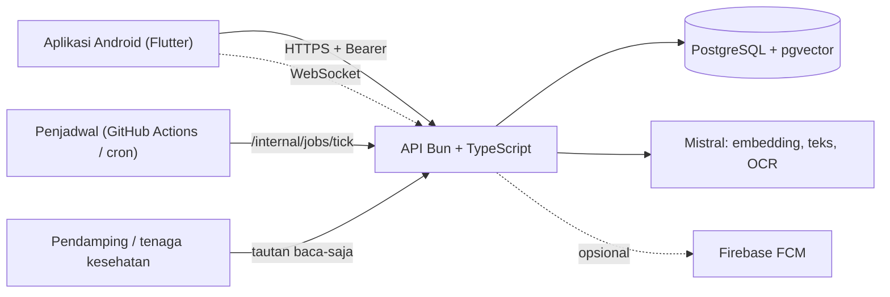

# beOkay

Teman catatan harian untuk orang dewasa dengan **diabetes tipe 2**: catat gula darah, makan, aktivitas, dan obat dengan cepat, lihat pola dari catatanmu sendiri, dan dapat dukungan kecil yang bisa kamu tolak, ubah, atau matikan kapan saja.

> **beOkay bukan alat diagnosis dan tidak memberi saran obat atau dosis.** Ringkasan dan saran di dalamnya bersifat deskriptif dari data yang kamu masukkan. Keputusan pengobatan tetap bersama dokter atau tenaga kesehatanmu. Proyek ini masih tahap pengembangan dan belum dipakai dalam pilot klinis.

## Isi

- [Fitur](#fitur) · [Prinsip rancangan](#prinsip-rancangan) · [Arsitektur](#arsitektur) · [Struktur repo](#struktur-repo)
- [Mulai cepat](#mulai-cepat) · [Produksi](#produksi) · [Status dan keterbatasan](#status-dan-keterbatasan) · [Dokumentasi](#dokumentasi)
- [Unduh aplikasi Android](#unduh-aplikasi-android)

## Fitur

| Area | Yang bisa dilakukan |
|---|---|
| **Pencatatan** | Glukosa (mg/dL dan mmol/L), makan (ketik, kalimat, foto, barcode, label gizi), aktivitas, obat dan konfirmasi dari notifikasi, berat/tinggi/tekanan darah, hasil lab (HbA1c dan lainnya). Tombol cepat "ulangi yang kemarin", dikte suara di perangkat, dan antrean luring yang terkirim sendiri saat tersambung |
| **Data dari perangkat** | Health Connect (langkah, berat, glukosa dari alat, tidur) per jenis dengan izin sendiri; impor CSV sensor glukosa LibreView dengan ringkasan waktu dalam rentang |
| **Memahami pola** | Statistik deskriptif dengan keterangan cakupan data, konteks saat menyimpan (mis. glukosa di sekitar makan), tren, ringkasan PDF dan tautan baca-saja untuk dokter atau Prolanis |
| **Asisten** | Percakapan berbahasa Indonesia: ringkasan data, cari makanan, ide aktivitas, catat makan dari kalimat. Aturan keselamatan memblokir permintaan obat/diagnosis/gejala darurat dan menautkan modul edukasi |
| **Coaching** | Rencana kecil yang kamu setujui sendiri, strategi untuk hambatan, refleksi mingguan, target yang menyesuaikan naik dan turun |
| **Edukasi** | Modul bacaan singkat (karbohidrat, hipoglikemia, kaki, hari sakit, Ramadan, kapan bertanya soal obat). Di produksi hanya tampil setelah ditinjau klinisi |
| **Keluarga dan komunitas** | Tautan pendamping baca-saja (ringkasan mingguan, tanpa catatan mentah, bisa dicabut); komunitas dengan alias, tantangan berulang, dan laporan alias |
| **Privasi** | Persetujuan per tujuan yang bisa ditarik, kunci aplikasi biometrik, ekspor data (JSON dan FHIR R4), hapus akun, mode coba 7 hari tanpa akun |

## Prinsip rancangan

- **Nilai tidak diketahui adalah NULL, bukan 0.** Obat tidak dianggap diminum atau terlewat tanpa konfirmasi.
- **Model bahasa hanya mengusulkan.** Aturan, persetujuan, dan pengguna yang memutuskan; usulan model selalu divalidasi dan dicatat. Model tidak memilih alat atau menulis catatan.
- **Consent per tujuan**, diperiksa di setiap endpoint yang menyentuh data kesehatan; menarik persetujuan berlaku segera.
- **Setiap query dibatasi `user_id` dari sesi.** Koreksi lewat revisi, bukan menimpa.
- **Tanpa klaim kesehatan.** Teks tidak menjanjikan menurunkan gula darah atau menyembuhkan.

## Arsitektur



| Lapisan | Teknologi |
|---|---|
| Aplikasi | Flutter, Riverpod, go_router, Health Connect, local_auth, flutter_local_notifications, speech_to_text |
| API | Bun 1.4, TypeScript, Zod 4, Prisma 7 (adapter `pg`), Better Auth (verifikasi email, bearer untuk seluler) |
| Data | PostgreSQL dengan `pgvector` dan `pg_trgm`; referensi gizi TKPI 2017 + hidangan Indonesia terkurasi |
| Operasi | Docker Compose (dev, uji, prod), Vercel + Neon (serverless), metrik Prometheus, sakelar fitur, retensi data |

## Struktur repo

| Folder | Isi |
|---|---|
| `app/` | Aplikasi Flutter (`lib/core`, `lib/features/*`, tes widget dan integrasi) |
| `server/` | API: `src/features/*` (routes, service, schema per fitur), `src/shared`, `src/infrastructure`, `prisma/` (skema + migrasi), `scripts/` (operasi, TKPI, evaluasi), `tests/` |
| `docs/` | Arsitektur, referensi API dan skema, runbook, audit, laporan per fase, riset |
| `design/` | Desain FigCraft dan ekspor layar |
| `ml/` | Pelatihan dan layanan model (riset) |
| `compose*.yaml`, `.env*.example` | Stack dev, uji terisolasi, dan produksi |

## Mulai cepat

Semua perintah server berjalan **di Docker**; Flutter berjalan di host.

```bash
cp .env.example .env
HOST_UID=$(id -u) HOST_GID=$(id -g) docker compose up --build   # API :3000, Postgres :5433, Mailpit :8025
curl http://127.0.0.1:3000/health

docker compose -f compose.test.yaml run --rm --build tester      # tes backend pada DB terisolasi
docker compose exec api bun run typecheck

cd app && flutter test && flutter analyze
flutter run --dart-define=API_BASE_URL=http://10.0.2.2:3000      # emulator Android
```

Migrasi memakai skrip `bun run db:*` di dalam container (bukan `bunx prisma`). Aturan kerja lengkap, termasuk larangan commit otomatis oleh agen, ada di [AGENTS.md](AGENTS.md).

## Produksi

- **Serverless (berjalan sekarang):** API di Vercel (`https://beokay-api.vercel.app`, cek `/health`), basis data di Neon. Pekerja latar diganti `/internal/jobs/tick` yang dipicu penjadwal. Deploy dari root repo: `vercel deploy --prod`. Panduan, layanan gratis pendukung, dan batasannya: [docs/operations/deploy-vercel-neon.md](docs/operations/deploy-vercel-neon.md).
- **Docker/VPS:** `docker compose -f compose.prod.yaml --env-file .env.prod up -d --build`. Lihat [runbook](docs/operations/runbook.md) dan [reverse-proxy](docs/operations/reverse-proxy.md).

## Status dan keterbatasan

Verifikasi terakhir (12 November 2026, setelah 3.0 Fase 11): `tsc` bersih · backend **406/406** tes (73 berkas) · `flutter analyze` bersih · Flutter **237/237** tes · uji asap produksi 17/17.

Belum selesai atau butuh pihak lain:

- **Tinjauan klinisi** untuk aturan keselamatan, 10 modul edukasi, dan strategi coaching; **ahli gizi** untuk 45 hidangan terkurasi. Selama itu modul edukasi disembunyikan di produksi.
- **Pengiriman email** (verifikasi akun, reset kata sandi) di produksi menunggu SMTP; **push** menunggu pendaftaran Firebase. Mode coba tetap bisa dipakai tanpa akun.
- **Integrasi SATUSEHAT** butuh faskes mitra; yang ada baru ekspor FHIR R4 ([kesiapan](docs/integration/satusehat-readiness.md)).
- Pembatas laju berjalan per instance; model foto hidangan dihentikan (tidak relevan untuk Indonesia).
- Belum ada lisensi yang ditetapkan.

## Dokumentasi

| Kebutuhan | Dokumen |
|---|---|
| Peta seluruh dokumentasi | [docs/README.md](docs/README.md) |
| Arsitektur dan invarian sistem | [docs/architecture/system-overview.md](docs/architecture/system-overview.md) |
| Endpoint, tabel, dan modul | [API](docs/api/endpoint-reference.md) · [skema](docs/database/schema-reference.md) · [modul server](docs/reference/server-modules.md) |
| Menjalankan, menguji, merilis | [docs/operations/runbook.md](docs/operations/runbook.md) |
| Analisis gap dan rencana fase | [docs/audits/gap-analysis-2026-11-12.md](docs/audits/gap-analysis-2026-11-12.md) |
| Laporan fase terbaru | [Fase 8](docs/reports/beokay-3.0-phase-8.md) · [9](docs/reports/beokay-3.0-phase-9.md) · [10](docs/reports/beokay-3.0-phase-10.md) · [11](docs/reports/beokay-3.0-phase-11.md) |
| Keamanan agen dan tinjauan klinisi | [threat model](docs/security/agent-threat-model.md) · [paket tinjauan](docs/research/safety-clinical-review-packet.md) |

---

## Unduh aplikasi Android

**[Unduh beOkay untuk Android (APK)](https://beokay-app.vercel.app/beokay.apk)**

| | |
|---|---|
| Versi | 1.0.0 (build pengembangan, ditandatangani dengan kunci rilis pribadi) |
| Cocok untuk | Android 8.0+ berprosesor 64-bit (arm64-v8a, hampir semua ponsel sejak 2017) |
| Ukuran | 34 MB |
| SHA-256 | `0bb10ee6a8dd9a156067881ce36f908d23ec470152c0d7a5a26cb2b4f9507d52` |
| Server | `https://beokay-api.vercel.app` |

Cara memasang: buka tautan di ponsel, unduh, lalu izinkan "pasang dari sumber ini" saat diminta. Setelah itu pilih **Coba dulu tanpa akun** untuk langsung mencatat; membuat akun butuh email verifikasi yang belum aktif di server ini (lihat keterbatasan di atas). Ini build pengembangan: data uji bisa dihapus sewaktu-waktu, dan aplikasi bukan pengganti saran tenaga kesehatan.
