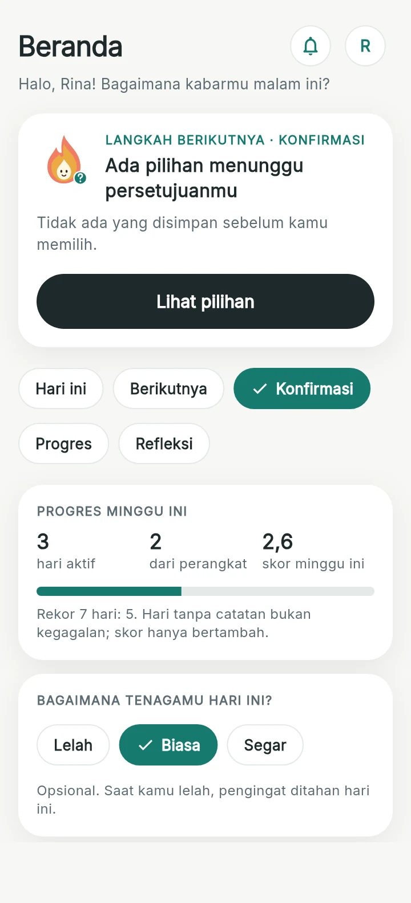
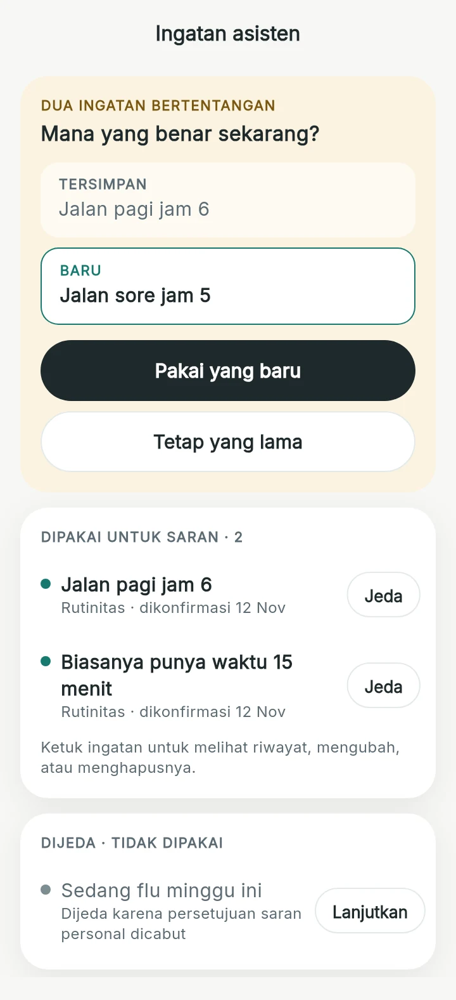
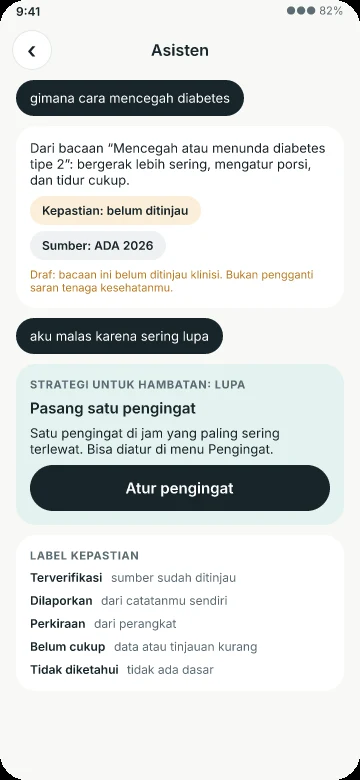
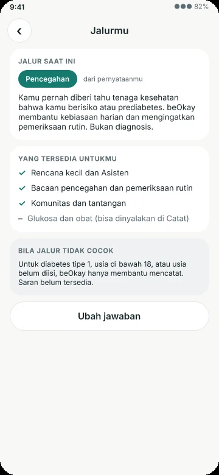
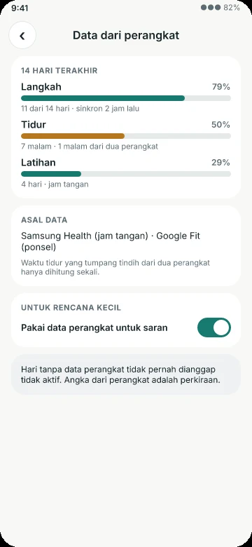
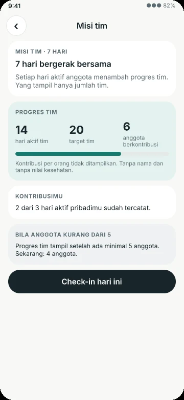
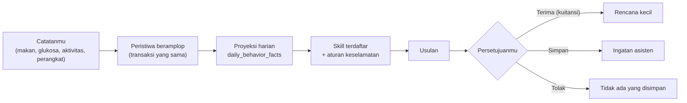
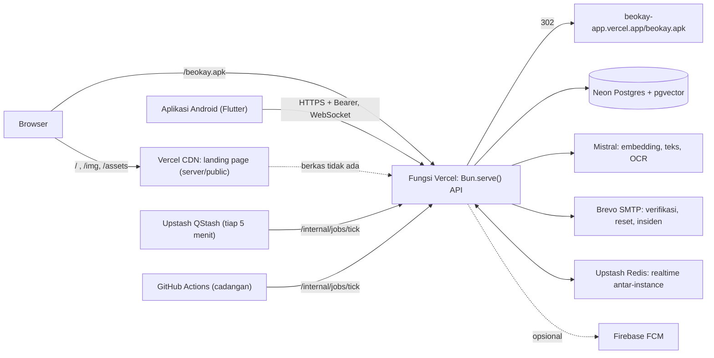

<p align="center">
  <picture>
    <source media="(prefers-color-scheme: dark)" srcset="landing/public/img/logo-full-dark.webp">
    
  </picture>
</p>

<h3 align="center">Kebiasaan sehat yang tetap kamu kendalikan</h3>

<p align="center">
  Ekosistem kebiasaan sehat untuk orang dewasa dengan tiga jalur: pencegahan, dukungan diabetes tipe 2, dan gaya hidup sehat.<br>
  Catat dalam hitungan detik, lihat pola dari catatanmu sendiri, dan putuskan sendiri langkah kecil berikutnya.
</p>

<p align="center">
  <a href="https://beokay-api.vercel.app"><b>Buka situs beOkay</b></a> ·
  <a href="https://beokay-api.vercel.app/beokay.apk"><b>Unduh APK Android</b></a> ·
  <a href="#pasang-dari-situs">Cara pasang</a> ·
  <a href="#peta-audit-14-november-2026">Peta audit</a>
</p>

<p align="center">
  
  &nbsp;
  
  &nbsp;
  
</p>
<p align="center"><sub>Beranda dan Ingatan: render layar Flutter asli dengan data contoh. Asisten: gambar desain (halaman 33).</sub></p>

> [!IMPORTANT]
> **beOkay bukan alat diagnosis dan tidak memberi saran obat atau dosis.** Ringkasan dan saran di dalamnya bersifat deskriptif dari data yang kamu masukkan. Keputusan pengobatan tetap bersama dokter atau tenaga kesehatanmu. Proyek ini masih tahap pengembangan dan belum dipakai dalam pilot klinis.

| | |
|---|---|
| Situs dan API (satu URL) | **https://beokay-api.vercel.app** |
| Unduh APK | **https://beokay-api.vercel.app/beokay.apk** (diteruskan ke `beokay-app.vercel.app`) |
| Status API | https://beokay-api.vercel.app/health |
| Versi aplikasi | 1.1.2 (build 4), Android 8.0+ 64-bit |

## Isi

- [Pasang dari situs](#pasang-dari-situs) · [Kenapa beOkay berbeda](#kenapa-beokay-berbeda) · [Tiga jalur](#tiga-jalur) · [Fitur](#fitur)
- [Cara kerja](#cara-kerja) · [Arsitektur](#arsitektur) · [Struktur repo](#struktur-repo)
- [Pengembangan](#pengembangan) · [Deploy produksi](#deploy-produksi) · [Variabel lingkungan](#variabel-lingkungan)
- [Status dan keterbatasan](#status-dan-keterbatasan) · [Dokumentasi](#dokumentasi) · [Peta audit](#peta-audit-14-november-2026)

## Pasang dari situs

Semua instalasi dimulai dari **https://beokay-api.vercel.app**.

1. **Buka situs di ponsel Android**, lalu ketuk **Unduh untuk Android** di menu atau **Mulai dengan beOkay** di bagian bawah halaman. Tautan langsungnya: https://beokay-api.vercel.app/beokay.apk.
2. **Izinkan pemasangan.** Saat Android bertanya, aktifkan "Izinkan dari sumber ini" untuk peramban yang kamu pakai, lalu ketuk **Pasang**.
3. **Mulai.** Pilih **Coba dulu tanpa akun** untuk langsung mencatat, atau **Buat Akun** dengan nama, email, dan kata sandi minimal 10 karakter.
4. **Verifikasi email.** Tautan verifikasi dikirim lewat Brevo dan berlaku 1 jam. Email bisa baru tiba beberapa menit setelah mendaftar; periksa juga folder **Spam** dan **Promosi**. Bila belum datang, ketuk **Kirim ulang tautan** di layar verifikasi.
5. **Jalur dan persetujuan.** Jawab pertanyaan singkat tentang kondisimu, lalu pilih persetujuan per tujuan. Persetujuan opsional bisa ditarik kapan saja dari **Pengaturan**.

<details>
<summary>Rincian APK dan cara memeriksa keasliannya</summary>

| | |
|---|---|
| Versi | 1.1.2 (build 4), ditandatangani dengan kunci rilis pribadi; push FCM aktif dan diuji di emulator |
| Cocok untuk | Android 8.0+ berprosesor 64-bit (arm64-v8a) |
| Ukuran | 34,1 MB (34.093.040 byte) |
| SHA-256 | `ac05625bc0ad84039dea563fb6dd98e2e2125a2be0e46568a97603c7edf405c4` |
| Server | `https://beokay-api.vercel.app` |

```bash
curl -L -o beokay.apk https://beokay-api.vercel.app/beokay.apk
sha256sum beokay.apk   # harus sama dengan SHA-256 di atas
adb install beokay.apk # opsional, bila ponsel tersambung lewat USB
```

Ini build pengembangan: data uji bisa dihapus sewaktu-waktu, dan aplikasi bukan pengganti saran tenaga kesehatan.

</details>

## Kenapa beOkay berbeda

Yang ditawarkan beOkay bukan sekadar "ada AI", melainkan **kendali dan kejujuran**. Setiap baris di bawah punya bukti di kode (rincian di [audit 14 November](docs/audits/beokay-demo-video-audit-2026-11-14.md#2-keunikan-yang-bisa-dijual)).

| | Keunikan | Artinya untukmu |
|---|---|---|
| 🛡️ | **Keselamatan di luar model bahasa.** Pertanyaan dosis, diagnosis, atau gejala darurat dicegat aturan deterministik (`safety-policy-v2`, termasuk bahasa gaul dan salah ketik) sebelum model bahasa menyentuhnya | beOkay tidak memberi saran obat atau dosis |
| ✅ | **Model hanya mengusulkan.** Tindakan baru berjalan setelah kamu menekan Terima; keputusan itu tercatat sebagai kuitansi bertanda `operationId` | Asisten mengusulkan, kamu yang menyetujui |
| ⬜ | **Kosong tidak sama dengan nol.** Nilai yang tidak diketahui tetap kosong; hari tanpa data perangkat tidak dihitung "tidak aktif"; tidur dari dua perangkat dihitung sekali | Hari tanpa catatan bukan kegagalan |
| 🔐 | **Persetujuan per tujuan yang berlaku seketika.** Mencabut persetujuan AI personal langsung menjeda ingatan dan membatalkan rekomendasi terbuka | Persetujuan bisa ditarik kapan saja dan berlaku segera |
| 🧠 | **Ingatan asisten yang transparan.** Usulan, konfirmasi, konflik berdampingan (TERSIMPAN vs BARU), jeda, dan riwayat | Asisten hanya mengingat yang kamu setujui |
| 🧭 | **Tiga jalur tanpa kebocoran konten.** Jalur ditentukan dari pernyataanmu; konten diabetes tidak pernah sampai ke jalur lain | Jalur ditentukan dari ceritamu, bukan ditebak dari data |
| 🏷️ | **Jujur sampai abstain.** Jawaban membawa label kepastian dan sumber; bila tidak ada bacaan yang cocok, asisten menolak menjawab | Kalau tidak tahu, asisten bilang tidak tahu |
| 👥 | **Privasi sosial.** Misi tim baru tampil bila ada minimal 5 anggota, tanpa nama dan tanpa angka kesehatan | Semangat bersama tanpa membuka angka kesehatan siapa pun |
| ⚡ | **Beban catat minimal dan tetap jalan luring.** Satu ketukan, dikte, foto, barcode, dan antrean luring yang terkirim satu kali | Catat dalam hitungan detik, tanpa sinyal pun |
| 📄 | **Bisa dibawa.** Ringkasan PDF, tautan baca-saja dengan QR untuk pendamping, ekspor JSON dan FHIR R4 | Datamu milikmu dan bisa dibawa |

Konteks lokal: referensi gizi TKPI 2017 dan hidangan Indonesia terkurasi, antarmuka dan aturan keselamatan berbahasa Indonesia.

## Tiga jalur

Jalur ditentukan **hanya dari pernyataan pengguna**, tidak ditebak dari data.

| Jalur | Untuk siapa | Isi |
|---|---|---|
| Pencegahan | Pernah diberi tahu tenaga kesehatan bahwa prediabetes atau berisiko | Kebiasaan kecil, bacaan pencegahan, pengingat pemeriksaan rutin |
| Dukungan diabetes tipe 2 | Sudah terdiagnosis tipe 2 | Catat makan, aktivitas, glukosa, obat; pengobatan tetap bersama tim kesehatan |
| Gaya hidup sehat | Ingin bergerak, makan, dan tidur lebih baik | Langkah sehari-hari yang realistis |

`UNDETERMINED` (tipe 1, usia < 18, atau usia tidak diketahui) hanya mendapat pencatatan.

## Fitur

| Area | Yang bisa dilakukan |
|---|---|
| **Pencatatan** | Glukosa (mg/dL dan mmol/L, peringatan di bawah 70 atau mulai 300 mg/dL), makan (ketik, kalimat, dikte, foto, barcode, label gizi), aktivitas, tidur, obat dengan konfirmasi dari notifikasi, berat/tinggi/tekanan darah, hasil lab. Kartu "Sering dicatat" untuk mengulang dengan satu ketukan, dan antrean luring yang terkirim sendiri saat tersambung |
| **Langkah berikutnya** | Kartu di Beranda yang memilih satu langkah (konfirmasi saran, rencana, refleksi, atau mencatat). Chip alur Hari ini, Berikutnya, Konfirmasi, Progres, dan Refleksi membuka bagiannya masing-masing |
| **Progres mingguan** | Hari aktif, hari dari perangkat, skor minggu ini (`score-v2`, hanya bertambah), dan rekor 7 hari |
| **Check-in tenaga** | Lelah, Biasa, atau Segar. Saat lelah, pengingat ditahan hari itu |
| **Data dari perangkat** | Health Connect (langkah, tidur, sesi latihan, berat, glukosa dari alat) dengan izin per jenis; status mutu data per hari; impor CSV CGM dengan ringkasan 14 hari |
| **Asisten** | Percakapan berbahasa Indonesia dengan label kepastian dan sumber; draf makan dari kalimat; rekomendasi yang menunggu persetujuanmu |
| **Ingatan asisten** | Usul, simpan, konflik berdampingan, jeda, lanjutkan, ubah, hapus, dan riwayat. Ada usulan turunan dari pola catatanmu sendiri |
| **Coaching** | Rencana kecil yang kamu setujui sendiri, strategi untuk hambatan, refleksi mingguan |
| **Komunitas** | Alias, tantangan berulang, dan misi tim yang hanya menampilkan jumlah tim |
| **Edukasi** | 13 modul bacaan singkat. Di produksi hanya tampil setelah ditinjau klinisi |
| **Privasi** | Persetujuan per tujuan, kunci aplikasi biometrik, ringkasan PDF, tautan pendamping dengan QR, ekspor JSON dan FHIR R4, hapus akun, mode coba tanpa akun |

<p align="center">
  
  &nbsp;
  
  &nbsp;
  
</p>
<p align="center"><sub>Jalur, status perangkat, dan misi tim: gambar desain halaman 33 (<code>design/beOkay-ui-v3.figcraft</code>).</sub></p>

## Cara kerja

Setiap catatan menjadi satu peristiwa, dan setiap saran menunggu persetujuanmu.



Prinsip yang menjaga alur itu:

- **Nilai tidak diketahui adalah NULL, bukan 0.** Obat tidak dianggap diminum atau terlewat tanpa konfirmasi.
- **Model bahasa hanya mengusulkan.** Perencana LLM hanya berjalan dalam mode bayangan dan usulannya tidak dieksekusi.
- **Consent diperiksa di setiap endpoint** yang menyentuh data kesehatan; menarik persetujuan berlaku segera.
- **Setiap query dibatasi `user_id` dari sesi.** Koreksi lewat revisi, bukan menimpa.
- **Tanpa klaim kesehatan.** Teks tidak menjanjikan menurunkan gula darah atau menyembuhkan.

## Arsitektur



| Lapisan | Teknologi |
|---|---|
| Aplikasi | Flutter, Riverpod, go_router, Health Connect, local_auth, flutter_local_notifications, speech_to_text |
| API | Bun 1.4, TypeScript, Zod 4, Prisma 7 (adapter `pg`), Better Auth (verifikasi email, bearer untuk seluler) |
| Landing page | Vite 6, React 19, TypeScript, Tailwind CSS 4, komponen gaya shadcn/ui (Radix), GSAP + ScrollTrigger, three.js 0.187 lewat React Three Fiber 9 dan drei 10 |
| Data | PostgreSQL dengan `pgvector` dan `pg_trgm`; referensi gizi TKPI 2017 + hidangan Indonesia terkurasi |
| Operasi | Docker Compose (dev, uji, prod), Vercel + Neon (serverless, region `sin1`), Upstash Redis dan QStash, metrik Prometheus, sakelar fitur, retensi data |

Landing page dan API berjalan di **satu proyek Vercel** (`beokay-api`, Root Directory `server`):

| Jalur | Dilayani oleh |
|---|---|
| `/`, `/assets/*`, `/img/*` | Berkas statis landing dari `server/public` (CDN). Bila CDN tidak menemukannya, `serveSite()` melayani berkas yang sama dengan CSP `'self'`, `frame-ancestors 'none'`, dan `nosniff` |
| `/beokay.apk`, `/download` | `302` ke `APK_DOWNLOAD_URL` (bawaan `https://beokay-app.vercel.app/beokay.apk`) |
| `/api/*`, `/internal/*`, `/health`, `/metrics` | API Bun |

Saat build, `server/vercel.json` menjalankan `bun run db:generate && bun run landing:build`; skrip itu membangun `landing/` lalu menyalin `landing/dist` ke `server/public` (keduanya di-gitignore). APK tetap di proyek terpisah `beokay-app` karena ukurannya. Arsitektur 4.0 lengkap: [docs/architecture/beokay-4.0-ecosystem.md](docs/architecture/beokay-4.0-ecosystem.md).

## Struktur repo

| Folder | Isi |
|---|---|
| `app/` | Aplikasi Flutter (`lib/core`, `lib/features/*`, tes widget dan alur) |
| `server/` | API: `src/features/*` (routes, service, schema per fitur), `src/shared`, `src/infrastructure`, `prisma/` (skema, migrasi, skrip turun), `scripts/`, `tests/` |
| `landing/` | Landing page React: `src/App.tsx`, `src/app.css`, `src/components/phone-3d.tsx` (ponsel 3D), `src/components/ui/*`, `public/img` |
| `design/` | Desain FigCraft (`beOkay-ui-v3.figcraft`) dan ekspor layar (`design/exports`) |
| `docs/` | Arsitektur, referensi API dan skema, runbook, audit, laporan per fase, koleksi Bruno |
| `ml/` | Pelatihan dan layanan model (riset) |
| `compose*.yaml`, `.env*.example` | Stack dev, uji terisolasi, dan produksi |

## Pengembangan

Semua perintah server berjalan **di Docker**; Flutter berjalan di host. Aturan kerja lengkap, termasuk larangan commit otomatis oleh agen, ada di [AGENTS.md](AGENTS.md).

```bash
cp .env.example .env
HOST_UID=$(id -u) HOST_GID=$(id -g) docker compose up --build   # API :3000, Postgres :5433, Mailpit :8025
curl http://127.0.0.1:3000/health

docker compose exec api bun run typecheck
docker compose -f compose.test.yaml up -d --wait api-test         # stack uji terisolasi
docker compose -f compose.test.yaml run --rm tester bun test
docker compose -f compose.test.yaml down -v
```

Migrasi memakai skrip `bun run db:*` di dalam container (bukan `bunx prisma`). Email lokal tidak keluar ke internet; buka Mailpit di http://127.0.0.1:8025 untuk tautan verifikasi.

**Aplikasi Android**

```bash
cd app
flutter analyze && flutter test
flutter run --dart-define=API_BASE_URL=http://10.0.2.2:3000      # emulator, API lokal
flutter build apk --release --split-per-abi --dart-define=API_BASE_URL=https://beokay-api.vercel.app
```

**Landing page** (di container `oven/bun:1.4.0`)

```bash
docker run --rm --user "$(id -u):$(id -g)" -e HOME=/tmp -v "$PWD/landing:/w" -w /w oven/bun:1.4.0 \
  sh -c "bun install --frozen-lockfile && bun run build"

docker run --rm -d --name beokay-landing-preview --user "$(id -u):$(id -g)" -e HOME=/tmp \
  -p 127.0.0.1:4173:4173 -v "$PWD/landing:/w" -w /w oven/bun:1.4.0 \
  bun run preview -- --host 0.0.0.0 --port 4173                   # http://127.0.0.1:4173
```

Ponsel 3D dimuat terpisah (`React.lazy`, chunk ±255 KB gzip), digambar ulang hanya saat hero terlihat, dan diam bila `prefers-reduced-motion: reduce`. Tanpa WebGL, hero menampilkan gambar statis. Nama berkas di Vercel peka huruf besar-kecil: impor `./app.css`, bukan `./App.css`.

<details>
<summary>Desain FigCraft</summary>

Desain dikerjakan di FigCraft lebih dulu, baru kode. Berkas: `design/beOkay-ui-v3.figcraft`.

| Halaman | Isi | Ekspor |
|---|---|---|
| 33 — beOkay 4.0 | Jalur, Beranda, keselamatan, memori, perangkat, asisten, spark, misi tim | `design/exports/33-*.png` |
| 34 — Landing page (web) | Landing desktop 1440 | `design/exports/34-landing-desktop.png` |
| 35 — Redesain Beranda, Ingatan, landing | Beranda ponsel dan tablet, Ingatan asisten, rantai alur, panel bertumpuk, ponsel 3D | `design/exports/35-*.png` |

</details>

## Deploy produksi

Proyek Vercel `beokay-api` (Root Directory `server`, preset Bun, fungsi di region `sin1` lewat setelan proyek `resourceConfig.functionDefaultRegions`; lihat [§13](docs/operations/deploy-vercel-neon.md)). Deploy dengan CLI selalu dari **root repo**:

```bash
# 1. Migrasi ke Neon (di container; URL direct, bukan pooled). Buat branch cadangan Neon lebih dulu.
docker compose -f compose.test.yaml run --rm -e DATABASE_URL="$NEON_DIRECT_URL" tester bun run db:migrate:deploy

# 2. Deploy API + landing page (satu URL)
vercel deploy --prod --yes

# 3. Periksa
curl -sI https://beokay-api.vercel.app/            # 200 text/html (landing)
curl -sI https://beokay-api.vercel.app/beokay.apk  # 302 ke beokay-app
curl -s  https://beokay-api.vercel.app/health      # {"status":"ok","db":true}
```

> [!WARNING]
> Deploy otomatis dari GitHub `main` saat ini **gagal** (`cd: ../landing: No such file or directory`), karena setelan proyek `sourceFilesOutsideRootDirectory` bernilai `false` sehingga build Git hanya melihat folder `server/`. Deploy CLI dari root tidak terkena karena mengunggah seluruh repo (kecuali `.vercelignore`). Perbaikannya: aktifkan **Settings → Build and Deployment → Root Directory → Include files outside the root directory in the Build Step**.

APK diterbitkan dari folder **di luar repo** ke proyek `beokay-app` (lihat [deploy-vercel-neon.md §10](docs/operations/deploy-vercel-neon.md)). Rahasia deploy ada di `/.env.deploy` (gitignored); jangan `source` berkas itu karena URL Neon memuat `&`. Jalur Docker/VPS tetap tersedia: `docker compose -f compose.prod.yaml --env-file .env.prod up -d --build` ([runbook](docs/operations/runbook.md), [reverse-proxy](docs/operations/reverse-proxy.md)).

## Variabel lingkungan

Skema dan nilai bawaan ada di `server/src/config/env.ts`; contoh di `.env.example` dan `.env.prod.example`. Nilai rahasia tidak pernah ditulis di repo.

<details>
<summary>Variabel yang terpasang di produksi dan yang opsional</summary>

**Terpasang di Vercel:** `NODE_ENV`, `DATABASE_URL` (Neon pooled), `DATABASE_POOL_MAX`, `BETTER_AUTH_SECRET`, `BETTER_AUTH_URL`, `PUBLIC_BASE_URL`, `TRUST_PROXY`, `CRON_SECRET`, `METRICS_TOKEN`, `MISTRAL_API_KEY`, `MISTRAL_EMBEDDING_MODEL`, `REALTIME_REDIS_URL` (Upstash), `EMAIL_FROM`, `SMTP_HOST`, `SMTP_PORT`, `SMTP_SECURE`, `SMTP_USER`, `SMTP_PASS`, `INCIDENT_EMAIL_TO`, `OUTBOX_WORKER_ENABLED`, `NOTIFY_WORKER_ENABLED`, `RETENTION_WORKER_ENABLED`, `PUSH_DISPATCH_ENABLED`, `CHALLENGE_LIFECYCLE_ENABLED`, `REMINDER_LOOKBACK_MINUTES`, `EDUCATION_INCLUDE_DRAFTS`, `FCM_PROJECT_ID` dan `FCM_SERVICE_ACCOUNT_JSON` (project Firebase `todolist-project-7979d`, disimpan sebagai base64, Secret), `FIRECRAWL_API_KEY`, `UPLOADTHING_TOKEN` (hanya untuk `scripts/tkpi/upload.ts`), `USDA_API_KEY`, `TAVILY_API_KEY`.

**SMTP Brevo:** `SMTP_HOST=smtp-relay.brevo.com`, `SMTP_PORT=587`, `SMTP_SECURE=false`, `SMTP_USER` (login SMTP `…@smtp-brevo.com`, bukan email akun; email akun menghasilkan `535`), `SMTP_PASS` (SMTP key). Pembatasan IP di Brevo (Settings → Security → Authorised IPs) harus tetap mati karena IP keluar Vercel berubah-ubah; bila dinyalakan, pengiriman gagal dengan `525`. Batas Brevo gratis 300 email/hari. Email verifikasi dan reset kata sandi dikirim di latar belakang setelah respons (`background()` → `waitUntil`), jadi kegagalan SMTP hanya terlihat di log sebagai `email_send_failed`.

**Push:** server mengirim lewat FCM; `id.beokay.app` terdaftar di project Firebase di atas, dan APK 1.1.1+ dibangun dengan `app/android/app/google-services.json` (di-gitignore).

| Opsional | Fungsi | Tanpa nilai |
|---|---|---|
| `TRUSTED_ORIGINS` | Asal tambahan untuk Better Auth (CSV) | Hanya `BETTER_AUTH_URL`; cukup selama landing dan API satu domain |
| `MODAL_ML_URL`, `MODAL_ML_AUTH_TOKEN` | Layanan model riset di Modal | Fitur model riset nonaktif |
| `ALERT_EMAIL_TO` | Penerima email `scripts/ops/check-alarms.ts` | Alarm hanya dicetak di log |
| `FEATURES_DISABLED`, `FEATURE_FLAG_CACHE_MS` | Mematikan fitur lewat env; cache sakelar | Mengikuti tabel `feature_flags`; cache 30 dtk |
| `APK_DOWNLOAD_URL` | Tujuan `/beokay.apk` dan `/download` | `https://beokay-app.vercel.app/beokay.apk` |
| `MISTRAL_AGENT_MODEL`, `MISTRAL_VISION_MODEL`, `MISTRAL_OCR_MODEL` | Ganti model Mistral | Model bawaan di `env.ts` |
| `RETENTION_*_DAYS` | Lama simpan peristiwa agen (90), notifikasi terbaca (60), audit (365), pemakaian (400), outbox | Nilai bawaan |

Rahasia di luar API: kunci rilis Android (`~/beokay-release.jks`, `app/android/key.properties`), token Vercel/Neon/Upstash di `/.env.deploy`, secret GitHub `BEOKAY_API_URL` dan `BEOKAY_CRON_SECRET` untuk penjadwal cadangan.

</details>

## Status dan keterbatasan

Verifikasi terakhir yang tercatat (14 November 2026, 1.1.2): `flutter analyze` bersih · Flutter **251/251** tes · backend `tsc` bersih dan **462/462** tes (81 berkas) · koleksi Bruno 120/120 · uji pulih cadangan OK · uji asap produksi **20/20**. Level bukti: fungsi teknis terbukti di lingkungan uji (level 1); belum ada klaim hasil klinis.

Belum selesai atau butuh pihak lain:

- **Uji di HP fisik**, jam tangan, dan TalkBack. Beranda, Ingatan, dan push baru diuji di emulator dengan Appium.
- **Tinjauan klinisi** untuk aturan keselamatan, modul edukasi, dan strategi coaching; **ahli gizi** untuk hidangan terkurasi; tinjauan hukum. Selama itu edukasi disembunyikan di produksi dan asisten abstain untuk topik tanpa bacaan tertinjau.
- Integrasi SATUSEHAT butuh faskes mitra; yang ada baru ekspor FHIR R4.
- Pembatas laju berjalan per instance. Belum ada lisensi yang ditetapkan.

## Dokumentasi

| Kebutuhan | Dokumen |
|---|---|
| Peta seluruh dokumentasi | [docs/README.md](docs/README.md) |
| Arsitektur 4.0 | [beokay-4.0-ecosystem](docs/architecture/beokay-4.0-ecosystem.md) · [system-overview](docs/architecture/system-overview.md) |
| Endpoint, tabel, modul | [API](docs/api/endpoint-reference.md) · [API 4.0](docs/api/ecosystem-4.0.md) · [skema](docs/database/schema-reference.md) · [modul server](docs/reference/server-modules.md) |
| Deploy serverless dan APK | [deploy-vercel-neon](docs/operations/deploy-vercel-neon.md) |
| Menjalankan, menguji, merilis | [runbook](docs/operations/runbook.md) |
| Laporan 4.0 dan paket tinjauan klinisi | [laporan](docs/reports/beokay-4.0-report.md) · [paket tinjauan](docs/reports/beokay-4.0-clinical-review-packet.md) |
| Audit fitur dan peta video demo | [beokay-demo-video-audit-2026-11-14](docs/audits/beokay-demo-video-audit-2026-11-14.md) |
| Keamanan agen | [threat model](docs/security/agent-threat-model.md) |

---

## Peta audit (14 November 2026)

Ringkasan dari [audit fitur dan peta video demo](docs/audits/beokay-demo-video-audit-2026-11-14.md). Audit itu membaca kode dan dokumen; aplikasi tidak dijalankan dan angka uji dikutip, bukan diulang.

**Kesimpulan**

1. Produk cukup lengkap untuk demo ujung ke ujung: 36 fitur terpetakan ke 16 adegan.
2. Nilai jualnya adalah kendali dan kejujuran (lihat [Kenapa beOkay berbeda](#kenapa-beokay-berbeda)), bukan "ada AI".
3. Tiga penghalang nyata: belum ada skrip data demo, edukasi dan jalur pencegahan disembunyikan di produksi, dan belum ada uji di ponsel fisik atau jam tangan.

### Peta fitur

**SIAP** ada di kode dan dilaporkan teruji · **DATA** butuh data contoh agar terlihat · **FLAG** butuh sakelar dev · **VERIF** periksa di layar dulu · **TAHAN** jangan diklaim.

| Area | Fitur (ID audit) | Status |
|---|---|---|
| Mulai | Mode coba tanpa akun (F01) | SIAP; alur pindahkan catatan setelah daftar VERIF |
| Mulai | Jalur dan pernyataan risiko (F02) · persetujuan per tujuan (F03) | SIAP |
| Mulai | Edukasi 13 modul (F04) | FLAG, produksi menyembunyikan draf |
| Pencatatan | Glukosa dan peringatan (F05) · antrean luring (F09) · draf makan dari kalimat (F18) | SIAP |
| Pencatatan | Makan ketik, kalimat, dikte (F06) | SIAP; dikte VERIF di perangkat |
| Pencatatan | Foto, barcode, label gizi (F07) | DATA; TAHAN klaim akurasi |
| Pencatatan | Sering dicatat (F08) | DATA |
| Beranda | Check-in tenaga (F10) · langkah berikutnya (F11) · Spark (F12) · refleksi dan coaching (F34) | SIAP |
| Beranda | Progres `score-v2` (F13) | DATA |
| Beranda | JITAI v3 dan push (F14) | VERIF; push baru diuji di emulator |
| Asisten | Keselamatan (F15) · kuitansi dan FSM (F16) · kepastian dan abstain (F17) | SIAP |
| Asisten | Ingatan dan memori turunan (F19) | DATA, butuh ≥ 4 sesi pagi |
| Perangkat | Status perangkat dan Health Connect (F20) | DATA; TAHAN klaim jam tangan |
| Laporan | Tren (F21) · CGM (F22) | DATA |
| Laporan | Ringkasan PDF (F23) · pendamping dan QR (F24) | SIAP |
| Laporan | Ekspor JSON dan FHIR R4 (F25) | SIAP; TAHAN klaim SATUSEHAT |
| Komunitas | Komunitas, tantangan, misi tim (F26) | DATA, butuh 5 akun contoh |
| Klinis dan privasi | Obat (F27) · vital dan lab (F28) · tujuan (F29) · pengingat (F30) · preferensi makanan (F31) · kunci aplikasi (F32) · ekspor dan hapus akun (F33) | SIAP |
| Web | Landing dan unduh APK satu URL (F35) · bukti rekayasa (F36) | SIAP |

Sengaja tidak ditampilkan sebagai kemampuan: perencana LLM bayangan, `baseline-v1` (SHADOW), model foto makanan riset (`RESEARCH_ONLY`), dan metrik retrieval (sampel 18 kueri terlalu kecil).

### Kesiapan produksi

| # | Temuan | Tindakan |
|---|---|---|
| P1 | Belum ada skrip data demo; akun kosong tidak menjual | Skrip di luar repo yang memanggil API nyata, kata sandi acak per eksekusi |
| P2 | Edukasi dan jalur pencegahan disembunyikan di produksi | Rekam di stack lokal dengan label "draf", atau tampilkan abstain sebagai kejujuran |
| P3 | Belum ada uji ponsel fisik, jam tangan, TalkBack | Jangan tampilkan jam tangan; jangan klaim "teruji di ponsel" |
| P4 | Target rekam | Build release di emulator ke API lokal; verifikasi email lewat Mailpit |
| P5 | Batas masuk 5 kali per menit | Masuk sekali per persona dan simpan sesi |
| P6 | Teks asisten tidak deterministik | Ambil minimal 3 kali; rute keselamatan stabil |
| P7 | Risiko kebocoran data di rekaman | Akun rekaan, tanpa notifikasi pribadi atau email pemilik |
| P8 | MCP `figcraft` gagal tersambung | Tidak dibutuhkan untuk video; ekspor desain yang ada cukup |
| P9 | Consent 1.1 meminta persetujuan ulang pengguna lama | Tidak berpengaruh ke akun baru |

### Temuan setelah audit (14 November 2026, sore)

| Temuan | Bukti | Status |
|---|---|---|
| Email verifikasi pendaftaran terkesan tidak terkirim | Akun uji dibuat 09:09:31 UTC; Brevo menerima login dan pengiriman; tautan diklik 09:16:05 UTC dan akun terverifikasi | Terkirim dengan jeda beberapa menit; petunjuk Spam/Promosi dan kirim ulang ditambahkan di [Pasang dari situs](#pasang-dari-situs) |
| Pengiriman email hanya mencatat kegagalan, tidak mencatat keberhasilan | `server/src/features/auth/auth.ts` (`dispatchEmail`) | Terbuka: tambahkan log `email_sent` tanpa alamat agar jeda dapat diukur |
| Build landing gagal di Linux karena impor `./App.css` untuk berkas `app.css` | `landing/src/App.tsx` baris 40 | Diperbaiki di working tree, belum di-commit |
| Deploy otomatis GitHub gagal | `cd: ../landing: No such file or directory`; `sourceFilesOutsideRootDirectory: false` | Terbuka: aktifkan setelan Vercel (lihat [Deploy produksi](#deploy-produksi)) |
| Produksi diperbarui lewat CLI | Deploy `dpl_3tGbpSVyzWcR91Hchxx7AsR7kfFr` di `sin1`; `/` 200, `/beokay.apk` 302, `/health` ok, aset JS dan ponsel 3D 200 | Selesai |

### Batas klaim

| Boleh | Jangan |
|---|---|
| "Bukan alat diagnosis; tidak memberi saran obat atau dosis" | "Menurunkan gula darah atau HbA1c", "mencegah diabetes atau komplikasi" |
| "Asisten mengusulkan, kamu yang memutuskan" | "Dokter AI", "prediksi gula darah", saran dosis dalam bentuk apa pun |
| "Membaca data dari Health Connect" | "Mendukung jam tangan" |
| "Ekspor FHIR R4" | "Terintegrasi SATUSEHAT" |
| "Konten edukasi masih draf, menunggu tinjauan klinisi" | "Ditinjau atau disetujui dokter/ahli gizi" |
| "Perkiraan gizi, berlabel kepastian" | "Mengenali makanan Indonesia dengan akurat" |
| "Tahap pengembangan, belum dipakai dalam pilot klinis" | "Dipakai pengguna nyata", testimoni, atau angka dampak |

### Langkah berikutnya

1. Tentukan audiens dan durasi video (asumsi audit: master ±6 menit, potongan 90 detik, enam klip).
2. Pilih target rekam: stack lokal dengan draf edukasi menyala (disarankan) atau produksi.
3. Setujui pembuatan skrip data demo di luar repo (P1), lalu periksa adegan berstatus VERIF sebelum merekam.
4. Aktifkan setelan Vercel untuk deploy GitHub dan tambahkan log `email_sent`.
