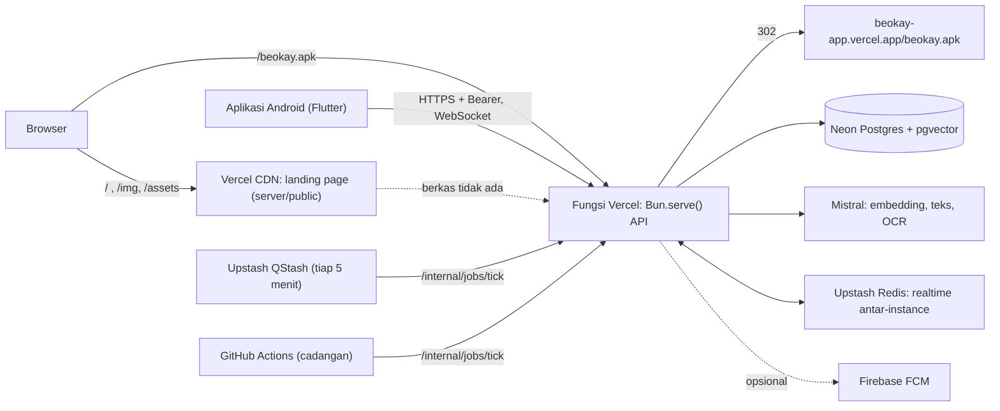

# beOkay

Ekosistem kebiasaan sehat untuk orang dewasa dengan tiga jalur: **pencegahan** (prediabetes atau berisiko), **dukungan diabetes tipe 2**, dan **gaya hidup sehat**. Catat makan, aktivitas, tidur, serta glukosa dan obat bila relevan; lihat pola dari catatanmu sendiri; terima satu langkah kecil berikutnya yang bisa kamu setujui, ubah, atau tolak.

> **beOkay bukan alat diagnosis dan tidak memberi saran obat atau dosis.** Ringkasan dan saran di dalamnya bersifat deskriptif dari data yang kamu masukkan. Keputusan pengobatan tetap bersama dokter atau tenaga kesehatanmu. Proyek ini masih tahap pengembangan dan belum dipakai dalam pilot klinis.

| | |
|---|---|
| Landing page + API (satu URL) | **https://beokay-api.vercel.app** |
| Unduh APK Android | **https://beokay-api.vercel.app/beokay.apk** (diteruskan ke berkas di `beokay-app.vercel.app`) |
| Status API | https://beokay-api.vercel.app/health |

## Isi

- [Tiga jalur](#tiga-jalur) · [Fitur](#fitur) · [Prinsip rancangan](#prinsip-rancangan)
- [Arsitektur](#arsitektur) · [Satu URL: landing page dan API](#satu-url-landing-page-dan-api) · [Struktur repo](#struktur-repo)
- [Landing page](#landing-page) · [Aplikasi Android](#aplikasi-android) · [Desain](#desain)
- [Mulai cepat (pengembangan)](#mulai-cepat-pengembangan) · [Deploy produksi](#deploy-produksi) · [Variabel lingkungan](#variabel-lingkungan)
- [Status dan keterbatasan](#status-dan-keterbatasan) · [Dokumentasi](#dokumentasi) · [Unduh aplikasi Android](#unduh-aplikasi-android)

## Tiga jalur

Jalur ditentukan **hanya dari pernyataan pengguna**, tidak ditebak dari data.

| Jalur | Untuk siapa | Isi |
|---|---|---|
| Pencegahan | Pernah diberi tahu tenaga kesehatan bahwa prediabetes atau berisiko | Kebiasaan kecil, bacaan pencegahan, pengingat pemeriksaan rutin |
| Dukungan diabetes tipe 2 | Sudah terdiagnosis tipe 2 | Catat makan, aktivitas, glukosa, obat; pengobatan tetap bersama tim kesehatan |
| Gaya hidup sehat | Ingin bergerak, makan, dan tidur lebih baik | Langkah sehari-hari yang realistis |

`UNDETERMINED` (tipe 1, usia < 18, atau usia tidak diketahui) hanya mendapat pencatatan. Konten T2DM tidak pernah sampai ke jalur lain.

## Fitur

| Area | Yang bisa dilakukan |
|---|---|
| **Pencatatan** | Glukosa (mg/dL dan mmol/L), makan (ketik, kalimat, foto, barcode, label gizi), aktivitas, tidur, obat dan konfirmasi dari notifikasi, berat/tinggi/tekanan darah, hasil lab. Tombol "ulangi yang kemarin", dikte suara, dan antrean luring yang terkirim sendiri saat tersambung |
| **Langkah berikutnya** | Kartu di Beranda yang memilih satu langkah (konfirmasi saran, rencana, refleksi, atau mencatat). Chip alur (Hari ini, Berikutnya, Konfirmasi, Progres, Refleksi) membuka bagiannya masing-masing |
| **Progres mingguan** | Hari aktif, hari dari perangkat, skor minggu ini (`score-v2`, hanya bertambah), dan rekor 7 hari. Hari tanpa catatan bukan kegagalan |
| **Check-in tenaga** | Lelah, Biasa, atau Segar. Saat lelah, pengingat ditahan hari itu |
| **Data dari perangkat** | Health Connect (langkah, tidur, sesi latihan, berat, glukosa dari alat) dengan izin per jenis. Waktu yang direkam dua perangkat dihitung sekali; angka perangkat ditandai sebagai perkiraan |
| **Asisten** | Percakapan berbahasa Indonesia dengan label kepastian dan sumber. Pertanyaan dosis, diagnosis, atau gejala darurat diarahkan ke tenaga kesehatan |
| **Ingatan asisten** | Asisten hanya mengingat yang kamu setujui. Konflik antara ingatan lama dan baru ditampilkan berdampingan; ingatan bisa dijeda, dilanjutkan, diubah, dihapus, dan dilihat riwayatnya |
| **Coaching** | Rencana kecil yang kamu setujui sendiri, strategi untuk hambatan, refleksi mingguan |
| **Komunitas** | Alias, tantangan berulang, dan misi tim yang hanya menampilkan jumlah tim (tanpa nama dan tanpa angka kesehatan) |
| **Edukasi** | Modul bacaan singkat. Di produksi hanya tampil setelah ditinjau klinisi |
| **Privasi** | Persetujuan per tujuan yang bisa ditarik, kunci aplikasi biometrik, ekspor data (JSON dan FHIR R4), hapus akun, mode coba tanpa akun |

## Prinsip rancangan

- **Nilai tidak diketahui adalah NULL, bukan 0.** Obat tidak dianggap diminum atau terlewat tanpa konfirmasi; hari tanpa data perangkat tidak dianggap tidak aktif.
- **Model bahasa hanya mengusulkan.** Aturan, persetujuan, dan pengguna yang memutuskan. Perencana LLM hanya berjalan dalam mode bayangan dan usulannya tidak dieksekusi.
- **Consent per tujuan**, diperiksa di setiap endpoint yang menyentuh data kesehatan; menarik persetujuan berlaku segera.
- **Setiap query dibatasi `user_id` dari sesi.** Koreksi lewat revisi, bukan menimpa.
- **Tanpa klaim kesehatan.** Teks tidak menjanjikan menurunkan gula darah atau menyembuhkan.

## Arsitektur



| Lapisan | Teknologi |
|---|---|
| Aplikasi | Flutter, Riverpod, go_router, Health Connect, local_auth, flutter_local_notifications, speech_to_text |
| API | Bun 1.4, TypeScript, Zod 4, Prisma 7 (adapter `pg`), Better Auth (verifikasi email, bearer untuk seluler) |
| Landing page | Vite 6, React 19, TypeScript, Tailwind CSS 4, komponen gaya shadcn/ui (Radix), GSAP 3.13 + ScrollTrigger, three.js 0.176 |
| Data | PostgreSQL dengan `pgvector` dan `pg_trgm`; referensi gizi TKPI 2017 + hidangan Indonesia terkurasi |
| Operasi | Docker Compose (dev, uji, prod), Vercel + Neon (serverless), Upstash Redis dan QStash, metrik Prometheus, sakelar fitur, retensi data |

Arsitektur 4.0 lengkap (jalur, peristiwa beramplop, proyeksi `daily_behavior_facts`, registri skill, mesin memori, JITAI v3): [docs/architecture/beokay-4.0-ecosystem.md](docs/architecture/beokay-4.0-ecosystem.md).

## Satu URL: landing page dan API

Landing page dan API berjalan di **satu proyek Vercel** (`beokay-api`, Root Directory `server`), jadi keduanya ada di `https://beokay-api.vercel.app`:

| Jalur | Dilayani oleh |
|---|---|
| `/`, `/assets/*`, `/img/*` | Berkas statis landing page dari `server/public` (CDN Vercel). Bila CDN tidak menemukannya, `serveSite()` di fungsi API melayani berkas yang sama |
| `/beokay.apk`, `/download` | Fungsi API, `302` ke `APK_DOWNLOAD_URL` (bawaan `https://beokay-app.vercel.app/beokay.apk`) |
| `/api/*`, `/internal/*`, `/health`, `/metrics` | API Bun |
| Jalur lain | `404` JSON |

Cara kerjanya:

1. `server/vercel.json` menjalankan `bun run db:generate && bun run landing:build` saat build.
2. Skrip `landing:build` (di `server/package.json`) membangun `landing/` dengan `bun install --frozen-lockfile && bun run build`, lalu menyalin `landing/dist` ke `server/public`.
3. `server/src/shared/http/static-site.ts` melayani berkas itu dengan header keamanan (CSP `'self'`, `frame-ancestors 'none'`, `nosniff`), menolak path traversal dan byte nol, dan memberi `Cache-Control` immutable untuk `/assets/` berhash.
4. APK tetap di proyek Vercel terpisah `beokay-app` karena ukurannya (34 MB) tidak perlu ikut setiap build API.

`server/public/` dan `landing/dist/` di-gitignore; keduanya hasil build.

## Struktur repo

| Folder | Isi |
|---|---|
| `app/` | Aplikasi Flutter (`lib/core`, `lib/features/*`, tes widget dan alur) |
| `server/` | API: `src/features/*` (routes, service, schema per fitur), `src/shared` (error, HTTP, situs statis, audit), `src/infrastructure`, `prisma/` (skema, migrasi, skrip turun), `scripts/` (operasi, TKPI, evaluasi), `tests/` |
| `landing/` | Landing page React: `src/App.tsx` (bagian halaman), `src/components/ui/*` (Button, Accordion, Sheet), `src/components/phone-3d.tsx` (ponsel 3D three.js), `public/img` (logo dan tangkapan layar) |
| `design/` | Desain FigCraft (`beOkay-ui-v3.figcraft`) dan ekspor layar (`design/exports`) |
| `docs/` | Arsitektur, referensi API dan skema, runbook, audit, laporan per fase, koleksi Bruno |
| `ml/` | Pelatihan dan layanan model (riset) |
| `compose*.yaml`, `.env*.example` | Stack dev, uji terisolasi, dan produksi |

## Landing page

Gaya visualnya mengikuti bahasa desain [healthapp.google](https://healthapp.google/): hero layar penuh dengan judul putih besar di kiri bawah, latar krem `#F6F5F1`, judul berbobot 400 dengan jarak huruf rapat, daftar navy `#2C3355`, tombol pil, kolase kartu data yang melayang, panel warna layar penuh, dan tanya jawab dengan judul di kiri. **Hanya gaya yang diikuti**: tidak ada logo, nama, foto, atau teks Google. Semua gambar adalah milik beOkay (logo, tangkapan layar aplikasi, gradien).

Bagian halaman, berurutan:

| Bagian | Isi dan gerak |
|---|---|
| Header | Logo beOkay, menu (Sheet), tombol **Unduh untuk Android** (di ponsel: **Unduh APK**). Latar berubah krem setelah hero digulir |
| Hero | Gradien langit, judul "Hubungan baru dengan kebiasaan sehatmu" muncul baris demi baris, dan **ponsel 3D** (three.js) yang menampilkan Beranda asli. Ponsel berputar pelan mengikuti gulir dan arah kursor; bagian belakangnya membawa logo beOkay |
| Strip unduh | Tombol **Android (APK)** dan "Lihat cara kerja" |
| Ringkasan | "Semua kebiasaan sehatmu di satu tempat" |
| Cara kerja | **Rantai alur** lima langkah (Catat → Sambungkan → Pahami pola → Satu langkah kecil → Kamu yang memutuskan). Rel di antara simpul terisi mengikuti posisi gulir; horizontal di desktop, vertikal di ponsel |
| Kolase | Enam kartu contoh (langkah, tidur, hari aktif, energi, rencana kecil, kepastian) dengan kecepatan parallax berbeda |
| Tiga jalur | Daftar navy besar |
| Layar aplikasi | Dua bingkai ponsel (Beranda dan Ingatan asisten hasil redesain) |
| Fitur | Empat **panel bertumpuk**: tiap panel menempel di layar, panel berikutnya naik menutupinya, panel di bawah mengecil dan meredup. Panel yang lebih tinggi dari layar ditempel pada sisi bawahnya, jadi isinya tetap terbaca di ponsel |
| Privasi, CTA, Tanya jawab, Footer | Empat kartu privasi; kartu unduh langsung dengan versi, ukuran, dan SHA-256 APK; enam pertanyaan; catatan kaki |

Aksesibilitas dan kinerja:

- Semua animasi GSAP hanya aktif di `prefers-reduced-motion: no-preference`. Dengan reduce motion, rantai alur tampil lengkap, panel tetap bertumpuk tanpa skala, dan ponsel 3D digambar diam.
- Ponsel 3D dimuat terpisah (`React.lazy`, chunk ±128 KB gzip). Tanpa WebGL, hero menampilkan logo statis. Lingkar render berhenti saat hero tidak terlihat (IntersectionObserver), dan rasio piksel dibatasi 1,75.
- Model 3D dibangun dari geometri three.js (`RoundedBoxGeometry` dan bidang bersudut bulat), tanpa berkas model pihak ketiga.
- Font Figtree di-host sendiri (`@fontsource`); tidak ada permintaan ke domain lain, sesuai CSP.

Perintah (di Docker; Bun tidak dijalankan di host):

```bash
# pasang dependensi dan bangun
docker run --rm --user "$(id -u):$(id -g)" -e HOME=/tmp -v "$PWD/landing:/w" -w /w oven/bun:1.4.0 \
  sh -c "bun install --frozen-lockfile && bun run build"

# pratinjau di http://127.0.0.1:4173
docker run --rm -d --name beokay-landing-preview --user "$(id -u):$(id -g)" -e HOME=/tmp \
  -p 127.0.0.1:4173:4173 -v "$PWD/landing:/w" -w /w oven/bun:1.4.0 \
  bun run preview -- --host 0.0.0.0 --port 4173
```

Tautan APK di halaman memakai `/beokay.apk` (relatif, jadi ikut domain yang sama). Nilai versi, ukuran, dan SHA-256 di kartu unduh ada di konstanta `APK` pada `landing/src/App.tsx`.

## Aplikasi Android

Flutter berjalan di host (pengecualian dari aturan Docker).

```bash
cd app
flutter analyze && flutter test
flutter run --dart-define=API_BASE_URL=http://10.0.2.2:3000      # emulator, API lokal
flutter build apk --release --split-per-abi --dart-define=API_BASE_URL=https://beokay-api.vercel.app
```

Redesain 1.1.0 (desain halaman 35, lalu kode):

- **Beranda**: judul "Beranda" dengan sapaan singkat; kartu langkah berikutnya dengan label kecil, judul, keterangan, dan tombol gelap selebar kartu; chip alur yang **benar-benar membuka bagiannya** (Hari ini → Catat, Konfirmasi → target konfirmasi, Progres → ringkasan aktivitas mingguan, Refleksi → refleksi); kartu progres dengan hari aktif, hari dari perangkat, **skor minggu ini**, dan rekor 7 hari; check-in tenaga dengan status menyimpan dan konfirmasi "Tersimpan".
- **Ingatan asisten**: kartu konflik yang memisahkan **TERSIMPAN** dan **BARU** dengan dua tombol jelas (bertumpuk di layar sempit); kartu "Dipakai untuk saran" dengan tombol **Jeda** ringkas; "Dijeda · tidak dipakai" dengan **Lanjutkan**; kartu **riwayat** ingatan yang dipilih beserta aksi Ubah dan Hapus; pengaturan dan pengaruh lain di bawah.
- Kartu putih bersudut 22 dengan bayangan lembut tanpa garis tepi; latar `#F7F7F4`, teks `#1E292B`, aksen teal merek. Warna abu-abu teks tetap `#5C6B73` (kontras 5:1), bukan abu-abu yang lebih terang, agar lolos WCAG AA.
- Responsif: isi halaman maksimal 960 px di tengah; di lebar ≥ 720 px Beranda memakai dua kolom (langkah + chip di kiri, progres + tenaga di kanan).

## Desain

Desain dikerjakan di FigCraft lebih dulu, baru kode. Berkas: `design/beOkay-ui-v3.figcraft`.

| Halaman | Isi | Ekspor |
|---|---|---|
| 33 — beOkay 4.0 | Layar 4.0 (jalur, Beranda, keselamatan, memori, perangkat, asisten, spark, misi tim) | `design/exports/33-*.png` |
| 34 — Landing page (web) | Landing desktop 1440 | `design/exports/34-landing-desktop.png` |
| 35 — Redesain Beranda, Ingatan, landing | Beranda ponsel dan tablet, Ingatan asisten, rantai alur, panel bertumpuk, ponsel 3D | `design/exports/35-*.png` |

## Mulai cepat (pengembangan)

Semua perintah server berjalan **di Docker**.

```bash
cp .env.example .env
HOST_UID=$(id -u) HOST_GID=$(id -g) docker compose up --build   # API :3000, Postgres :5433, Mailpit :8025
curl http://127.0.0.1:3000/health

docker compose exec api bun run typecheck
docker compose -f compose.test.yaml up -d --wait api-test         # stack uji terisolasi
docker compose -f compose.test.yaml run --rm tester bun test
docker compose -f compose.test.yaml down -v
```

Migrasi memakai skrip `bun run db:*` di dalam container (bukan `bunx prisma`). Aturan kerja lengkap, termasuk larangan commit otomatis oleh agen, ada di [AGENTS.md](AGENTS.md).

## Deploy produksi

Proyek Vercel `beokay-api` (Root Directory `server`, preset Bun, fungsi di region `sin1` lewat setelan proyek `resourceConfig.functionDefaultRegions`; `regions` di `vercel.json` saja tidak cukup, lihat [§13](docs/operations/deploy-vercel-neon.md)) tersambung ke GitHub `main`: push ke `main` membangun produksi otomatis. Deploy manual dengan CLI selalu dari **root repo**.

```bash
# 1. Migrasi ke Neon (di container; URL direct, bukan pooled). Buat branch cadangan Neon lebih dulu.
docker compose -f compose.test.yaml run --rm -e DATABASE_URL="$NEON_DIRECT_URL" tester bun run db:migrate:deploy

# 2. Deploy API + landing page (satu URL)
vercel deploy --prod --yes

# 3. Periksa
curl -sI https://beokay-api.vercel.app/            # 200 text/html (landing)
curl -sI https://beokay-api.vercel.app/beokay.apk  # 302 ke beokay-app
curl -s  https://beokay-api.vercel.app/health      # {"status":"ok",...}
```

Saat build, Vercel menjalankan `bun run db:generate && bun run landing:build`, jadi folder `landing/` harus ikut terunggah (`.vercelignore` hanya membuang `landing/dist`, `landing/.vite`, dan `node_modules`).

APK diterbitkan dari folder **di luar repo** ke proyek `beokay-app` (lihat [deploy-vercel-neon.md §10](docs/operations/deploy-vercel-neon.md)). Rahasia deploy ada di `/.env.deploy` (gitignored). Jangan `source` berkas itu: URL Neon memuat `&`.

Jalur Docker/VPS tetap tersedia: `docker compose -f compose.prod.yaml --env-file .env.prod up -d --build` ([runbook](docs/operations/runbook.md), [reverse-proxy](docs/operations/reverse-proxy.md)).

## Variabel lingkungan

Skema dan nilai bawaan ada di `server/src/config/env.ts`; contoh di `.env.example` dan `.env.prod.example`. Status produksi per 13 November 2026 (nama saja, nilai tidak pernah ditulis di repo):

### Sudah terpasang di Vercel (33)

`NODE_ENV`, `DATABASE_URL` (Neon pooled), `DATABASE_POOL_MAX`, `BETTER_AUTH_SECRET`, `BETTER_AUTH_URL`, `PUBLIC_BASE_URL`, `TRUST_PROXY`, `CRON_SECRET`, `METRICS_TOKEN`, `MISTRAL_API_KEY`, `MISTRAL_EMBEDDING_MODEL`, `REALTIME_REDIS_URL` (Upstash), `EMAIL_FROM`, `SMTP_HOST`, `SMTP_PORT`, `OUTBOX_WORKER_ENABLED`, `NOTIFY_WORKER_ENABLED`, `RETENTION_WORKER_ENABLED`, `PUSH_DISPATCH_ENABLED`, `CHALLENGE_LIFECYCLE_ENABLED`, `REMINDER_LOOKBACK_MINUTES`, `EDUCATION_INCLUDE_DRAFTS`, `FCM_PROJECT_ID` dan `FCM_SERVICE_ACCOUNT_JSON` (project Firebase `todolist-project-7979d` milik Ceria, akun layanan `firebase-adminsdk`, disimpan sebagai base64, Secret), `FIRECRAWL_API_KEY` (dari `.env` dev, Secret), `UPLOADTHING_TOKEN` (token dev, Secret; hanya dipakai skrip `scripts/tkpi/upload.ts`), `USDA_API_KEY` (Secret, 3.600 permintaan/jam), `TAVILY_API_KEY` (Secret; pencarian web penemuan makanan, menggantikan Brave), `INCIDENT_EMAIL_TO` (email pemilik), serta SMTP Brevo: `SMTP_HOST=smtp-relay.brevo.com`, `SMTP_PORT=587`, `SMTP_SECURE=false`, `SMTP_PASS` (SMTP key, Secret).

Push: server mengirim lewat FCM (diuji dengan `validate_only`; job `push_dispatch` di tick berstatus `OK`). `id.beokay.app` sudah terdaftar sebagai aplikasi Android di project Firebase `todolist-project-7979d`, dan APK 1.1.1+ dibangun dengan `app/android/app/google-services.json` (di-gitignore; plugin Google Services hanya aktif bila berkas itu ada). Untuk build di mesin lain, unduh berkas itu dari Firebase Console project tersebut.

### SMTP Brevo: aktif (14 Nov 2026)

`SMTP_HOST=smtp-relay.brevo.com`, `SMTP_PORT=587`, `SMTP_SECURE=false`, `SMTP_USER` (login SMTP Brevo), `SMTP_PASS` (SMTP key, Secret), `EMAIL_FROM=beOkay <email pemilik>`. Pembatasan IP di akun Brevo (Settings → Security → Authorised IPs) harus tetap mati, karena IP keluar fungsi Vercel berubah-ubah; bila dinyalakan lagi, pengiriman gagal dengan `525 Unauthorized IP address`. Diuji dari produksi: laporan insiden terkirim ke `INCIDENT_EMAIL_TO` (`emailed: true`). Email verifikasi pendaftaran dan reset kata sandi memakai pengirim yang sama. Batas Brevo gratis: 300 email/hari.

### Opsional, belum diisi

| Variabel | Fungsi | Tanpa nilai |
|---|---|---|
| `TRUSTED_ORIGINS` | Asal tambahan untuk Better Auth (CSV) | Hanya `BETTER_AUTH_URL` yang dipercaya; cukup selama landing dan API satu domain |
| `MODAL_ML_URL`, `MODAL_ML_AUTH_TOKEN` | Layanan model riset di Modal | Fitur model riset nonaktif (tidak dipakai di jalur produksi) |
| `ALERT_EMAIL_TO` | Penerima email `scripts/ops/check-alarms.ts` | Alarm hanya dicetak di log |
| `FEATURES_DISABLED`, `FEATURE_FLAG_CACHE_MS` | Mematikan fitur lewat env; cache sakelar | Semua fitur mengikuti tabel `feature_flags`; cache 30 dtk |
| `APK_DOWNLOAD_URL` | Tujuan `/beokay.apk` dan `/download` | Bawaan `https://beokay-app.vercel.app/beokay.apk` |
| `MISTRAL_AGENT_MODEL`, `MISTRAL_VISION_MODEL`, `MISTRAL_OCR_MODEL` | Ganti model Mistral | Memakai model bawaan di `env.ts` |
| `RETENTION_*_DAYS` | Lama simpan peristiwa agen (90), notifikasi terbaca (60), audit (365), pemakaian (400), outbox | Nilai bawaan |
| `PORT` | Port proses | Tidak dipakai di Vercel |

Rahasia di luar API: kunci rilis Android (`~/beokay-release.jks`, `app/android/key.properties`), token Vercel/Neon/Upstash di `/.env.deploy`, secret GitHub `BEOKAY_API_URL` dan `BEOKAY_CRON_SECRET` untuk penjadwal cadangan.

## Status dan keterbatasan

Verifikasi terakhir (14 November 2026, 1.1.2): `flutter analyze` bersih · Flutter **251/251** tes · backend `tsc` bersih dan **462/462** tes (81 berkas) · koleksi Bruno 120/120 · uji pulih cadangan OK · uji asap produksi **20/20** (termasuk landing dan `/beokay.apk`).

Belum selesai atau butuh pihak lain:

- **Push** diuji ujung ke ujung di emulator Android 17 (token terdaftar, pesan FCM tampil di kanal Pengingat); belum diuji di HP fisik.
- **Tinjauan klinisi** untuk aturan keselamatan, modul edukasi, dan strategi coaching; **ahli gizi** untuk hidangan terkurasi; tinjauan hukum. Selama itu modul edukasi disembunyikan di produksi.
- Uji di HP fisik. Beranda, Ingatan, dan push sudah diuji di emulator dengan Appium ([laporan uji](docs/operations/deploy-vercel-neon.md)).
- Integrasi SATUSEHAT butuh faskes mitra; yang ada baru ekspor FHIR R4.
- Pembatas laju berjalan per instance. Belum ada lisensi yang ditetapkan.

## Dokumentasi

| Kebutuhan | Dokumen |
|---|---|
| Peta seluruh dokumentasi | [docs/README.md](docs/README.md) |
| Arsitektur 4.0 | [docs/architecture/beokay-4.0-ecosystem.md](docs/architecture/beokay-4.0-ecosystem.md) · [system-overview](docs/architecture/system-overview.md) |
| Endpoint, tabel, modul | [API](docs/api/endpoint-reference.md) · [API 4.0](docs/api/ecosystem-4.0.md) · [skema](docs/database/schema-reference.md) · [modul server](docs/reference/server-modules.md) |
| Deploy serverless dan APK | [docs/operations/deploy-vercel-neon.md](docs/operations/deploy-vercel-neon.md) |
| Menjalankan, menguji, merilis | [docs/operations/runbook.md](docs/operations/runbook.md) |
| Laporan 4.0 dan paket tinjauan klinisi | [laporan](docs/reports/beokay-4.0-report.md) · [paket tinjauan](docs/reports/beokay-4.0-clinical-review-packet.md) |
| Keamanan agen | [threat model](docs/security/agent-threat-model.md) |

---

## Unduh aplikasi Android

**[Unduh beOkay untuk Android (APK)](https://beokay-api.vercel.app/beokay.apk)**: tautan ini diteruskan ke `https://beokay-app.vercel.app/beokay.apk`.

| | |
|---|---|
| Versi | 1.1.2 (build 4), ditandatangani dengan kunci rilis pribadi; push FCM aktif dan diuji di emulator |
| Cocok untuk | Android 8.0+ berprosesor 64-bit (arm64-v8a) |
| Ukuran | 34,1 MB (34.093.040 byte) |
| SHA-256 | `ac05625bc0ad84039dea563fb6dd98e2e2125a2be0e46568a97603c7edf405c4` |
| Server | `https://beokay-api.vercel.app` |

Cara memasang: buka tautan di ponsel, unduh, lalu izinkan "pasang dari sumber ini" saat diminta. Pilih **Coba dulu tanpa akun** untuk langsung mencatat; membuat akun memakai email verifikasi yang dikirim lewat Brevo (cek folder spam bila tidak muncul). Ini build pengembangan: data uji bisa dihapus sewaktu-waktu, dan aplikasi bukan pengganti saran tenaga kesehatan.
