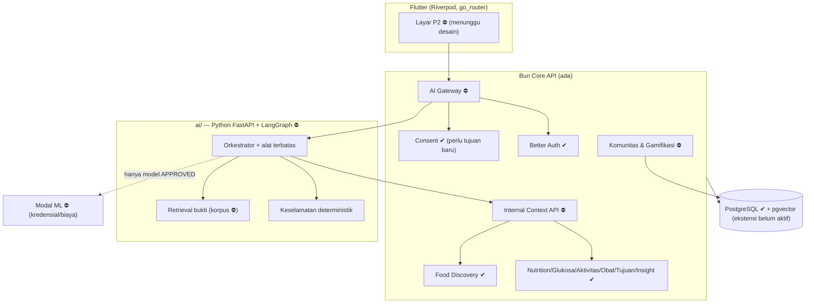

# P2 — peta dependensi dan batas (9 November 2026)

Lihat audit di `docs/audits/p2-readiness-audit.md`. Diagram ini menunjukkan **target**; elemen bertanda ⛔ belum ada.

## Aturan batas (kontrak)

1. **Satu pintu publik**: hanya Bun. Service Python tidak dipublikasikan ke host; menerima hanya token layanan dari Bun.
2. **Identitas**: `userId` selalu dari sesi server → disimpan pada `agent_run`. Python tidak pernah menerima `userId` dari model/LLM; konteks diminta lewat `runId` dan Bun menurunkan pemilik.
3. **Konteks minimal bercakupan**: API konteks menerima `{runId, purpose, requestedScopes, timeWindow}` dan hanya mengembalikan scope yang diizinkan consent + tujuan run. Setiap respons memuat sumber, kualitas, kesegaran, versi konteks, status cakupan (`SUFFICIENT|PARTIAL|INSUFFICIENT|UNAVAILABLE`).
4. **Alat deny-by-default**: daftar alat tetap; tidak ada SQL, shell, URL bebas, ubah dosis, "pasien terdekat", atau baca akun lain.
5. **Efek samping hanya lewat konfirmasi pengguna** yang terikat pada ID + versi aksi yang persis; resume tidak mengulang efek samping (kunci idempotensi).
6. **Keselamatan di luar LLM**: aturan berversi + validator; LLM tidak dapat menimpa.
7. **Modal**: hanya dipanggil dari Python, hanya model `APPROVED` dengan kebijakan penggunaan cocok; selain itu fallback deterministik. Tanpa kredensial → klien siap, deploy dilaporkan *unverified*.
8. **Komunitas**: tabel komunitas tidak punya FK ke ukuran kesehatan; leaderboard dibaca dari proyeksi skor + alias.

## Matriks dependensi → fitur

| Fitur | Perlu | Status dependensi |
|---|---|---|
| Chat AI dasar + keselamatan | sesi, consent AI baru, gateway, Python | consent AI/gateway/Python belum ada |
| Bantuan makan | Food Discovery, preferensi/alergi, rencana makan | preferensi/alergi + rencana belum ada |
| Aktivitas | catatan aktivitas, tujuan, keselamatan | wearable tidak ada → manual saja |
| Coaching mingguan | insight mingguan, tujuan | ada |
| Peringkat ML | model APPROVED, Modal | tidak ada model; Modal terblokir |
| Komunitas/tantangan | consent komunitas, wilayah, skor | belum ada |
| UI | desain FigCraft | figcraft tidak tersambung |
