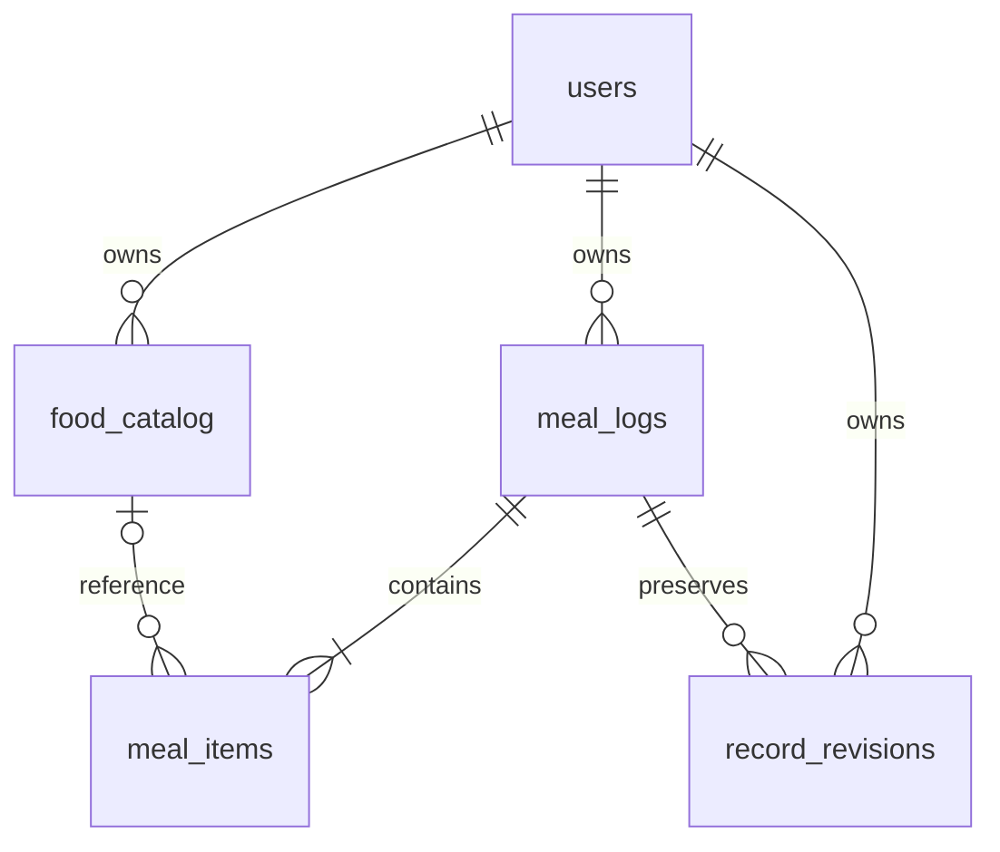

# Nutrition — data dictionary dan relasi

Migration: `20261108070202_nutrition`. Empat tabel baru; auth hanya mendapat back-relations Prisma yang diizinkan. Tidak mengubah mekanisme Better Auth atau menerapkan migrasi ke DB dev/produksi selama pengembangan ini.

| Entity | Kolom dan semantik |
|---|---|
| food_catalog | id UUID default gen_random_uuid; user_id nullable FK users (NULL hanya untuk referensi bersama yang dikelola di luar endpoint pribadi); name; source; source_version nullable; status; calories/carbohydrates/protein/fat/fiber NUMERIC(12,4) nullable per 100 g; created_at/updated_at TIMESTAMPTZ |
| meal_logs | id UUID (ID stabil create/retry); user_id UUID FK; category; consumed_at TIMESTAMPTZ occurrence; notes nullable; capture_method manual; create_hash SHA-256 payload awal untuk idempotency, bukan salinan payload dalam audit; version integer; archived_at nullable; created_at/updated_at TIMESTAMPTZ |
| meal_items | id UUID; meal_id UUID FK; food_id nullable FK; name snapshot; quantity NUMERIC(12,4); unit; grams nullable NUMERIC(12,4); grams_basis nullable; source/source_version/status snapshots; lima nutrient NUMERIC(12,4) nullable per 100 g snapshot. Amounts dihitung, tidak diduplikasi |
| record_revisions | id UUID; user_id UUID FK; meal_id UUID FK; version; reason; snapshot JSONB previous domain version; created_at TIMESTAMPTZ. JSONB sengaja menampung bentuk revisi record variabel, bukan tabel pengukuran universal |

Indeks: food user/name; meal user/consumed_at DESC/id DESC; meal_items meal dan food; revision user/time dan unique meal/version. Foreign key users cascade saat account dihapus, meal item/revision cascade saat record dihapus di luar API; food reference SET NULL mempertahankan snapshot. Tidak ada endpoint penghapusan fisik meal.

CHECK SQL mengunci enum kategori/unit/status, versi positif, batas nama/source/reason, nilai nutrisi nonnegatif, quantity positif, gram dan provenance harus konsisten, unit gram sama dengan quantity, hash 64 karakter, timestamp minimum, notes maksimum. Null ditangani eksplisit pada constraint gram. Invarian 1–30 item dan ukuran request ditegakkan pada API; tidak ada klaim RLS atau constraint agregat antarbaris.

Snapshot dibuat dalam transaksi bersama meal. Optimistic updateMany membatasi id + session user_id + expectedVersion; konflik →409 sebelum revision/item diubah. Previous view tersimpan sebagai revisi, audit hanya memuat ID/versi/event tanpa makanan/nilai gizi/notes. Original capture timestamps dipertahankan, event time dapat dikoreksi dengan jejak revisi.

Tidak membuat daily_summaries, weekly_summaries, outbox atau tabel sync pada slice ini. Ringkasan harian Nutrition dihitung saat dibaca dari sumber yang current. Koreksi/arsip langsung memengaruhi pembacaan berikutnya; cache Flutter terkait diinvalidasi. Persistence summary/version invalidation lintas domain tetap Slice Insights.
