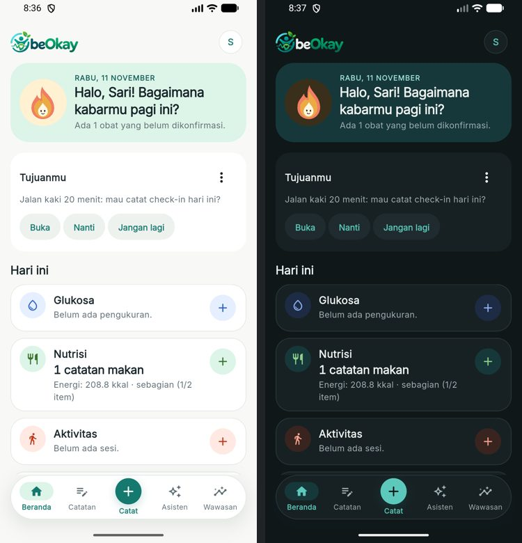
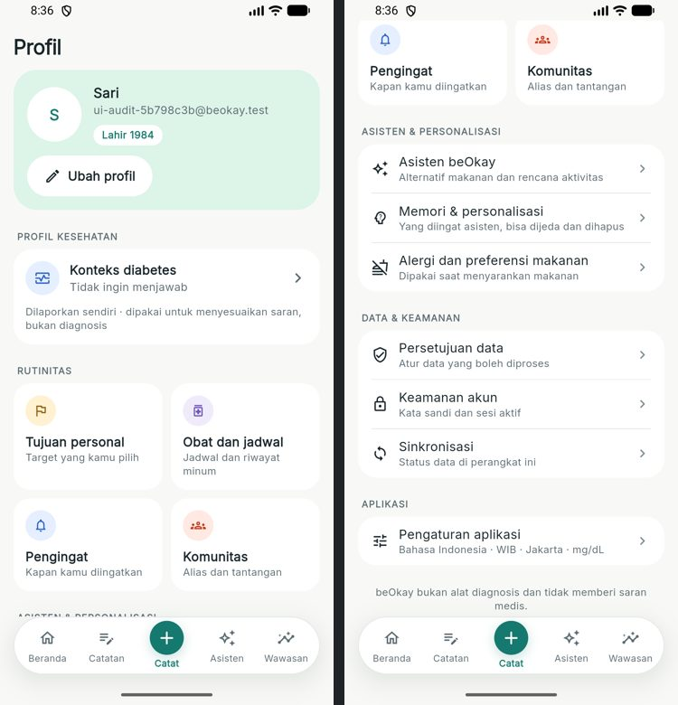
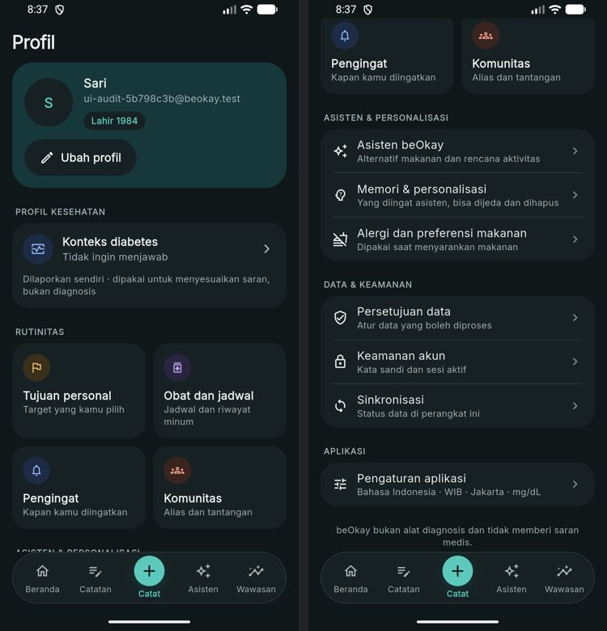
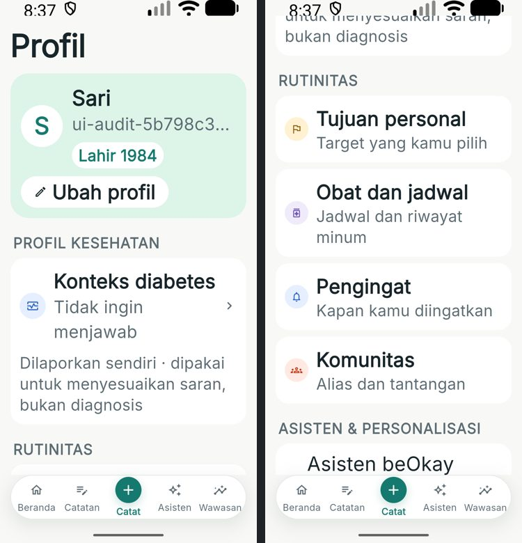
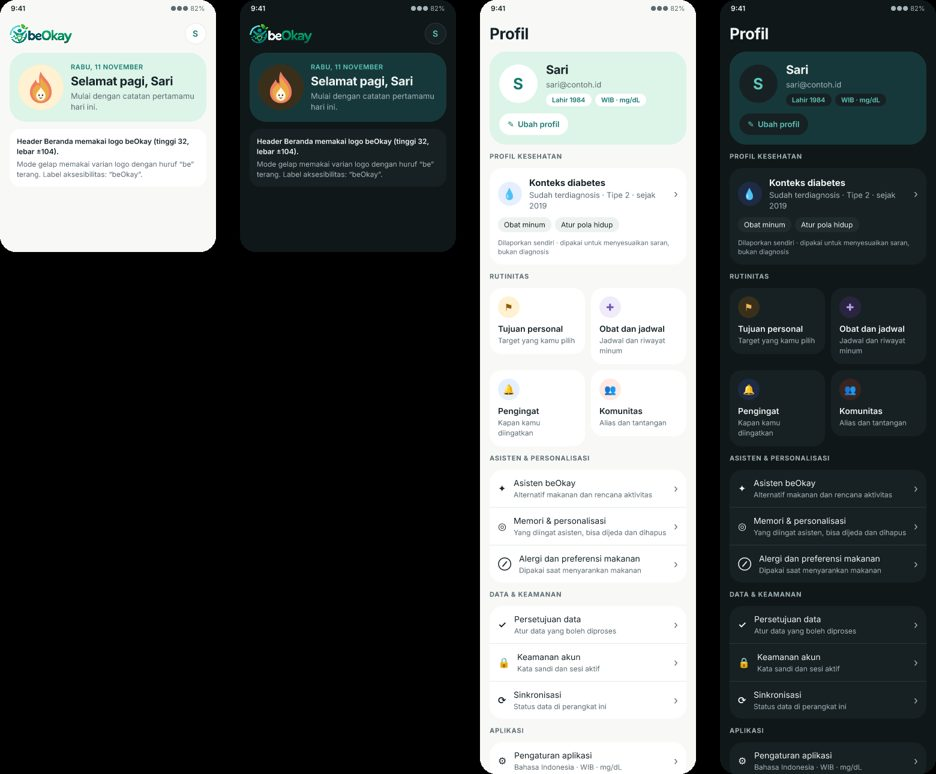

# beOkay 3.0 — Logo di Beranda & perbaikan Profil

> Tanggal: 11 November 2026. Desain FigCraft: halaman "25 — Beranda (logo) & Profil" di `design/beOkay-ui-v3.figcraft`, ekspor `design/exports/25-*.png`.

## 1. Header Beranda

- Teks "beOkay" di header Beranda diganti logo beOkay (`BeOkayLogo`, tinggi 32), dengan avatar profil tetap di kanan.
- Logo asli memakai huruf "be" berwarna teal tua yang hampir tidak terbaca di latar gelap. Varian `assets/images/logo_full_dark.png` dibuat dari logo yang sama: hanya piksel teal tua pada tulisan diganti warna teks utama mode gelap (`#EEF3F1`), sedangkan simbol dan tulisan "Okay" tidak diubah.
- `BeOkayLogo` (`app/lib/core/widgets/beokay_logo.dart`) memilih varian sesuai palet aktif dan memberi label aksesibilitas "beOkay". Layar splash juga memakainya, sehingga logo di splash ikut terbaca di mode gelap.

## 2. Profil

| Sebelum | Sesudah |
|---|---|
| Judul + avatar kecil, nama dan email dalam satu baris | Kartu identitas: avatar 64, nama, email, tanda "Lahir 1984", tombol "Ubah profil" |
| Baris "Konteks diabetes" hanya bernilai "Terisi" | Kartu konteks diabetes: status, tipe, tahun ("Sudah terdiagnosis · Tipe 2 · sejak 2019"), pengobatan sebagai tanda, catatan "dilaporkan sendiri" |
| Bahasa, Zona waktu, Satuan glukosa diulang dari Pengaturan | Satu baris "Pengaturan aplikasi" dengan ringkasan "Bahasa Indonesia · WIB · Jakarta · mg/dL" |
| Tujuh baris "Rutinitas" berisi hal yang berbeda jenis | Empat ubin berwarna domain (Tujuan, Obat, Pengingat, Komunitas), lalu kelompok "Asisten & personalisasi" dan "Data & keamanan" |
| Memori & personalisasi hanya ada di Pengaturan | Juga tersedia di Profil, di samping Asisten dan Alergi & preferensi makanan |

- Status kartu kesehatan: memuat, belum diisi (ajakan melengkapi), perlu persetujuan data kesehatan (bila `CONSENT_REQUIRED`), atau belum bisa dimuat.
- Ubin menjadi daftar satu kolom bila ukuran teks besar (skala > ~1,3), sehingga tidak ada teks yang terpotong. Judul baris pengaturan kini boleh tiga baris pada teks besar (sebelumnya terpotong "Alergi dan preferensi maka…").
- Tidak ada permintaan jaringan baru: Profil hanya memakai data akun, profil, profil kesehatan, dan preferensi yang sudah dimuat sebelumnya.

## 3. Pengujian

| Lapisan | Hasil |
|---|---|
| `flutter analyze` | bersih |
| Flutter | **193/193**; `identity_flows_test.dart`: Beranda menampilkan logo (label "beOkay", tanpa teks "beOkay"), Profil menampilkan tahun lahir, ringkasan konteks diabetes, pengobatan, empat ubin, baris Memori, ringkasan pengaturan, dan tidak lagi menampilkan "Zona waktu"; alur ubah profil memakai tombol "Ubah profil" |
| Emulator (data dev) | Beranda terang dan gelap; Profil terang, gelap, teks 2×; navigasi Ubah profil, Obat dan jadwal, Memori & personalisasi, Pengaturan aplikasi |

## 4. Bukti

| | |
|---|---|
|  |  |
|  |  |
|  | |
