# beOkay 3.0 — Laporan Fase 0, 1, dan 2

> Tanggal: 10 November 2026. Sumber tugas: master prompt "beOkay 3.0 — Adaptive Metabolic Wellness Ecosystem".
> Bukti: kode di repo (belum di-commit), tes otomatis yang dijalankan, tangkapan layar emulator Pixel_4 (API 37) dengan **akun sintetis** di DB dev, dan desain FigCraft.
> Desain FigCraft: halaman "20 — beOkay 3.0 Design System" dan "21 — beOkay 3.0 Fase 2: Beranda & Statistik" pada berkas `beOkay-ui-v3.figcraft`. Berkas itu **hanya ada di scratchpad sesi**, bukan di repo (folder `design/` dihapus pemilik pada commit `833bba5`). Ekspor gambarnya ada di `artifacts/beokay-3.0/figcraft-*.png`.

## 1. Ringkasan

| Fase | Status | Bukti utama |
|---|---|---|
| 0 — Audit repo & produk | **SELESAI** (dokumen ini + `docs/audits/full-project-audit-2026-11-10.md`) | audit kode, 23 tangkapan layar baseline (normal + teks 2×), uji suite |
| 1 — Sistem desain & navigasi | **SELESAI** (mode gelap ditambahkan menyusul pada hari yang sama) | token v3 terverifikasi kontras, beOkay Spark, nav baru, 10 tes baru |
| 2 — Beranda & statistik | **SELESAI** untuk irisan vertikal pertama | `GET /api/me/insights/statistics`, 12 tes backend + 8 tes Flutter baru, verifikasi emulator |

Verifikasi akhir: backend **250/250** tes (Docker, DB uji terisolasi) dan `tsc` bersih; Flutter **175/175** tes dan `flutter analyze` bersih.

## 2. Fase 0 — audit lima dimensi

### A. UI/UX (dari tangkapan layar nyata, bukan dari kode)

| Temuan | Bukti | Tindakan |
|---|---|---|
| Asisten dan Komunitas hanya terjangkau lewat daftar di tab Profil | `before-asisten.jpg`; route `/coach` di-*push* dari `profile_screen.dart` | **Fase 1:** Asisten menjadi tab |
| Semua ikon domain tampil mint/teal walau ada token warna per domain | `before-beranda.jpg`; `MetricCard` mengabaikan parameter `tint`/`ink` | **Fase 1:** warna domain dipakai |
| Tombol besar "Quick Record" menggandakan tombol tengah "Catat" | `before-beranda.jpg` | **Fase 1:** dihapus dari Beranda |
| Label bar navigasi terpotong pada teks 2× ("Wawas…") | `before-beranda-2x.jpg` | **Fase 1:** label mengecil, tidak terpotong (diuji) |
| Avatar = logo statis yang hanya naik-turun | `beokay_avatar.dart` | **Fase 1:** beOkay Spark |
| Wawasan: ringkasan harian + tren terpisah; tidak ada metadata statistik, belum ada makronutrien lengkap | `before-wawasan.jpg`, `trends.model.ts` | **Fase 2** |
| Tidak ada tema gelap; bahasa tunggal `id-ID` | `app_theme.dart` | token gelap sudah didesain, **belum dipasang** |
| Formulir, keadaan kosong, dan bahasa non-klinis sudah baik ("Hari kosong bukan kegagalan") | tangkapan layar Tren/Catatan | dipertahankan |

### B. Desain sistem
Struktur modular dan pola invarian (idempotensi, versi, consent per tujuan, outbox) solid; rincian di `docs/architecture/system-overview.md`. Batas yang relevan untuk 3.0: satu proses API dengan pembatas laju di memori (F-05), SSE berbasis polling DB 400 ms, dan tidak ada observabilitas agregat.

### C. Inventaris kapabilitas (status berbasis bukti)

| Kapabilitas | Status | Catatan |
|---|---|---|
| Pencatatan makan/glukosa/aktivitas/obat/tujuan, offline + sinkronisasi | IMPLEMENTED_AND_VERIFIED | tes integrasi + emulator |
| Pencarian makanan lokal + TKPI hibrida + OFF/USDA, barcode | IMPLEMENTED_AND_VERIFIED | USDA tanpa kunci → nonaktif |
| Pindai label (OCR) dan foto (nama saja) | IMPLEMENTED_BUT_UNVERIFIED pada audit ini | bergantung kunci Mistral |
| Model pengenal hidangan (Modal) | PARTIALLY_IMPLEMENTED | registri tanpa alat pendaftaran (F-16) |
| Agen nutrisi + aktivitas dengan persetujuan tepat-sekali | IMPLEMENTED_AND_VERIFIED | maksud masih sempit (lihat D) |
| Percakapan bebas / riwayat percakapan | NOT_IMPLEMENTED | hanya rantai `parent_run_id` maks 20 giliran |
| Memori longitudinal yang bisa dilihat/dihapus | PARTIALLY_IMPLEMENTED | hanya profil personalisasi deterministik + reset |
| RAG pengetahuan wellness terkurasi | NOT_IMPLEMENTED | RAG hanya TKPI (gizi) |
| Statistik deskriptif bermetadata | **IMPLEMENTED_AND_VERIFIED (Fase 2)** | `stats-v1` |
| Baseline pribadi longitudinal | NOT_IMPLEMENTED | statistik Fase 2 membandingkan dua periode, belum baseline |
| Intervensi JITAI | PARTIALLY_IMPLEMENTED | kanal **masih IN_APP saja**, belum ada pemicu dari server |
| Refleksi mingguan percakapan | NOT_IMPLEMENTED | ringkasan mingguan ada, tanpa check-in |
| Komunitas & tantangan | PARTIALLY_IMPLEMENTED | siklus hidup tantangan tidak ada (F-04) |
| Ekspor data / hapus akun | PARTIALLY_IMPLEMENTED / NOT_IMPLEMENTED | F-02 / F-01 |

### D. Kecerdasan agentik
- Maksud tetap: `NUTRITION_ALTERNATIVES`, `ACTIVITY_PLAN`, `FOLLOW_UP_WHY`, `FOLLOW_UP_MORE`, `UNSUPPORTED`, dipilih regex (`classifyIntent`). Pesan di luar pola → "Saat ini saya baru bisa membantu mencari alternatif makanan" — **titik kaku utama**.
- Registri alat deny-by-default dengan anggaran, batas waktu, ukuran hasil, dan audit; `requiredPermissions` belum ditegakkan di `executeTool` (F-10, masih terbuka).
- Keselamatan deterministik di luar LLM (regex, belum ditinjau klinisi — F-11). LLM hanya menulis ulang teks yang lolos gerbang.
- Persistensi run, SSE dengan `Last-Event-ID`, pemulihan run macet, dan kuitansi keputusan sudah ada dan bisa dipakai ulang untuk percakapan umum (Fase 3).

### E. Lingkar tertutup
`rekomendasi → keputusan (tepat-sekali) → rencana (planned_meals / activity_plans) → observasi nyata (meal_logs / activity_sessions) → recommendation_outcomes → outbox → personalisasi ±1` **ada dan teruji** (`p2-closed-loop.test.ts`), termasuk penarikan bila bukti diarsipkan. Celahnya: belum ada refleksi pengguna, belum ada umpan balik "waktu lain / saran lain", dan intervensi tidak terhubung ke rencana.

### Cek ulang temuan audit 10 Nov 2026
F-01, F-02, F-03, F-04, F-05, F-06, F-09, F-10, F-11, F-13, F-16 **masih terbuka** — tidak ada yang diubah di Fase 1–2 karena tidak termasuk cakupannya. Mana yang memblokir rilis: F-01, F-02, F-03 (lihat §6).

## 3. Arsitektur — kini vs target (inkremental)

```
KINI                                            TARGET 3.0 (tanpa layanan baru)
Flutter: Beranda·Catatan·[Catat]·Asisten·Wawasan Sama + layar percakapan, refleksi mingguan, memori
Bun API (satu proses)                           Bun API (sama)
 ├─ agent: maksud tetap (regex)                  ├─ agent: router hibrida → kapabilitas (maksud lama jadi kapabilitas)
 ├─ insights: daily/weekly/trends                ├─ insights: + statistics (stats-v1) ✔  + baseline pribadi
 ├─ interventions: IN_APP                        ├─ interventions: + kanal notifikasi lokal/push, pemicu terjadwal
 └─ outbox + worker                              ├─ conversations (thread/pesan/bagian) di atas agent_runs
PostgreSQL + pgvector (TKPI)                     └─ memory_items + memory_events (bisa dilihat/dikoreksi/dihapus)
                                                PostgreSQL + pgvector (+ korpus wellness terkurasi, terpisah dari data pribadi)
```
Keputusan: **tidak** menambah FastAPI/LangGraph/broker. Semua tambahan memakai modul fitur Bun, outbox, dan SSE yang ada.

## 4. Fase 1 — yang dikerjakan

| Bagian | Isi | Berkas |
|---|---|---|
| Token warna v3 | Palet prompt dikoreksi bila gagal WCAG: teks sekunder `#63727A` (4,26–4,45:1 di atas tint) → `#5C6B73` (≥ 4,7:1); coral `#F17D64` (2,7:1), amber `#EBAA43` (2,0:1), violet (3,5:1) hanya dekoratif; tiap domain punya `tint`/`solid`/`ink` (ink ≥ 4,5:1 di atas tint dan putih) | `core/theme/app_colors.dart` |
| Skala | radius 12/16/22/28; gaya angka tabular `metric`/`metricLarge` | `app_spacing.dart`, `app_typography.dart` |
| beOkay Spark | `CustomPainter` 3 lapis, 10 keadaan (IDLE, LISTENING, THINKING, SEARCHING, RESPONDING, ENCOURAGING, CELEBRATING, NEUTRAL, ERROR, PAUSED); gerak ambien hanya 3 siklus lalu diam; keadaan sibuk berulang selama operasi; *reduce motion* → pose diam tanpa frame; wajah hilang di bawah 40 px; tidak pernah mewakili nilai kesehatan | `core/widgets/beokay_spark.dart` |
| Navigasi | Beranda · Catatan · [Catat] · **Asisten** · Wawasan; Profil lewat avatar kanan atas tiap akar tab; `/coach` dipindah ke shell (path sama, tautan lama tetap bekerja); bar terang dengan indikator; label mengecil alih-alih terpotong | `home_shell.dart`, `pill_nav_bar.dart`, `tab_root_header.dart`, `app_router.dart` |
| Komponen | `AdaptiveHeroCard`, `ProfileAction`, `TabRootHeader`; `MetricCard` dan `TimelineTile` memakai warna domain | `core/widgets/` |
| Layar | Beranda (hero + Spark), Asisten sebagai akar tab dengan kepala pendamping yang keadaannya mengikuti status run dan selalu ditulis sebagai teks | `home_screen.dart`, `coach_screen.dart` |

Alasan nav 4 tujuan + aksi tengah (bukan 5 tujuan seperti usulan prompt): enam slot (5 tujuan + Catat) tidak muat pada 1,3× teks di layar 360 dp; Catatan (linimasa) tetap dibutuhkan untuk pencatatan cepat; Komunitas tetap terjangkau dari Profil dan akan muncul di Beranda (Fase 6).

**Bukti:** `v3-beranda.jpg`, `v3-asisten.jpg`, `v3-catatan.jpg`; tes `test/unit/beokay_spark_test.dart` (8), `test/flows/nav_center_test.dart` (+2).

## 5. Fase 2 — yang dikerjakan

### Backend: mesin statistik deterministik
`GET /api/me/insights/statistics?days=7|14|30|90` (consent `health_data_processing` + `descriptive_summaries`). Berkas: `insights/statistics.model.ts` (fungsi murni), `statistics.service.ts`.

Setiap statistik membawa: `id`, `label`, `value`, `unit`, `category` (`OBSERVATION_COUNT`/`DESCRIPTIVE_AGGREGATE`), `state` (`READY`/`INSUFFICIENT_DATA`), `range`, `sourceType`, `sampleCount` + `minimumSample`, `coverage`, `derivation`, `comparison` (periode sebelumnya sama panjang, hanya bila keduanya punya data), `detail`, `limitations`, `analysisVersion` (`stats-v1`), `computedAt`.

| Statistik | Aturan bukti minimum |
|---|---|
| Hari dengan catatan; hari dengan catatan makan | selalu (cacah) |
| Energi/karbohidrat/protein/lemak/serat **per hari tercatat** | ≥ 3 hari bernilai; cakupan item dilaporkan |
| Durasi aktivitas, hari aktif, menit per hari aktif | ≥ 1 / ≥ 1 / ≥ 2 hari aktif; *needs_review* tidak dihitung |
| Pengukuran glukosa, **median puasa**, rentang tercatat | median hanya konteks puasa, ≥ 3 pengukuran; tanpa TIR/GMI/HbA1c |
| Jadwal obat dikonfirmasi | hanya kejadian yang sudah jatuh waktu; "belum dikonfirmasi ≠ terlewat"; bukan kepatuhan |

Kartu insight (`insight-rules-v1`, maks 3): perubahan aktivitas (≥ 10%, perlu pembanding), pola hari kerja vs akhir pekan (≥ 14 hari, ≥ 4 hari aktif, selisih laju ≥ 25%), cakupan catatan makan < 50%, perubahan median glukosa puasa (bahasa netral, tanpa sebab-akibat), jadwal obat belum dikonfirmasi. Tiap kartu: bukti, cakupan, aksi (`OPEN_TRENDS`, `CREATE_GOAL`, `ASK_COACH`, `LOG_MEAL`, `OPEN_GLUCOSE`, `OPEN_MEDICATION`).

### Flutter
| Bagian | Isi |
|---|---|
| Wawasan | filter periode tersinkron (7/14/30/90), kartu insight, empat ubin statistik, kartu "Gizi tercatat" dengan grafik makronutrien bertumpuk (dari nol, "–" untuk hari tanpa catatan, tabel aksesibel), rata-rata per hari tercatat, lembar **"Cara dihitung"** untuk setiap angka; data lama diredupkan saat periode berganti |
| Beranda | "Gizi hari ini" (tanpa target; cakupan sebagian dijelaskan), "Langkah berikutnya" (hanya dari keadaan nyata: obat lewat waktu belum dikonfirmasi, belum ada catatan makan setelah 11.00, tujuan check-in manual yang belum tercapai), "Sedikit wawasan hari ini" (kartu insight 14 hari pertama yang bukan obat; **disembunyikan bila tidak ada pola yang layak**) |

**Bukti:** `p2-beranda-gizi.jpg`, `p2-wawasan-insight.jpg`, `p2-wawasan-grafik.jpg`, `p2-cara-dihitung.jpg`; tes `server/tests/unit/statistics.test.ts` (11), `server/tests/integration/statistics.test.ts` (1, termasuk isolasi akun, pengecualian baris arsip/perlu-tinjau, satuan mmol/L), `app/test/flows/statistics_test.dart` (8).

Pada akun sintetis, kartu "Sedikit wawasan hari ini" **tidak muncul** pada periode 14 hari karena periode pembanding kosong. Itu perilaku yang benar, bukan kerusakan.

### Perbaikan sampingan
`server/tests/integration/trends.test.ts` menghitung `startedAt`/`endedAt` dengan dua panggilan `Date.now()`; selisih 1 ms melanggar CHECK `ended_at = started_at + durasi` sehingga tes gagal acak (gejala G-01). Diperbaiki dengan menghitung waktu sekali.

## 6. Register risiko

| ID | Risiko | Dampak | Status / mitigasi |
|---|---|---|---|
| R1 | Tidak ada hapus akun/data (F-01) | hak pengguna, janji teks consent | **memblokir rilis** — Fase 7 (disarankan dipercepat) |
| R2 | Ekspor tidak lengkap (F-02) | portabilitas | memblokir rilis — Fase 7 |
| R3 | Rilis Android belum siap (F-03) | tidak bisa terbit | memblokir rilis — Fase 7 |
| R4 | Keselamatan regex tanpa tinjauan klinisi (F-11) | gejala darurat terlewat | **wajib sebelum Fase 3 diperluas**: korpus adversarial + tinjauan. Fase 3 menambah pola menyakiti diri; tinjauan masih terbuka |
| R5 | Statistik glukosa disalahbaca sebagai penilaian klinis | salah tafsir | median per konteks, bahasa netral, batasan di setiap angka; perlu uji keterbacaan pengguna |
| R6 | Desain hanya di scratchpad | hilang antarsesi | **DITUTUP**: `design/beOkay-ui-v3.figcraft` di repo |
| R7 | Pembatas laju di memori (F-05) | tidak konsisten bila >1 replika | tetap satu replika |
| R8 | Mode gelap | aksesibilitas/kenyamanan | **DITUTUP**: palet dinamis, mengikuti sistem, kontras diuji otomatis |

## 7. Rencana fase berikutnya dan kriteria terima

| Fase | Irisan pertama yang disarankan | Kriteria terima |
|---|---|---|
| 3 — Pendamping percakapan | tabel `conversation_threads`/`messages`/`content_parts` di atas `agent_runs`; router hibrida yang memetakan pesan bebas ke kapabilitas (maksud lama tetap jalan); keluaran bertipe (TEXT, STATISTIC_CARD, ACTION_PROPOSAL, QUESTION, SAFETY_NOTICE); alat `get_activity_statistics`/`get_nutrition_statistics` memakai `stats-v1` | pesan bebas tidak lagi jatuh ke "Saat ini saya baru bisa…"; tidak ada efek samping tanpa persetujuan; `requiredPermissions` ditegakkan di `executeTool`; SSE sambung ulang teruji |
| 4 — Multimodal & memori | pencatatan makan dari kalimat → draf yang bisa disunting; `memory_items` + layar "Memori & personalisasi" | tidak ada catatan makan tersimpan tanpa konfirmasi; memori bisa dilihat, dikoreksi, dihapus; menarik consent menghentikan penulisan dan pengambilan |
| 5 — Lingkar tertutup | refleksi mingguan percakapan; umpan balik "waktu lain/saran lain"; kanal notifikasi untuk keputusan JITAI | `DO_NOT_INTERVENE` tetap umum; setiap perubahan personalisasi tercatat dan bisa dijelaskan |
| 6 — Komunitas | templat + pembuat/penutup tantangan idempoten (F-04) | tantangan tidak bergantung tanggal migrasi |
| 7 — Pengerasan | F-01, F-02, F-03, CI (F-06), registri model (F-16), tinjauan klinisi | semua pemblokir rilis tertutup |

## 8. Strategi pengujian
- **Backend:** model murni diuji unit (aturan bukti minimum, `INSUFFICIENT_DATA`, pembanding); endpoint diuji integrasi pada stack terisolasi (consent, isolasi akun, pengecualian baris, satuan). Waktu dihitung sekali per baris uji (pelajaran dari tes Tren).
- **Flutter:** widget/flow dengan backend palsu; animasi diuji untuk berhenti (`hasScheduledFrame`), *reduce motion*, dan semantik; tidak ada tes yang bergantung jaringan nyata.
- **Visual:** emulator dengan akun sintetis; teks normal dan 2×; tangkapan disimpan di `artifacts/beokay-3.0/`.

## 9. Yang belum diverifikasi
- Uji teks 2× di emulator dilakukan kemudian: tanpa *overflow*; filter periode Wawasan terlalu rapat (diperbaiki di redesign UI/UX).
- TalkBack manual, perangkat fisik, perangkat Android kelas rendah (60 fps/baterai Spark belum diprofil).
- MacroFactor dipakai hanya sebagai rujukan pola publik (halaman produk dan App Store); situsnya tidak dapat diambil langsung dari lingkungan ini. Tidak ada aset atau tata letak yang disalin.

## 10. Galeri bukti

| Sebelum | Sesudah |
|---|---|
| 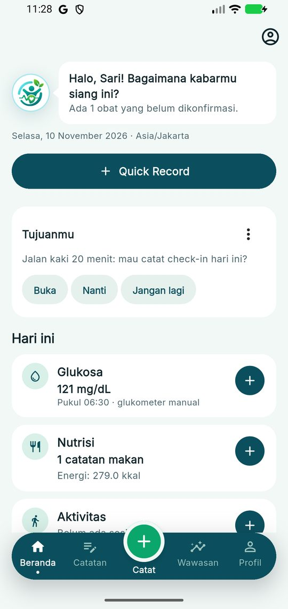 | 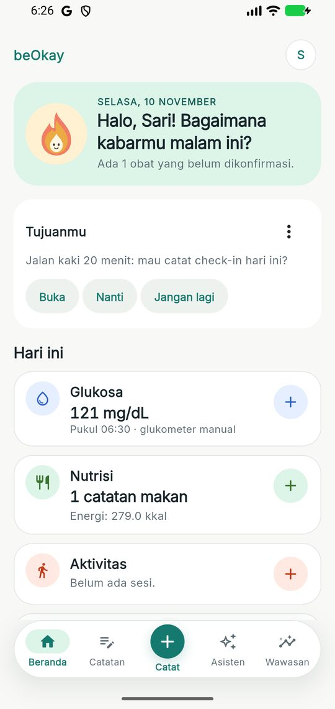 |
| 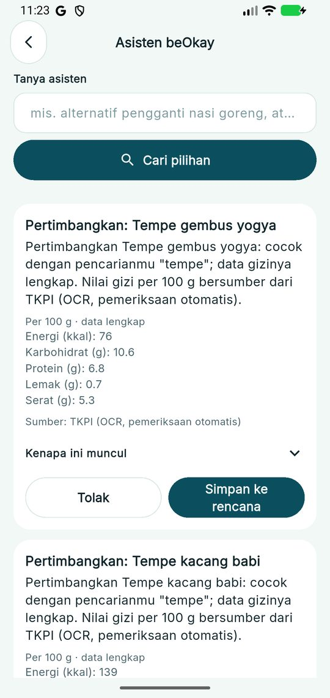 | 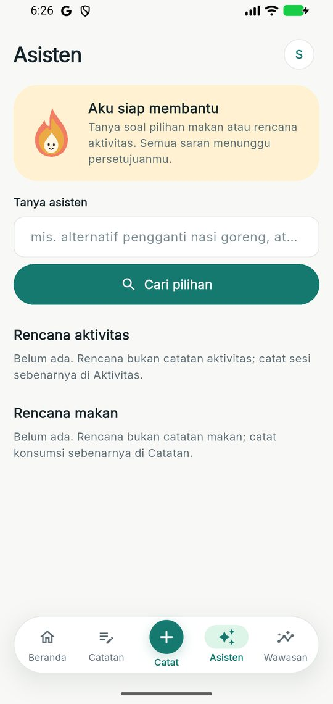 |
| 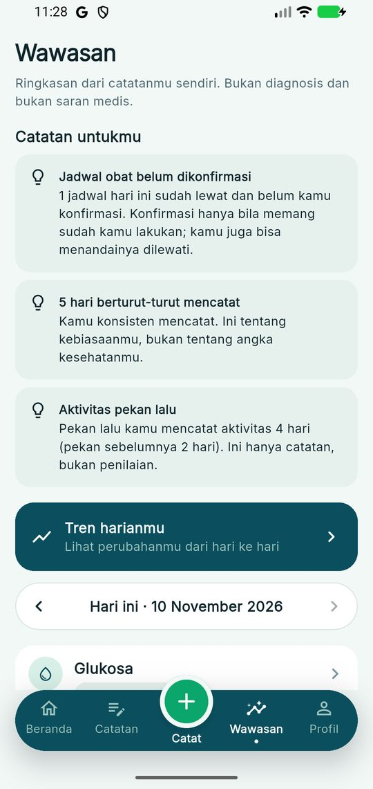 | 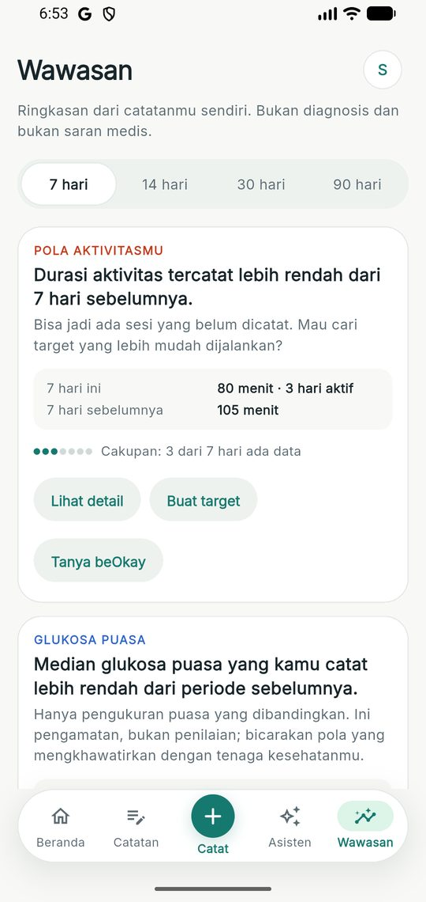 |
| 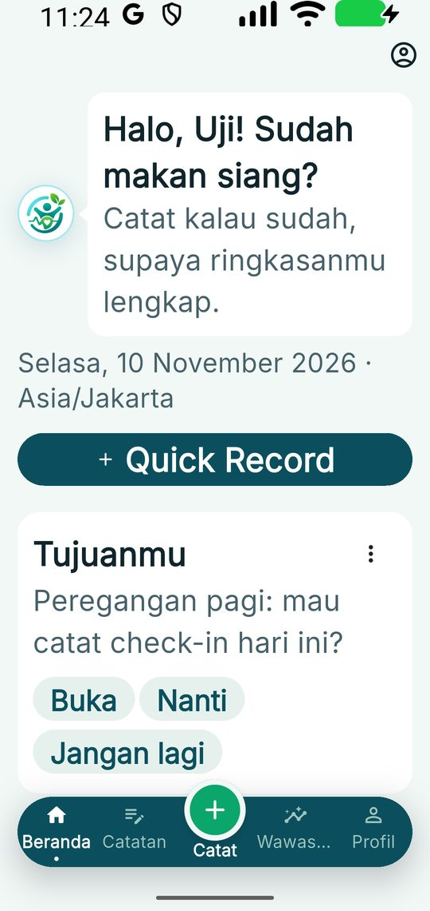 | 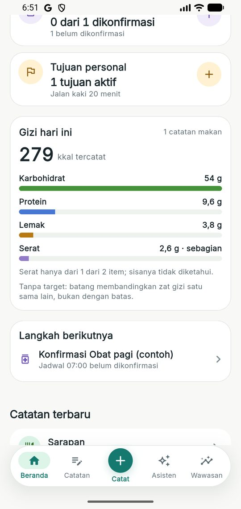 |
| 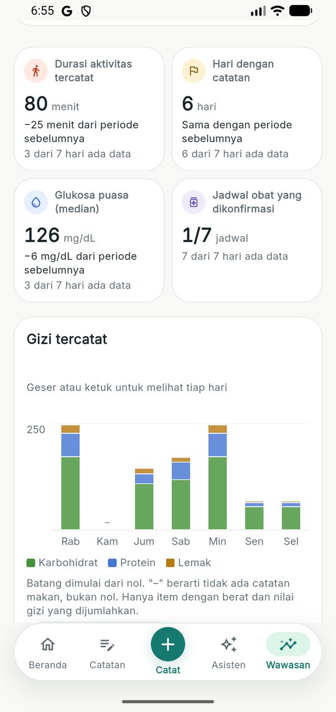 | 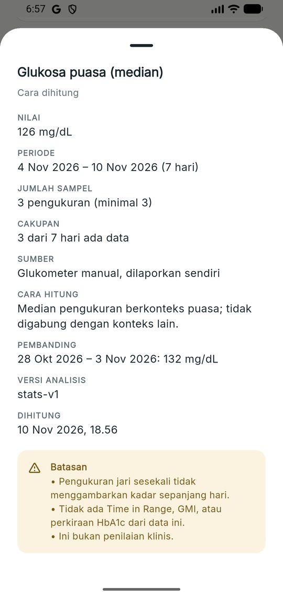 |

Desain FigCraft: 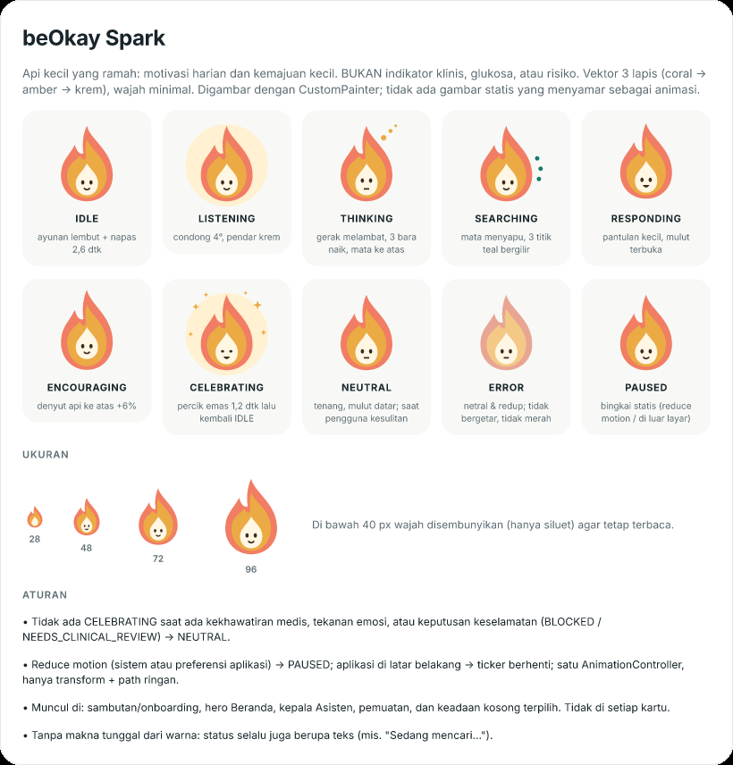 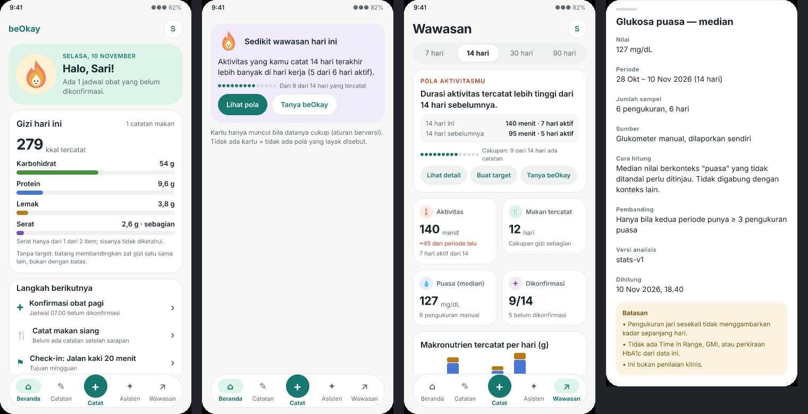
