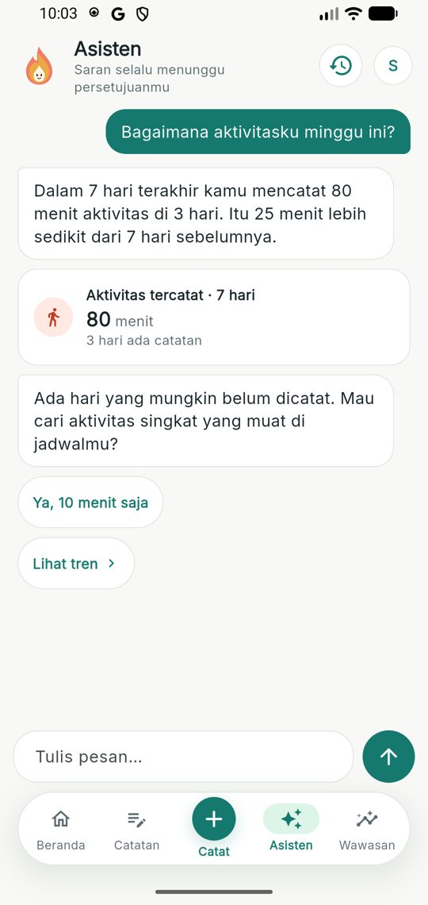
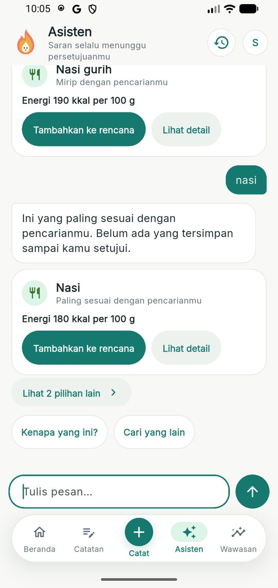
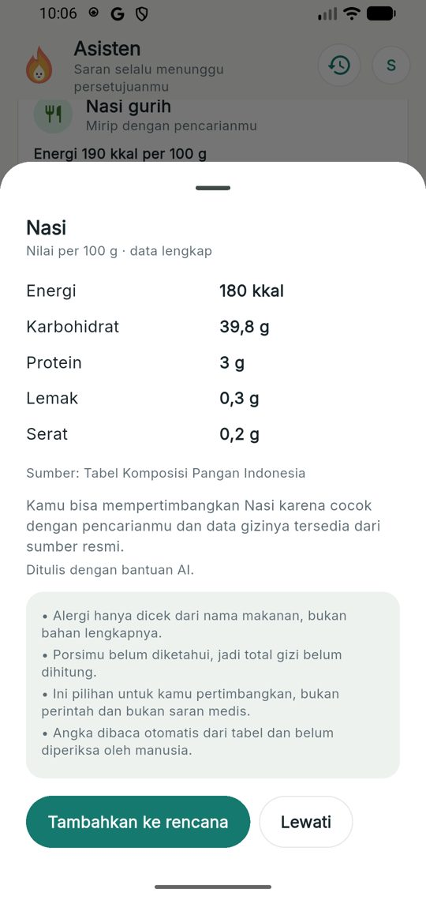
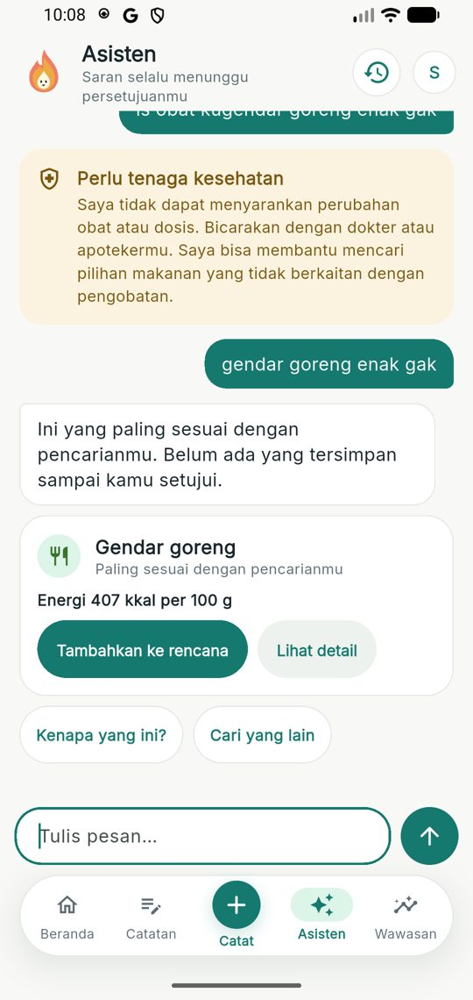
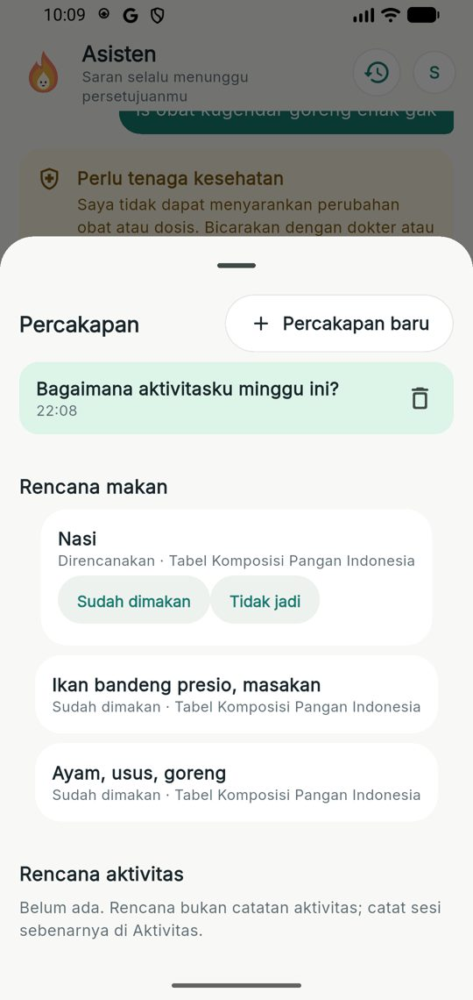
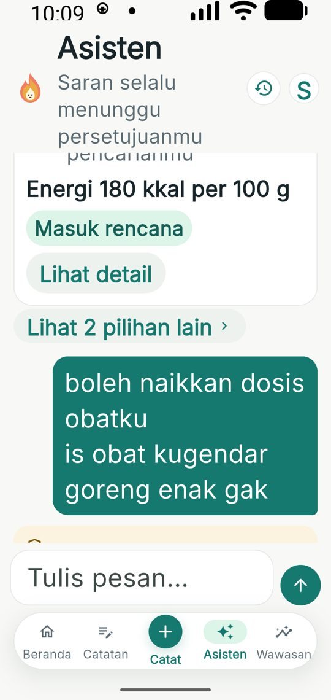
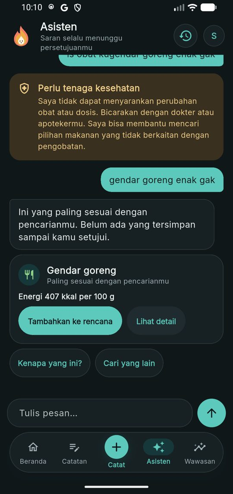
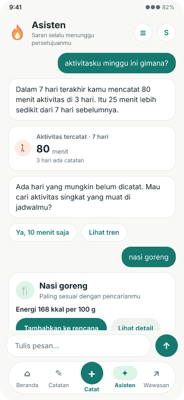

# beOkay 3.0 — Fase 3: Asisten percakapan

> Tanggal: 10 November 2026. Lanjutan dari [beokay-3.0-phase-0-2.md](beokay-3.0-phase-0-2.md).
> Desain FigCraft: halaman "22 — Fase 3: Asisten percakapan" pada `design/beOkay-ui-v3.figcraft`; ekspor `design/exports/22-*.png`.

## 1. Ringkasan

Asisten berubah dari formulir "cari alternatif makanan" menjadi percakapan. Pesan bebas dipetakan ke kemampuan yang sudah ada oleh router deterministik, dan balasan berupa bagian bertipe yang dirender sebagai kartu. Tidak ada efek samping tanpa persetujuan: saran makanan dan aktivitas tetap lewat run agen P2 dan keputusan tepat-sekali.

| Kriteria terima (dari rencana Fase 3) | Status |
|---|---|
| Pesan bebas tidak lagi jatuh ke "Saat ini saya baru bisa…" | terpenuhi: sapaan, terima kasih, dukungan, bantuan, ringkasan catatan, makanan, aktivitas, lanjutan, keselamatan, dan teks tak dikenal punya jawaban masing-masing |
| Tidak ada efek samping tanpa persetujuan | terpenuhi: percakapan hanya menulis pesan; rencana dibuat hanya lewat `decision` |
| `requiredPermissions` ditegakkan di `executeTool` | terpenuhi (F-10 ditutup) |
| Saran makanan tidak memuat kecocokan lemah | terpenuhi: gerbang identitas makanan |
| SSE sambung ulang teruji | tetap dari P2 (`agent.stream.ts`); percakapan memakai permintaan sinkron |

## 2. Backend

- **Skema** (`20261110132120_conversations`): `conversation_threads`, `conversation_messages` dengan CHECK peran/isi, `UNIQUE(user_id, client_message_id)`, `UNIQUE(thread_id, seq)`, satu balasan per pesan. Kedua tabel masuk ekspor (`conversations`) dan terhapus berantai saat akun dihapus.
- **Router `router-v1`** (`conversation.router.ts`, murni): urutan keselamatan (termasuk menyakiti diri) → sapaan (sisa kalimat tetap dirutekan) → terima kasih → dukungan → bantuan → lanjutan "kenapa"/"pilihan lain" (hanya bila thread punya run sebelumnya; tanpa itu dijawab jujur) → ringkasan (domain + petunjuk pertanyaan + rujukan diri/periode; 7/14/30 hari) → aktivitas → makanan (kata kunci) → teks pendek tak dikenal diuji ke referensi TKPI dengan gerbang identitas sebelum dianggap makanan.
- **Ringkasan dari `stats-v1`** (`conversation.parts.ts`): kalimat dan kartu statistik dibangun dari statistik yang sama dengan Wawasan; tanpa data → kalimat tanpa angka; glukosa diberi catatan "bukan penilaian medis". Metadata analisis tidak ditampilkan.
- **Gerbang identitas makanan** (`agent/food-identity.ts`): kata pertama pencarian wajib ada di nama kandidat; `EXACT` bila semua kata ada, `CLOSE` bila ≥ separuh, selain itu dibuang (`weakMatchesDropped`). "nasi goreng" tidak lagi menawarkan "Ayam, usus, goreng" atau "Gendar goreng". Kalimat pembuka balasan jujur bila hasil hanya mirip.
- **API** `/api/me/conversations*` (lihat [endpoint-reference](../api/endpoint-reference.md#9a-percakapan-asisten-30-fase-3)): idempoten lewat `clientMessageId`, consent yang kurang dijawab sebagai bagian `consent_required`, hapus percakapan membatalkan saran terbuka dan menyamarkan teks run.
- **F-10**: `executeTool` memeriksa consent setiap alat sebelum menjalankannya.
- Fungsi maksud agen dipindah ke `agent/agent.intent.ts` (murni) agar router dapat diuji tanpa basis data.

## 3. Flutter

- `ConversationController` (Riverpod `Notifier`): thread aktif, pesan tertunda dengan kirim ulang memakai `clientMessageId` yang sama, keputusan saran dengan `operationId` yang dipakai ulang, pemulihan thread < 24 jam saat dibuka.
- `coach_screen.dart` ditulis ulang: kepala dengan Spark (status mengikuti percakapan), tombol "Riwayat & rencana", gelembung pengguna/asisten, penyusun pesan di atas bar navigasi, keadaan kosong dengan empat pemicu.
- `chat_parts.dart`: kartu statistik, kartu hasil ringkas (satu utama, sisanya di balik "Lihat N pilihan lain"), lembar detail (nilai per 100 g, "tidak diketahui" untuk nilai kosong, sumber, batasan, label "Ditulis dengan bantuan AI."), kartu tidak ketemu ("Ubah pencarian" mengisi penyusun, "Catat manual"), kartu keselamatan, chip saran hanya pada balasan terakhir.
- `coach_history_sheet.dart`: daftar percakapan (buka, hapus dengan konfirmasi, percakapan baru) dan rencana makan/aktivitas dengan umpan balik.
- Fokus keyboard dilepas sebelum lembar dibuka; daftar pesan tetap di akhir setelah tema berganti.

## 4. Pengujian

| Lapisan | Hasil |
|---|---|
| Backend `bun test` (stack uji terisolasi) | **270/270**; baru: `tests/unit/conversation.test.ts` (11: router, identitas, balasan statistik), `tests/integration/conversation.test.ts` (7: akses & isolasi, idempotensi, ringkasan + consent, makanan & lanjutan & tidak ketemu, keselamatan, hapus + ekspor, izin alat) |
| `tsc --noEmit` | bersih |
| `flutter analyze` | bersih |
| Flutter `flutter test` | **179/179**; `test/flows/coach_test.dart` ditulis ulang (8 alur) |
| Emulator (Pixel 4, akun sintetis, API dev) | ringkasan aktivitas dengan data nyata, pencarian "cari info nasi goreng" / "nasi" / "gendar goreng", lembar detail, setujui dari lembar, pemblokiran dosis obat, riwayat & rencana, teks 2× tanpa *overflow*, mode gelap |

## 5. Batasan dan risiko

- Router berbasis aturan: parafrase di luar pola dijawab "Aku belum paham" dengan pemicu. Model bahasa tidak dipakai untuk merutekan (sengaja: dapat diaudit).
- Keselamatan masih regex `safety-policy-v1` + pola menyakiti diri; tinjauan klinisi tetap wajib (R4/F-11).
- Ringkasan memakai periode minimal 7 hari; "hari ini" dijawab dengan 7 hari terakhir.
- TKPI berisi bahan dan beberapa olahan; banyak hidangan (mis. "nasi goreng") tidak ada persis, sehingga hasil terbaik bisa hanya "mirip".
- Pembatas laju percakapan di memori (sama dengan F-05).

## 6. Galeri bukti

| | | |
|---|---|---|
|  |  |  |
|  |  |  |
|  |  | |
