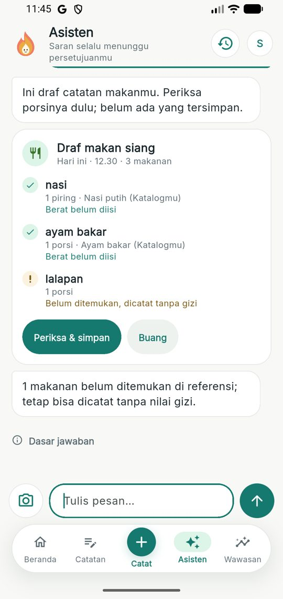
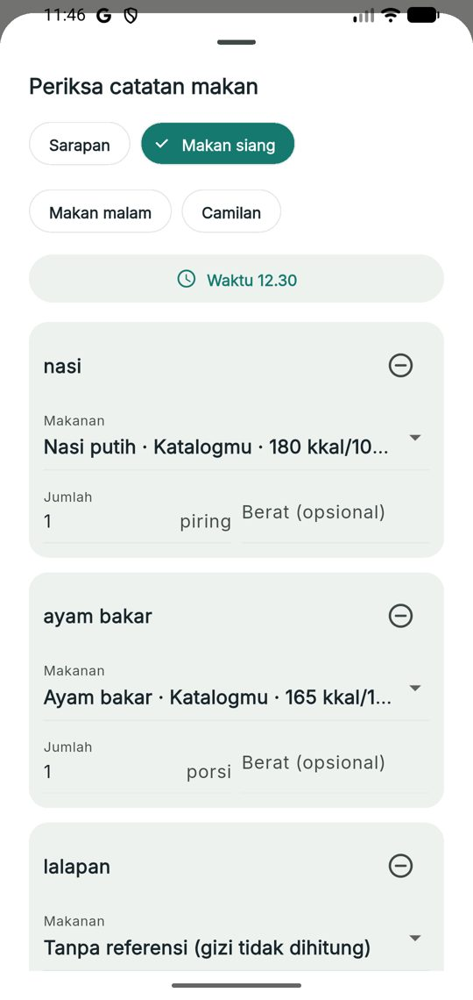
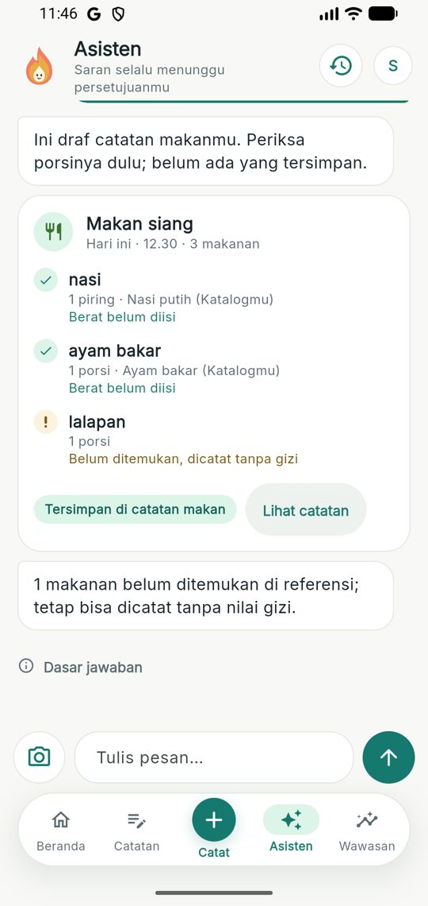
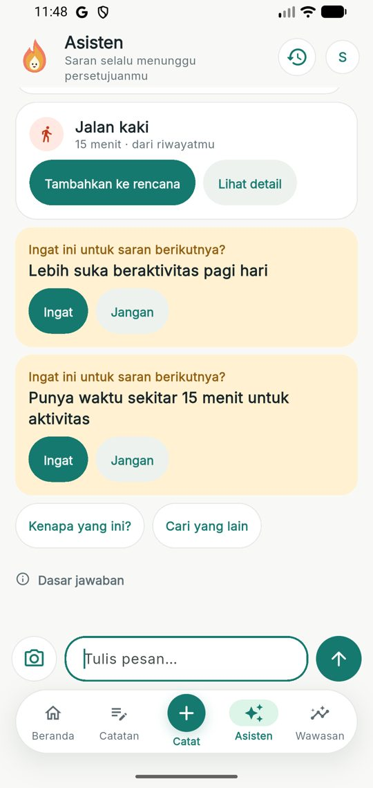
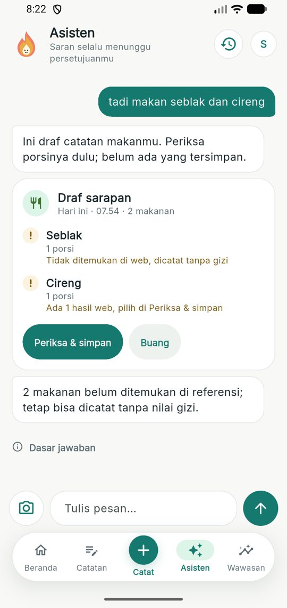
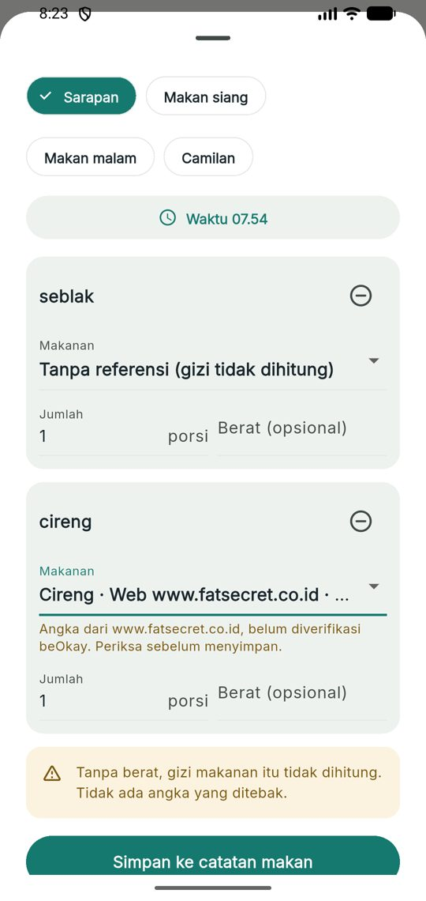
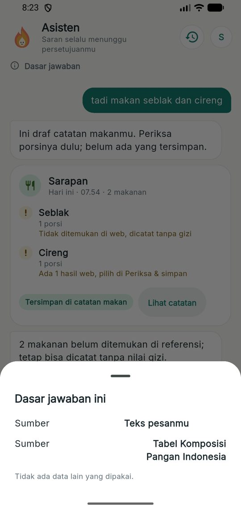
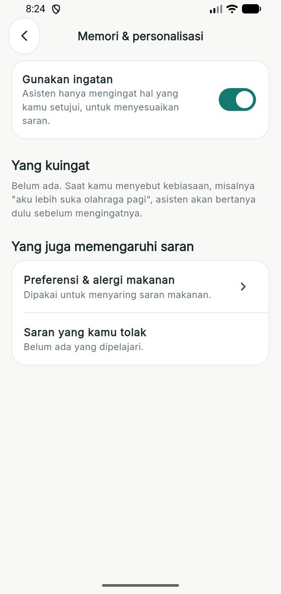
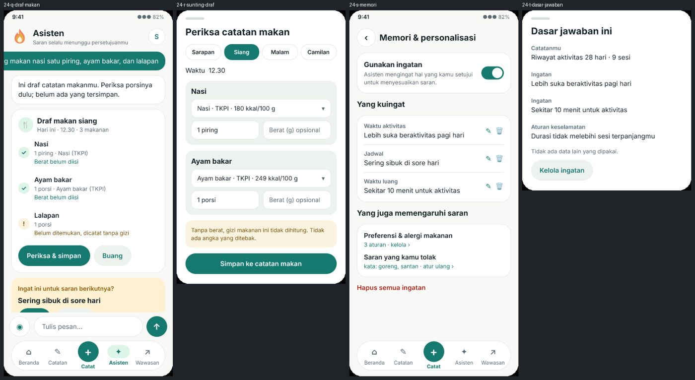

# beOkay 3.0 — Fase 4: Multimodal & Memori

> Tanggal: 10–11 November 2026. Desain FigCraft: halaman "24 — Fase 4: Pencatatan percakapan & Memori" di `design/beOkay-ui-v3.figcraft`, ekspor `design/exports/24-*.png`.

## 1. Ringkasan

| Kriteria terima (rencana Fase 4) | Status |
|---|---|
| Tidak ada catatan makan tersimpan tanpa konfirmasi | terpenuhi: kalimat/foto → draf; catatan dibuat hanya lewat `confirm`, ID draf = ID catatan (tepat sekali) |
| Memori bisa dilihat, dikoreksi, dihapus | terpenuhi: layar Memori & personalisasi, `PATCH`/`DELETE`, hapus semua |
| Menarik consent menghentikan penulisan dan pengambilan | terpenuhi: tanpa consent A atau saat ingatan dijeda, tidak ada usulan dan tidak ada pemakaian; data tetap bisa dilihat dan dihapus |
| Retrieval dapat diamati | terpenuhi: `basis` pada pesan asisten ("Dasar jawaban") dan run `MEAL_DRAFT_ENRICHMENT` + `agent_tool_calls` untuk pencarian web |

## 2. Pencatatan makan dari kalimat

- Router `router-v1` mengenali pernyataan makan ("tadi siang makan nasi satu piring, ayam bakar, dan lalapan") dan membedakannya dari pertanyaan ("berapa kalori nasi goreng?").
- Parser deterministik (`meal-text.parser.ts`) mengambil kategori (sarapan/siang/malam/camilan), memecah daftar makanan, dan membaca jumlah + satuan (piring, potong, gelas, "segelas", "setengah", gram). Gram hanya diisi bila pengguna menyebut gram, atau bila pengguna punya takaran tersimpan untuk makanan itu ("piring" = 200 g) — selain itu berat dibiarkan kosong.
- Kandidat per makanan dari TKPI dan katalog pengguna dengan gerbang identitas; maksimal 3; alergi ditandai, tidak dipilih otomatis.
- Waktu makan dari kategori (mis. "siang" → 12.30 bila sudah lewat), tidak pernah di masa depan.
- Penyunting draf di aplikasi: kategori, jam, pilihan makanan, jumlah, berat opsional, keluarkan item. Server memvalidasi bahwa pilihan berasal dari kandidat item itu.

## 3. Foto di percakapan

Tombol kamera memakai alur yang sudah ada (dialog persetujuan unggah → `/api/me/foods/scan/photo`). Percakapan hanya menerima nama dan tingkat keyakinan, bukan gambar. Nama dari model diperlakukan sebagai dugaan: disanitasi, dicari ulang dengan gerbang identitas, porsi selalu kosong sampai dikonfirmasi.

## 4. Pencarian web (Firecrawl) bila tidak ada di data

- Alat agen terdaftar `search_web_nutrition` (deny-by-default, consent H, maksud `MEAL_DRAFT_ENRICHMENT`, batas waktu 25 dtk, hasil ≤ 20 kB), dipanggil hanya lewat tombol "Cari di web" pada makanan yang tidak ditemukan, setelah dialog yang menjelaskan bahwa nama makanan dikirim ke Firecrawl.
- Klien Firecrawl `v2/search` dengan `scrapeOptions.formats: ["markdown"]`, host dipaku, tanpa redirect, kunci hanya di header (`FIRECRAWL_API_KEY`, opsional).
- Tidak ada model bahasa yang membaca halaman. Parser deterministik menerima angka hanya bila:
  1. halaman menyatakan basis per 100 g (termasuk tabel "per sajian (100 g)"), atau
  2. nilai per sajian bisa diskalakan dengan gram sajian yang dinyatakan, atau dengan rasio energi "100 gram – X kkal" pada entri yang sama, dan lolos cek silang ≤ 15%;
  3. semuanya lolos rentang dan uji 4·P + 4·K + 9·L (±35%).
- Pembacaan dibatasi pada entri yang diawali nama makanan, sehingga produk lain di halaman daftar tidak terbaca. Nama kandidat diambil dari judul halaman ("Kerupuk seblak superindo" tidak menyamar sebagai "Seblak").
- Hasil berlabel "Web · belum diverifikasi", tidak pernah dipilih otomatis, dan saat disimpan menjadi makanan katalog berstatus `estimated` dengan sumber `Web: host` dan URL.
- Diuji pada halaman nyata: Seblak 131 kkal/100 g (FatSecret, dari 262 kkal per porsi dan "100 gram – 131 kkal"), Cireng 348 kkal/100 g; halaman artikel tanpa tabel lengkap ditolak.

## 5. Memori

- Ekstraksi hanya dari pernyataan eksplisit: waktu aktivitas yang disukai, jadwal sibuk, waktu luang (menit), aktivitas yang disukai/kurang disukai. Pernyataan yang menyentuh obat, gula darah, diagnosis, kondisi mental, keuangan, dan topik sensitif lain tidak pernah diusulkan.
- Setiap usulan tampil sebagai kartu "Ingat ini?" — baru aktif setelah "Ingat". Yang ditolak tidak diusulkan ulang dengan isi yang sama.
- Pemakaian: saran aktivitas memakai waktu luang sebagai batas durasi dan aktivitas yang kurang disukai sebagai jenis yang dihindari (batasan hanya memendekkan, tidak pernah menambah beban), serta menyebut waktu yang disukai. Ingatan yang dipakai ditampilkan di "Dasar jawaban".
- Kontrol: layar Memori & personalisasi (Pengaturan → Privasi & keamanan), sakelar jeda, ubah (versi), hapus, hapus semua; juga menampilkan preferensi makanan dan kata dari saran yang ditolak (dengan atur ulang).
- Retensi: sampai dihapus pengguna; ikut terhapus saat akun dihapus; ikut ekspor (`memories`, `mealDrafts`).

## 6. Konteks dan keterlacakan

- `conversation_threads.context` menyimpan rute terakhir sehingga "Tapi akhir-akhir ini sibuk" atau "Yang 10 menit aja" setelah saran aktivitas dipahami sebagai permintaan versi singkat, dan "Oke, masukin" dijawab dengan petunjuk untuk mengetuk "Tambahkan ke rencana" (tidak ada persetujuan lewat teks).
- `basis` pada pesan asisten mencatat sumber (ringkasan catatan, TKPI, katalog, riwayat aktivitas, foto, takaran, aturan keselamatan) dan ingatan yang dipakai.

## 7. Pengujian

| Lapisan | Hasil |
|---|---|
| Backend `bun test` (stack uji Docker bersih) | **290/290**; baru: `tests/unit/meal-memory.test.ts`, `tests/unit/web-nutrition.test.ts`, `tests/integration/meal-memory.test.ts` (draf → konfirmasi tepat sekali, takaran, foto, memori, consent, ekspor, pencarian web lewat alat terdaftar, izin alat) |
| `tsc` | bersih |
| Flutter | **193/193**; `coach_test.dart` (draf, ingatan + dasar jawaban, foto, pencarian web), `memory_test.dart` |
| Emulator (data dev nyata, kunci Firecrawl dev) | draf dari kalimat, sunting + simpan, usulan ingatan + saran 15 menit, pencarian web nyata (Cireng 348 kkal/100 g dari FatSecret) disimpan sebagai `estimated`, dasar jawaban, layar memori |

Perbaikan dari verifikasi: kartu draf tersimpan tidak lagi menampilkan "Berat belum diisi" yang sudah usang; fokus keyboard dilepas sebelum dialog; dialog ubah ingatan memiliki controller sendiri (sebelumnya memakai controller yang sudah dibuang); parser web tidak lagi membaca produk lain di halaman daftar. Tes komunitas lama yang rapuh (alias acak kadang berupa 6 angka) dibuat deterministik.

## 8. Batasan

- Parser kalimat dan ekstraksi memori berbasis pola: variasi bahasa di luar pola tidak dikenali (dijawab sebagai pertanyaan biasa atau tidak diusulkan).
- Hasil web bergantung pada struktur halaman; banyak artikel tidak memuat tabel per 100 g sehingga dijawab "Tidak ditemukan di web". Status "tidak ditemukan" tidak dicari ulang otomatis.
- Memori episodik (hasil saran sebelumnya) dan memori perilaku (pola dari catatan) belum disimpan sebagai ingatan; pola perilaku tetap dihitung langsung di Wawasan.
- Pembatas laju pencarian web disimpan di memori proses (seperti F-05).

## 9. Bukti

| | | |
|---|---|---|
|  |  |  |
|  |  |  |
|  |  |  |
