# beOkay 3.0 — Fase 5: Coaching lingkar tertutup

> Tanggal: 11 November 2026. Desain FigCraft: halaman "26 — Fase 5: Rencana kecil & Refleksi mingguan" di `design/beOkay-ui-v3.figcraft`, ekspor `design/exports/26-*.png`.

## 1. Ringkasan

| Rencana Fase 5 | Implementasi |
|---|---|
| Deteksi peluang | aturan deterministik `coach-rules-v1` dari catatan 14 hari dan ingatan yang dinyatakan; setiap usulan membawa bukti angka ("Makan siang tercatat di 2 dari 9 hari…") |
| Perencanaan aksi | usulan → diterima (tepat sekali) → rencana 1–3 hari dengan waktu pilihan dan pengingat opsional |
| Integrasi JITAI | `jitai-policy-v2`: pemicu `COACHING_ACTION_DUE`, lima kelas keputusan, refleksi tidak diingatkan lagi setelah terisi, kartu tertutup otomatis saat rencana hari itu terlihat atau dikonfirmasi |
| Pelacakan hasil | status per hari `PLANNED`, `OBSERVED`, `USER_CONFIRMED`, `NOT_OBSERVED`, `RETRACTED`, `UNKNOWN`; pencocokan dengan catatan nyata, bukan dengan "diterima" |
| Refleksi mingguan | layar tiga langkah + pengakuan usaha; juga dari percakapan ("Minggu ini aku merasa gagal.") |
| Pembaruan personalisasi | delapan jenis umpan balik dengan akibat yang tercatat di `personalization_events`; penyesuaian tujuan hanya dengan konfirmasi |
| Umpan balik pengguna | lembar umpan balik pada setiap usulan dan rencana; kartu Beranda punya pertanyaan klarifikasi |
| Penyampaian intervensi yang relevan | kartu Beranda dari JITAI (rencana hari ini, refleksi), dengan jam tenang, jatah, jeda minimum, dan "tidak mengintervensi" sebagai hasil yang sah |

## 2. Lingkar

Konteks → peluang → validasi keselamatan → usulan → persetujuan eksplisit → rencana → pengingat opsional → tindakan pengguna → pengamatan → rekonsiliasi → refleksi → pembaruan personalisasi → peluang berikutnya.

### 2.1 Peluang (hanya dari catatan atau pernyataan pengguna)

| Sumber | Syarat | Usulan |
|---|---|---|
| `ROUTINE_START` | catatan ada di ≤ 2 dari 7 hari terakhir, akun ≥ 3 hari | catat satu kali makan per hari, 3 hari (lalu 1 hari) |
| `GOAL_PACE` | tujuan mingguan aktivitas/jalan kaki/catat makan, hari ke-3 s.d. sebelum akhir periode, capaian < 50% dari laju | sesi singkat untuk sisa periode; tujuannya tidak diubah |
| `ACTIVITY_STEP_DOWN` | ≥ 2 rencana aktivitas (asisten atau rencana kecil) belum terlihat dan tidak kurang dari yang terlaksana | sesi separuh rata-rata rencana sebelumnya, dibatasi waktu luang yang diingat |
| `MEAL_LOG_GAP` | ≥ 5 hari dengan catatan makan; sarapan/makan siang/makan malam tercatat di ≤ 30% hari itu | catat waktu makan itu 3 hari (lalu 1 hari); "hanya bila kamu memang makan siang" |

Keselamatan: durasi 5 menit sampai sesi terpanjang 28 hari terakhir (minimal 10, maksimal 30), jenis aktivitas yang tidak disukai tidak diusulkan, tidak ada target klinis. Usulan yang tidak lolos dicatat di `withheld` beserta alasannya. Maksimal dua usulan (satu setelah "terlalu sering"), diurutkan dengan penilaian pengguna.

### 2.2 Keputusan dan hasil

- `ACCEPT` memulai rencana hari ini, menyimpan waktu, dan bila diminta membuat pengingat (jenis `meal`/`activity`, hari sesuai rencana) yang diarsipkan otomatis saat rencana selesai atau dihentikan.
- Rekonsiliasi: aktivitas cocok bila jenis sama dan durasi ≥ 50% rencana pada tanggal lokal itu; makan cocok bila kategori sama. Catatan pembukti yang diarsipkan membuat hari itu `RETRACTED`. Konfirmasi sendiri (`USER_CONFIRMED`) terpisah dari `OBSERVED`; catatan yang muncul kemudian menggantinya menjadi `OBSERVED`.
- Hari yang lewat tanpa catatan = `NOT_OBSERVED` dan ditampilkan sebagai "belum terlihat", bukan gagal. Tanpa izin membaca catatan = `UNKNOWN`.

### 2.3 Umpan balik → personalisasi

| Umpan balik | Akibat |
|---|---|
| Membantu / Kurang membantu | skor sumber naik/turun (urutan usulan berikutnya); sekali per rencana |
| Sudah kulakukan | usulan: ditunda 7 hari; rencana: hari ini `USER_CONFIRMED` |
| Bukan sekarang | usulan ditunda 3 hari |
| Terlalu sering | jatah intervensi ≤ 1/hari dan ≤ 3/minggu; maksimal 1 usulan |
| Waktu lain | waktu rencana dan jam pengingat berubah; waktu disimpan sebagai preferensi |
| Saran lain | varian itu tidak diusulkan lagi; varian yang lebih kecil disiapkan |
| Jangan sarankan ini lagi | sumber dimatikan; usulan dan rencana sejenis ditutup |

Semua perubahan menaikkan versi profil personalisasi dan tercatat (`COACHING_*`, aturan `coach-rules-v1`); "atur ulang" di Memori & personalisasi menghapusnya. Tidak ada pelatihan model dari data kesehatan.

### 2.4 JITAI v2

`decision`: `INTERVENE`, `DO_NOT_INTERVENE`, `DEFER` (jam tenang, jatah, jeda minimum, ditunda, `SLOT_NOT_STARTED`), `ASK_FOR_CLARIFICATION` (setelah tanggapan "kurang membantu" terakhir: "Masih mau diingatkan?" dengan "Ya, tetap" / "Tidak usah"), `REQUIRES_REVIEW` (rencana gagal validasi ulang, mis. jenis aktivitas kini tidak disukai). Kartu rencana hari ini baru muncul setelah waktu yang dipilih dimulai. Kartu ditutup saat hari itu terlihat/dikonfirmasi, rencana dihentikan, atau refleksi terisi.

## 3. Refleksi mingguan

- Minggu sasaran: minggu berjalan bila sudah ≥ 4 hari berlalu, selain itu minggu lalu. Satu refleksi per minggu.
- Ringkasan: yang berjalan baik (hanya usaha: hari dengan catatan makan, menit aktivitas, rencana terlaksana, tujuan tercapai, refleksi sebelumnya; tidak ada nilai glukosa atau kalori), status rencana, tujuan, kelengkapan data.
- Pertanyaan: "Bagaimana minggu ini menurutmu?", "Bagian mana yang paling sulit?", catatan opsional.
- Penyesuaian: hanya menurunkan target tujuan mingguan yang tertinggal (< 60%) ke `max(1,2 × capaian, 50% target)`; tujuan pencatatan glukosa tidak pernah disesuaikan; sakelar default mati; diterapkan dengan versi dan `record_revisions`. Waktu yang enak disimpan sebagai preferensi dan, bila dipilih, sebagai ingatan `ACTIVITY_TIME`.
- Pengakuan: "Refleksi mingguan selesai", rentetan minggu, rencana terlaksana, hari dengan data.
- Percakapan: rute `REFLECTION` membalas dengan empati, fakta minggu berjalan yang benar-benar tercatat, dan tombol ke refleksi; tidak ada penilaian atau perbandingan.

## 4. Pengujian

| Lapisan | Hasil |
|---|---|
| Backend `bun test` (stack uji Docker bersih) | **306/306**; baru `tests/unit/coaching.test.ts` (11) dan `tests/integration/coaching.test.ts` (5: akses dan skema; lingkar makan tepat sekali → tercatat → ditarik → dikonfirmasi → belum terlihat → pengingat diarsipkan; delapan umpan balik dan jejaknya; JITAI v2 ditunda/kartu/klarifikasi/ditahan; refleksi dengan penyesuaian, ingatan, tepat sekali, ekspor, dan percakapan) |
| `tsc` | bersih |
| Flutter | **200/200**; `coaching_test.dart` (6) dan tes percakapan refleksi |
| Emulator (data dev nyata) | usulan dari tujuan "Jalan kaki 20 menit" (25 dari 100 menit di hari ke-4), mulai rencana siang + pengingat 12.00, umpan balik, konfirmasi hari ini, refleksi tiga langkah + pengakuan, kartu Beranda tertutup setelah refleksi, balasan percakapan, mode gelap, teks 2× |

Perbaikan dari verifikasi: `SwitchListTile` di lembar mulai rencana dibungkus `Material`; progress bar refleksi tidak lagi memberi nilai semantik non-angka; kartu JITAI ditutup saat tugasnya selesai; balasan percakapan memakai minggu berjalan ("sejauh ini") dan penyebut hari yang sudah berlalu; label "Refleksi minggu ini" menjadi "Refleksi mingguan" karena minggu sasaran bisa minggu lalu.

## 5. Batasan

- Aturan peluang sederhana dan berbasis pola; tidak ada model statistik atau klaim efektivitas klinis. Penerimaan dan pelaksanaan dilacak terpisah, tanpa mengasumsikan dampak kesehatan.
- Rencana mencakup aktivitas dan pencatatan makan; obat dan glukosa sengaja tidak dijadikan rencana coaching.
- Penyesuaian tujuan hanya untuk periode mingguan dan hanya menurunkan; menaikkan target tetap lewat layar Tujuan.
- Rekonsiliasi berjalan saat layar atau JITAI dibuka (tidak ada penjadwal latar).
- Drift skema lama yang sudah ada sebelum fase ini (FK `activity_plans`/`score_events`, indeks `communities`) tetap muncul di `prisma migrate diff`; tidak diubah di sini.

## 6. Bukti

| | | |
|---|---|---|
| 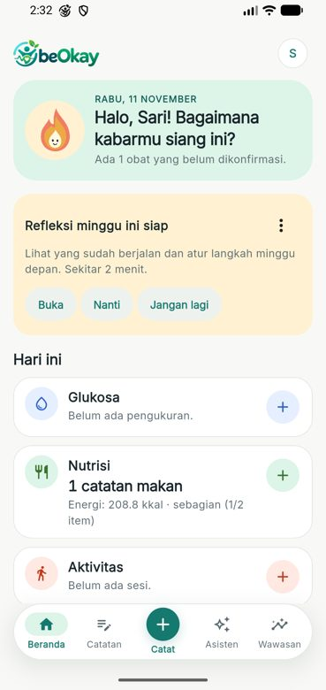 | 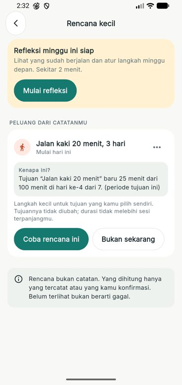 | 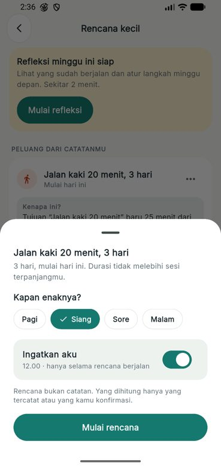 |
| 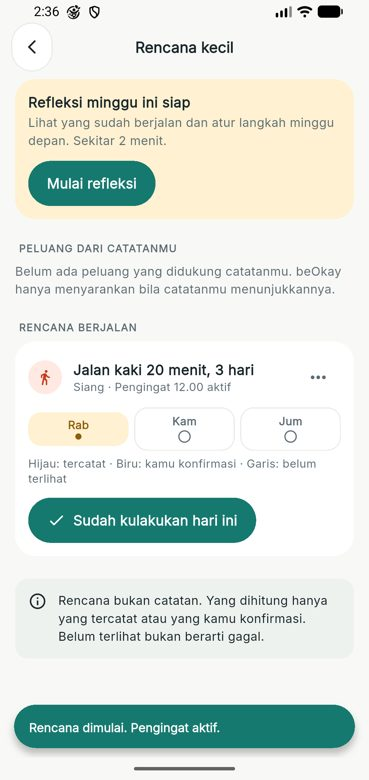 | 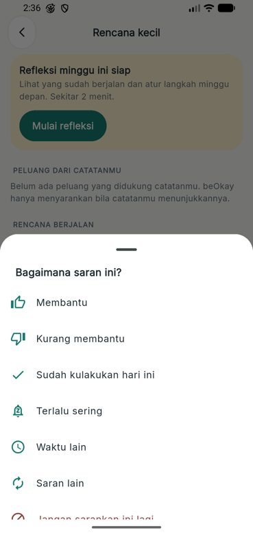 | 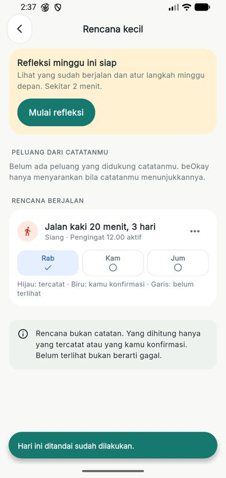 |
| 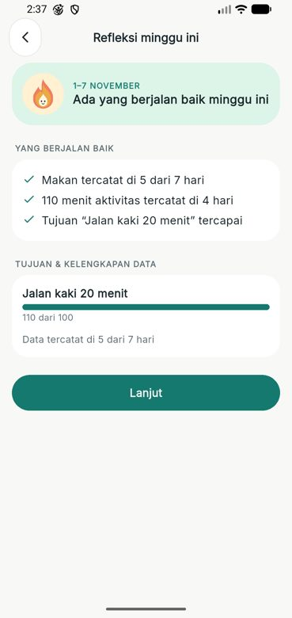 | 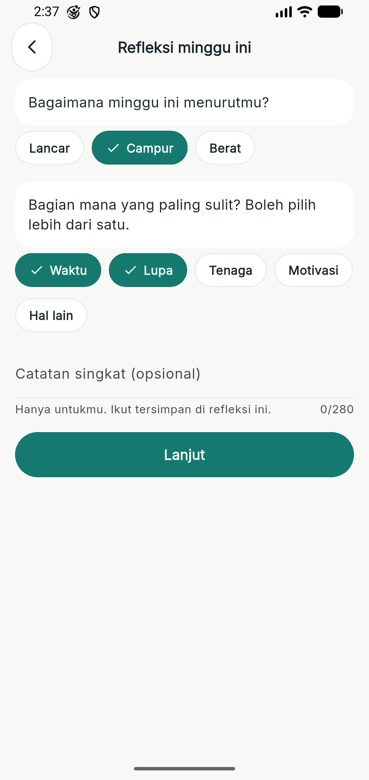 | 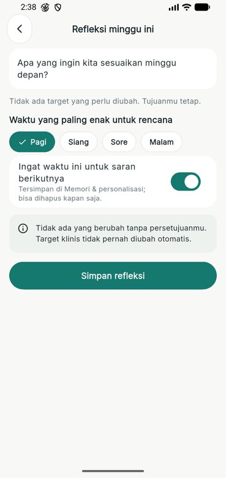 |
| 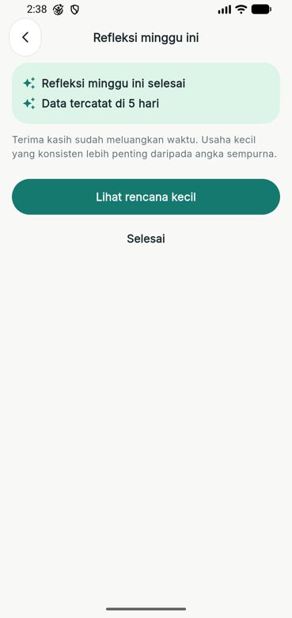 | 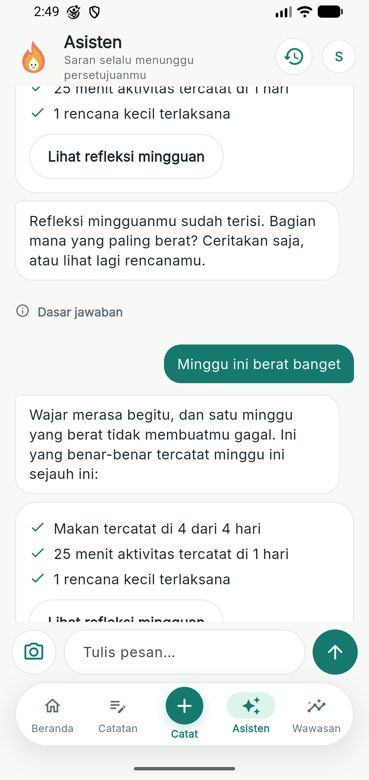 | 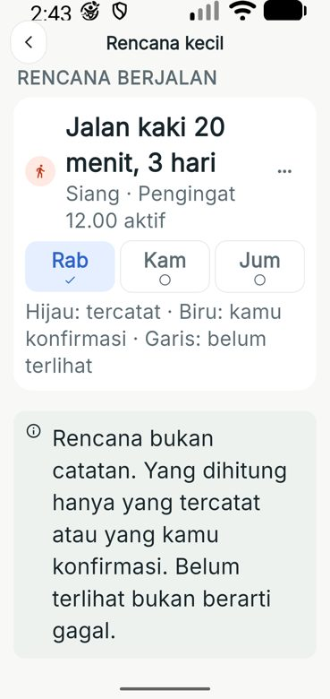 |
| 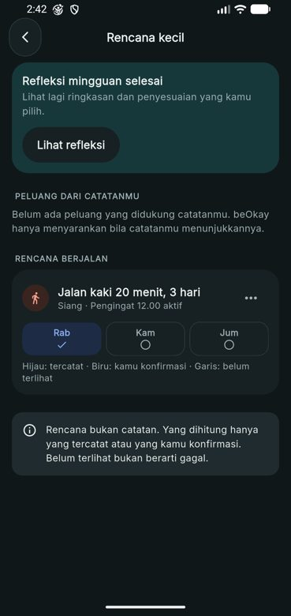 | 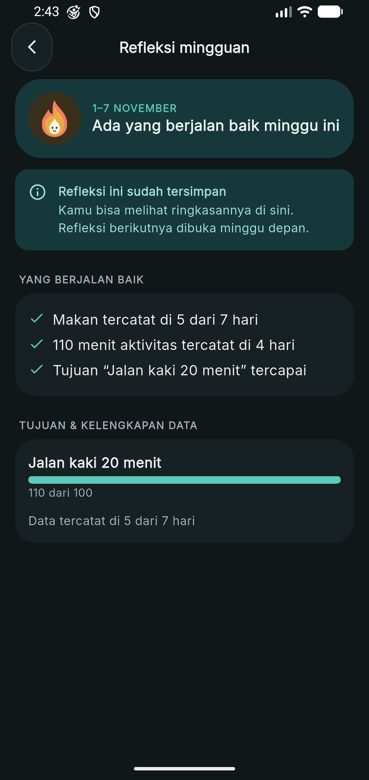 | 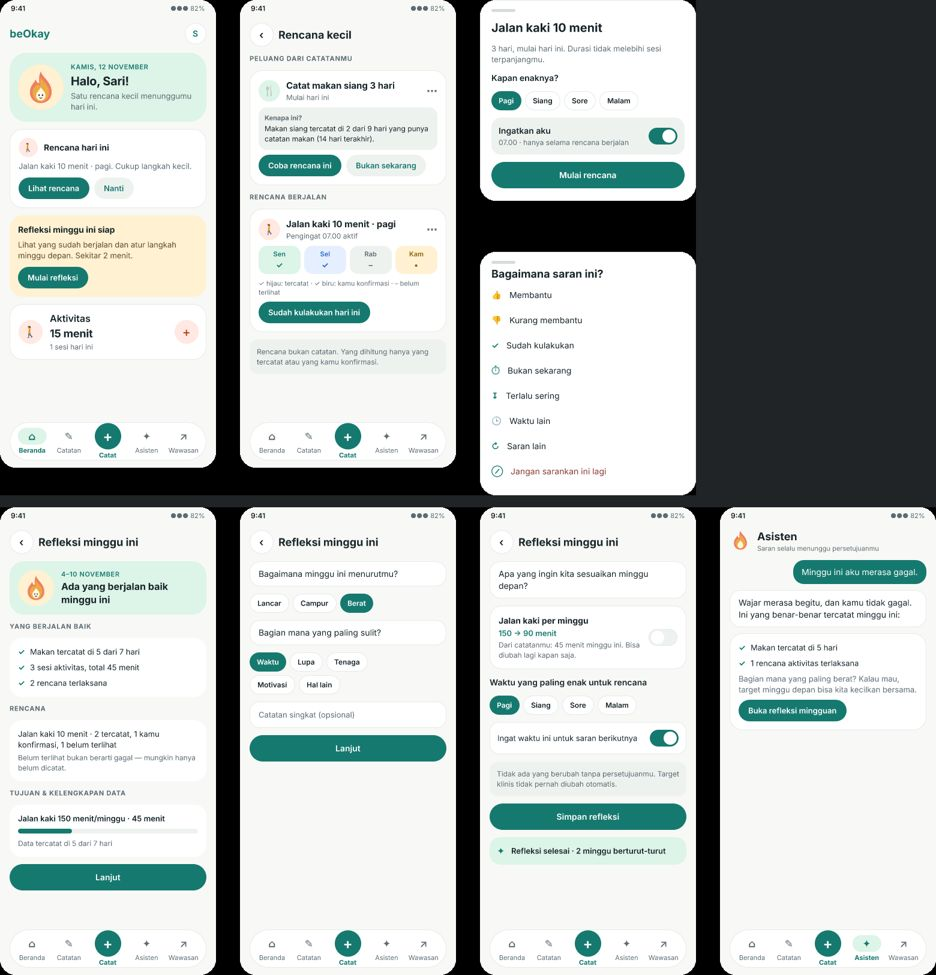 |
