# beOkay 3.0 — Fase 6: Komunitas, notifikasi realtime, form dan halaman detail

> Tanggal: 11 November 2026. Desain FigCraft: halaman "27 — Fase 6: Komunitas & tantangan" dan "28 — Notifikasi, pola form & detail" di `design/beOkay-ui-v3.figcraft`, ekspor `design/exports/27-*.png` dan `28-*.png`.

## 1. Ringkasan

| Permintaan | Implementasi |
|---|---|
| Fase 6: komunitas dan tantangan | tantangan berulang otomatis (`challenge-lifecycle-v1`, menutup audit F-04), status Terjadwal · Berjalan · Selesai dengan hasil beku, detail tantangan, riwayat, pengakuan usaha pribadi (`recognition-v1`), privasi komunitas, sorotan di Beranda, saran tantangan di Asisten |
| UI notifikasi | kotak masuk per hari, lonceng dengan lencana di setiap akar tab, banner di dalam aplikasi, pengaturan push dan per jenis |
| WebSocket realtime | `/api/me/realtime` (Bun WebSocket): notifikasi baru, status dibaca, progres tantangan, papan peringkat, pembaruan rencana kecil |
| Pengingat ke FCM | pekerja server membuat notifikasi `REMINDER` dari pengingat yang jatuh tempo (kotak masuk + WebSocket); push FCM pengingat dikirim pengirim P1 yang kini menghormati pengaturan notifikasi dan membawa tujuan, sehingga ketukan push membuka layar yang sama dengan notifikasi di kotak masuk (teks layar kunci tetap umum) |
| Semua form | glukosa, aktivitas, makan, obat, tujuan, profil, profil kesehatan, pengingat memakai `form_kit` (hero domain, bagian berjudul, waktu, tombol simpan tetap di bawah) |
| Semua halaman detail | glukosa, makan, aktivitas, riwayat obat memakai `detail_kit` (hero nilai, rincian label/nilai, aksi, riwayat koreksi, provenans) |
| Bug bottom bar di tab Tren | tombol Kembali sistem di Wawasan (Tren) menutup aplikasi; sekarang kembali ke Beranda dan sorotan bar ikut berpindah (lihat §5) |

## 2. Komunitas dan tantangan

### 2.1 Siklus tantangan

- Dua templat di `challenge_templates`: **3 hari aktif minggu ini** (7 hari, target 3, berulang tiap 7 hari) dan **12 hari aktif dalam 4 minggu** (28 hari, target 12, berulang tiap 28 hari). Jangkar Senin 2 Nov 2026; tanggal dihitung di `Asia/Jakarta`.
- Tiap jam (dan secara malas saat layar komunitas dibuka, paling sering tiap 10 menit) server membuat periode berjalan dan berikutnya untuk setiap komunitas, membuka yang sudah mulai, menutup yang lewat, lalu membekukan hasil peserta: **Tuntas** (hari aktif ≥ target), **Ikut serta**, atau **Keluar**. Semua langkah idempoten (unik `(community_id, template_id, starts_on)` dan `updateMany` bersyarat status).
- Peserta mendapat notifikasi "Tantangan dimulai" dan "Tantangan selesai: Tuntas/Ikut serta" tepat sekali (`dedupe_key`).
- Label manusiawi dari server: "Mulai besok", "Berjalan · sisa 5 hari", "Berjalan · hari terakhir", "Selesai"; jumlah peserta < 5 menjadi "kurang dari 5 peserta".

### 2.2 Pengakuan usaha (`recognition-v1`)

Tujuh pengakuan, semuanya pribadi dan hanya tentang usaha: tantangan pertama, tantangan tuntas, 3 tantangan diikuti sampai selesai, refleksi pertama, 4 minggu refleksi berturut-turut, 5 hari rencana kecil terlaksana, 7 hari berturut-turut ada catatan. Tidak ada aturan dari nilai glukosa, berat badan, kalori, atau peringkat. Pengakuan baru menghasilkan notifikasi `RECOGNITION`.

### 2.3 Layar

- **Hub komunitas**: tantanganmu (progres, status), pencapaian pribadi (tercapai/terkunci), komunitasku, direktori provinsi, pintasan privasi.
- **Detail komunitas**: tantangan dikelompokkan Berjalan · Akan datang · Selesai.
- **Detail tantangan** (`/challenge/:id`, dimuat dari server sehingga bisa dibuka dari notifikasi atau percakapan): status, progres hari aktif dengan rincian aktivitas/check-in, check-in hari ini (berubah menjadi "Sudah check-in hari ini" setelah dipakai, `checkedInToday` dari server), cara kerja, hasil saat selesai, papan peringkat yang berubah langsung lewat topik `challenge:<id>`.
- **Lembar gabung**: pilihan tampil di papan peringkat, default mati.
- **Privasi komunitas**: yang terlihat anggota lain vs yang tidak pernah dibagikan, sakelar sorotan Beranda, "Sembunyikan dari semua papan peringkat", keluar komunitas, kelola persetujuan.
- **Beranda**: kartu sorotan (tantangan berjalan, atau pengakuan ≤ 7 hari) setelah bagian "Hari ini"; bisa dimatikan.
- **Asisten** (`router-v3`, rute `COMMUNITY`): "ada tantangan apa?", "aturannya gimana?", "progres tantanganku" dijawab dengan kartu tantangan dan tautan; tanpa consent komunitas, balasan meminta persetujuan.

## 3. Notifikasi dan realtime

- Tabel `notifications` (kotak masuk, unik `(user_id, dedupe_key)`) dan `notification_preferences` (`push_enabled`, `muted_kinds`). Jenis: Pengingat, Rencana kecil, Refleksi mingguan, Tantangan, Pencapaian. Jenis yang dibisukan tidak dibuat.
- Sumber: pekerja tiap 30 dtk untuk pengingat jatuh tempo (jendela 3 menit, zona waktu pengguna); ajakan refleksi tiap jam setelah 18.00 lokal; siklus tantangan; pengakuan.
- WebSocket `/api/me/realtime`: sesi Bearer, topik `user:<id>` otomatis, topik tantangan hanya untuk anggota, sesi diperiksa ulang tiap ≤ 60 dtk (`4401`). Klien mengirim `ping` tiap 25 dtk dan menyambung ulang dengan jeda bertahap; lencana diperbarui dari `hello`, `notification`, dan `notifications.read`. Protokol lengkap di [endpoint-reference §8a](../api/endpoint-reference.md).
- FCM: server mengirim push ke perangkat aktif bila `push_enabled` dan kredensial server ada. Isi push hanya teks layar kunci umum ("Pengingat beOkay — Buka beOkay untuk mencatat.") plus `{type, notificationId, action, refId}`; judul dan isi asli hanya di kotak masuk. Ketukan push (aplikasi berjalan atau dari keadaan tertutup) membuka tujuan yang sama dengan notifikasi di kotak masuk.
- Pengingat: notifikasi kotak masuk dibuat oleh pekerja notifikasi tanpa push; push-nya tetap dikirim oleh pengirim P1 (`push-dispatcher.ts`, buku besar `push_deliveries`), jadi tidak ada push ganda. Pengirim itu kini menghormati pengaturan notifikasi (push mati atau "Pengingat" dibisukan = tidak dikirim, dihitung `skippedByPreference`) dan membawa `{action, refId}` sehingga ketukan membuka Catatan, Obat, Tujuan, Pengingat, atau rencana kecil terkait. Sebelumnya sakelar di layar pengaturan tidak berpengaruh pada push pengingat. Aplikasi mengosongkan jadwal pengingat lokal bila perangkat itu sudah terdaftar push, jadi pengingat lokal dan push tidak muncul bersamaan.

## 4. Form dan halaman detail

- `core/widgets/form_kit.dart`: `FormHero` (ikon dan warna domain, kalimat konteks), `FormSection` (judul overline, kartu), `DateTimeTile` ("Rabu, 11 Nov 2026 · 19.21 · WIB" + Ubah), `FormNote`, `SaveBar` (tombol simpan tetap di bawah + catatan offline). Dipakai oleh form glukosa, aktivitas, makan, obat, tujuan, profil pribadi, profil kesehatan, dan lembar pengingat.
- `core/widgets/detail_kit.dart`: `DetailHero` (nilai besar + chip waktu dan sumber), `DetailSection` + `DetailRow` (label/nilai; bertumpuk otomatis pada teks besar atau nilai panjang), `DetailActions`, `RevisionTimeline`, dan bagian provenans (diukur, dicatat, diterima server). Dipakai oleh detail glukosa, makan, aktivitas, dan riwayat obat.
- Ringkasan gizi di form dan detail makan kini memakai baris label/nilai yang sama (sebelumnya kartu bersarang dengan judul ganda).
- Grafik harian (`day_chart.dart`): label sumbu bawah tidak lagi bertumpuk dengan label hari terpilih.

## 5. Bug bottom bar di tab Tren

Dicoba di emulator: buka Wawasan → Tren, tekan tombol Kembali sistem → **aplikasi tertutup**, dan saat dibuka lagi bar kembali ke Beranda. Penyebab: shell memakai satu halaman per tab di navigator bersarang, jadi tidak ada yang bisa di-pop dan Android menganggap Flutter tidak menangani Kembali. `PopScope` di tingkat shell tidak cukup karena navigator akar meneruskan sinyal "tidak bisa pop" dari navigator bersarang ke `SystemNavigator.setFrameworkHandlesBack(false)`.

Perbaikan: `BackToHome` (`PopScope` → `context.go('/home')`) membungkus halaman tab Catatan, Asisten, Wawasan, dan Profil di dalam navigator shell. Ia hanya mengambil alih bila tidak ada yang bisa di-pop, jadi tab yang dibuka dengan `push` (mis. notifikasi pengingat di kotak masuk membuka Catatan) tetap kembali ke layar sebelumnya. Hasil di emulator: Kembali dari Tren membuka Beranda dengan sorotan bar yang benar; Wawasan tetap mengingat bagian Tren; kotak masuk → Catatan → Kembali → kotak masuk → Kembali → Beranda; Kembali di Beranda menutup aplikasi seperti biasa. Tes regresi `identity_flows_test.dart` (O) memeriksa `handlePopRoute` dan sinyal `setFrameworkHandlesBack` (true di Wawasan, false di Beranda); tes itu gagal bila perbaikan dilepas.

Peralihan tab, pilihan bagian Wawasan, dan sorotan bar saat pindah tab sudah benar sebelum perbaikan. Bila yang dimaksud adalah gejala lain, perlu langkah reproduksinya.

## 6. Pengujian

| Lapisan | Hasil |
|---|---|
| Backend `bun test` (stack uji Docker bersih) | **318/318**; baru `tests/unit/community-lifecycle.test.ts` (4), tes pengirim push yang menghormati pengaturan notifikasi dan membuka rencana kecil (`push.test.ts`), dan `tests/integration/lifecycle-realtime.test.ts` (7: periode dari jangkar dan idempotensi; hasil Tuntas/Ikut serta/Keluar dengan notifikasi dan pengakuan tepat sekali; pembukaan terjadwal; detail hanya untuk anggota; privasi dan hub; pengingat → kotak masuk → dibaca/dibisukan + WebSocket `hello`/`pong`/event/topik terlarang; Asisten komunitas) |
| `tsc` | bersih |
| Flutter | **207/207**, `flutter analyze` bersih; `community_test.dart` (6), `notifications_test.dart` (4), tes percakapan tantangan, tes regresi tombol Kembali |
| Emulator (API dev nyata) | pengingat dev → pekerja → WebSocket → banner dan lencana; hub, gabung, check-in, pengakuan baru, "Sudah check-in hari ini", privasi; form glukosa/aktivitas/makan; detail glukosa/makan/aktivitas/riwayat obat; Tren dan tombol Kembali; mode gelap + teks 2× |

Perbaikan dari verifikasi: tombol Kembali di tab (§5); pengirim push pengingat P1 mengabaikan pengaturan notifikasi baru (§3); baris status sambungan di kotak masuk meluap pada teks 2× (sekarang membungkus); lencana pencapaian memotong kata pada teks 2× ("Tantang an") dan sekarang menjadi baris selebar layar; ringkasan gizi bersarang dua kali; tombol check-in kini tahu check-in hari ini sudah tercatat. Pengaturan emulator (ukuran font 1,0, mode gelap mati) dikembalikan dan pengingat uji yang dimasukkan ke DB dev dihapus.

## 7. Batasan

- **Push FCM belum bisa diuji di perangkat.** Kredensial server sudah ada, tetapi proyek Firebase yang tersedia hanya berisi aplikasi lain; `id.beokay.app` belum didaftarkan dan `app/android/app/google-services.json` tidak ada. Sampai itu dilakukan, notifikasi tetap masuk lewat kotak masuk dan WebSocket saat aplikasi terbuka, dan pengingat lokal tetap berjalan. Pengaturan notifikasi menampilkan "Belum ada perangkat terdaftar untuk push".
- Langganan WebSocket dan pekerja hidup di memori proses (asumsi satu replika). Di belakang reverse proxy, `Upgrade` harus diteruskan.
- Templat tantangan hanya bisa ditambah lewat migrasi; tidak ada layar admin.
- Drift skema lama sebelum fase ini (FK `activity_plans`/`score_events`, indeks `communities`) masih muncul di `prisma migrate diff`; tidak diubah di sini.

## 8. Bukti

| | | |
|---|---|---|
| 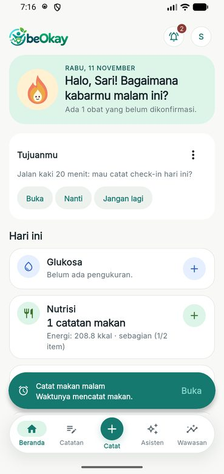 | 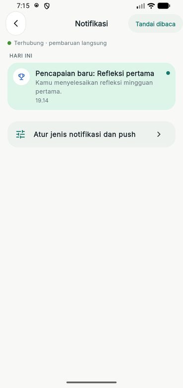 | 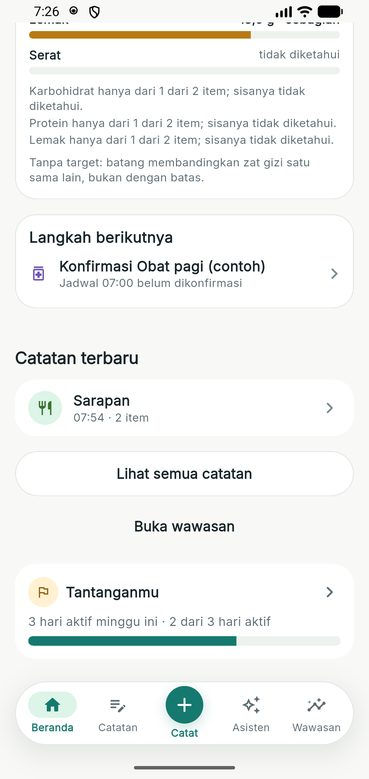 |
| 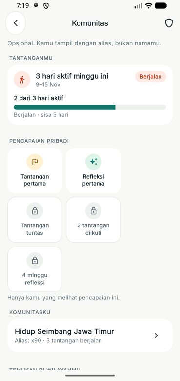 | 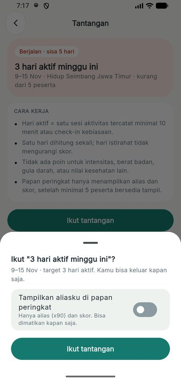 | 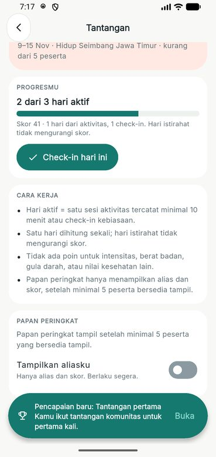 |
| 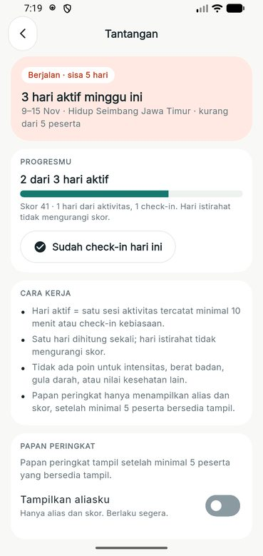 | 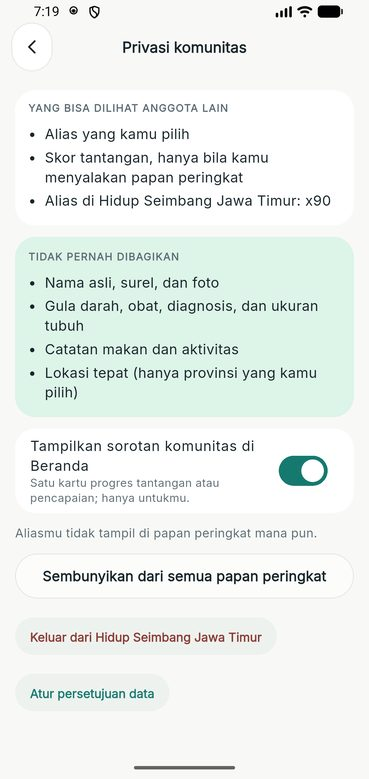 | 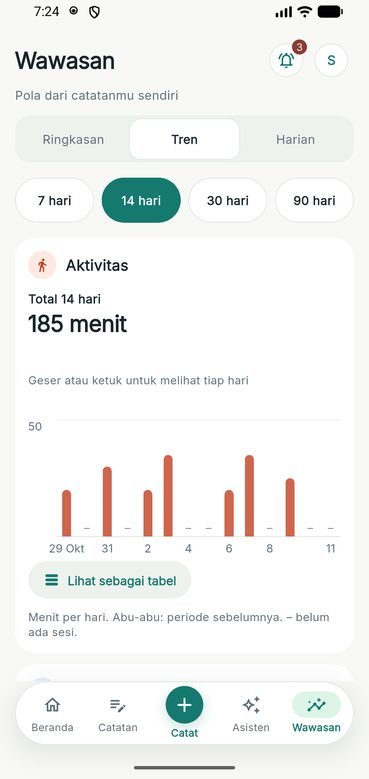 |
| 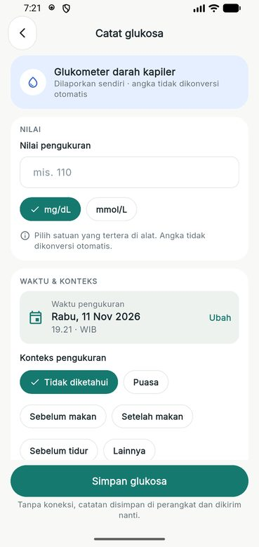 | 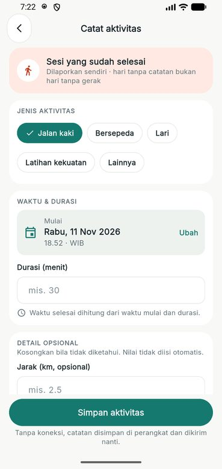 | 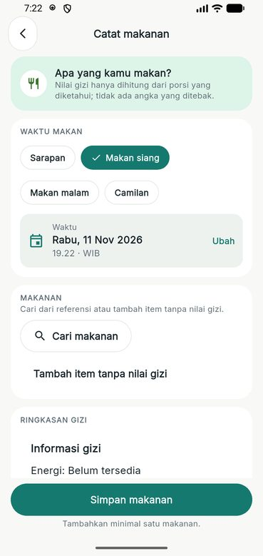 |
| 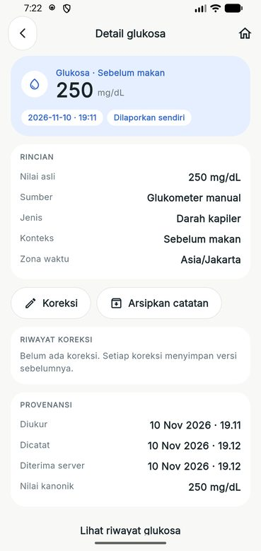 | 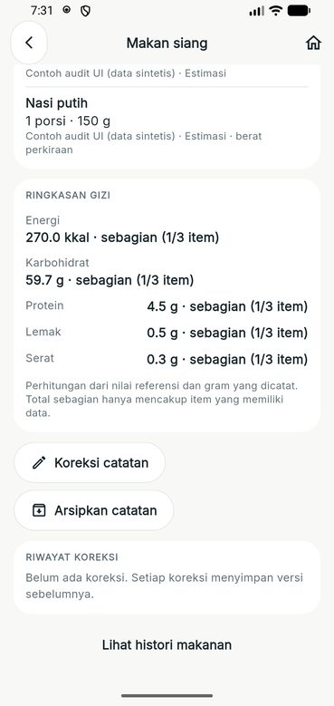 | 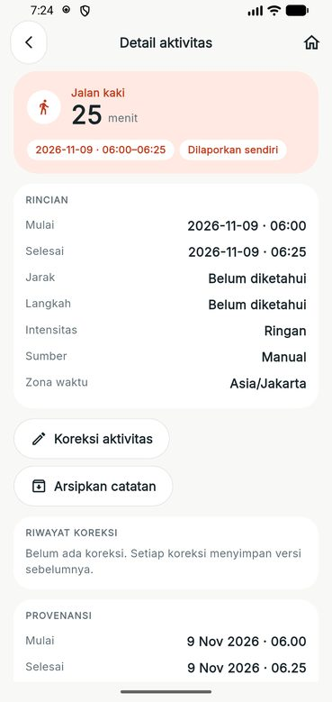 |
| 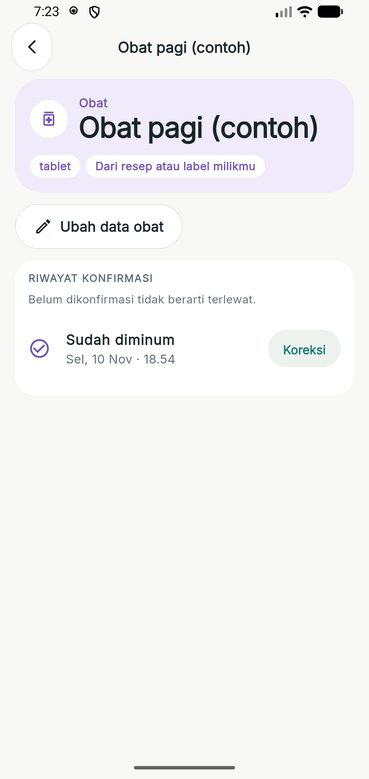 | 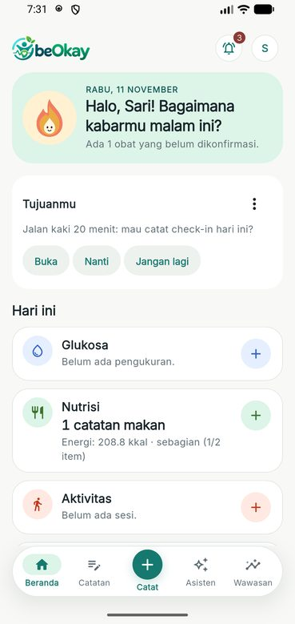 | 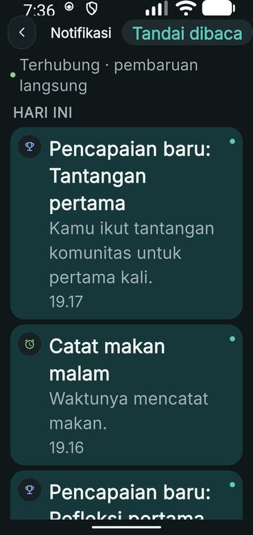 |
| 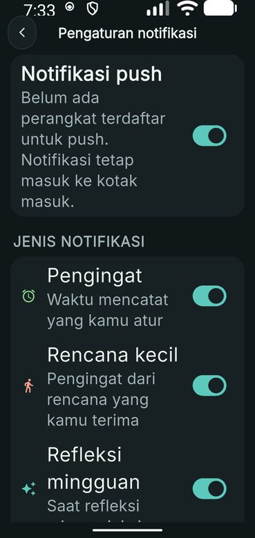 | 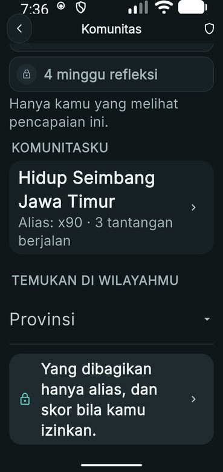 | 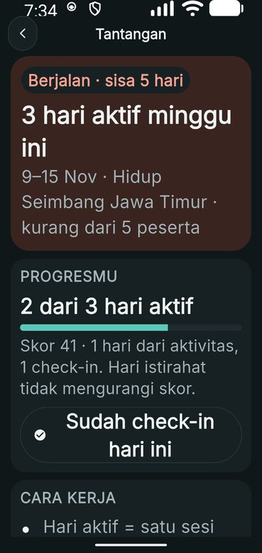 |
| 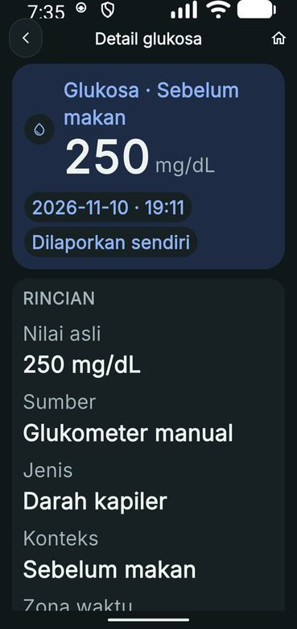 | 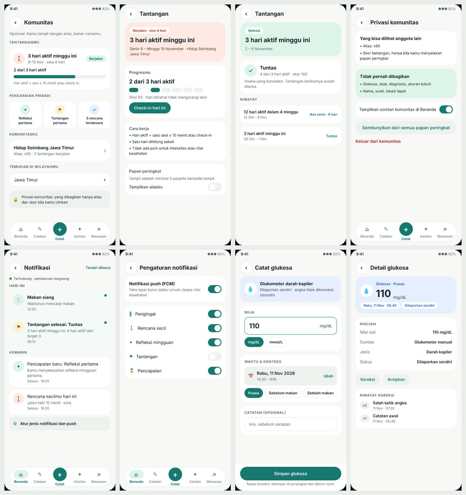 | |
