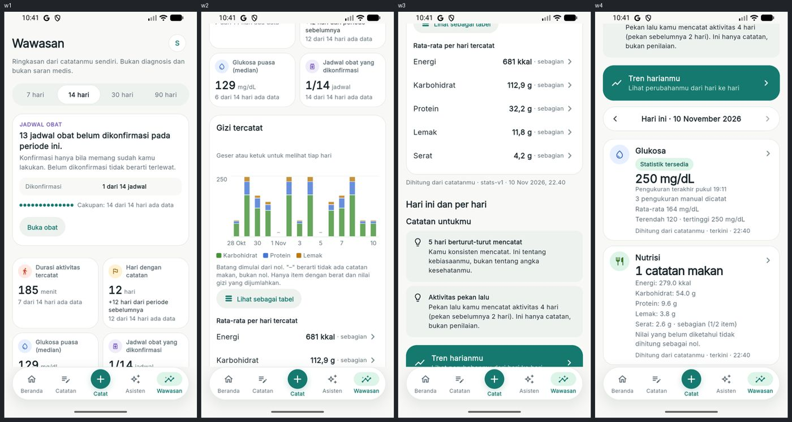
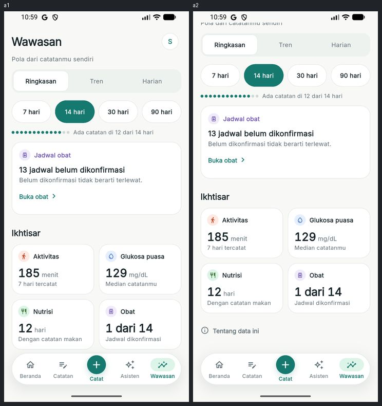
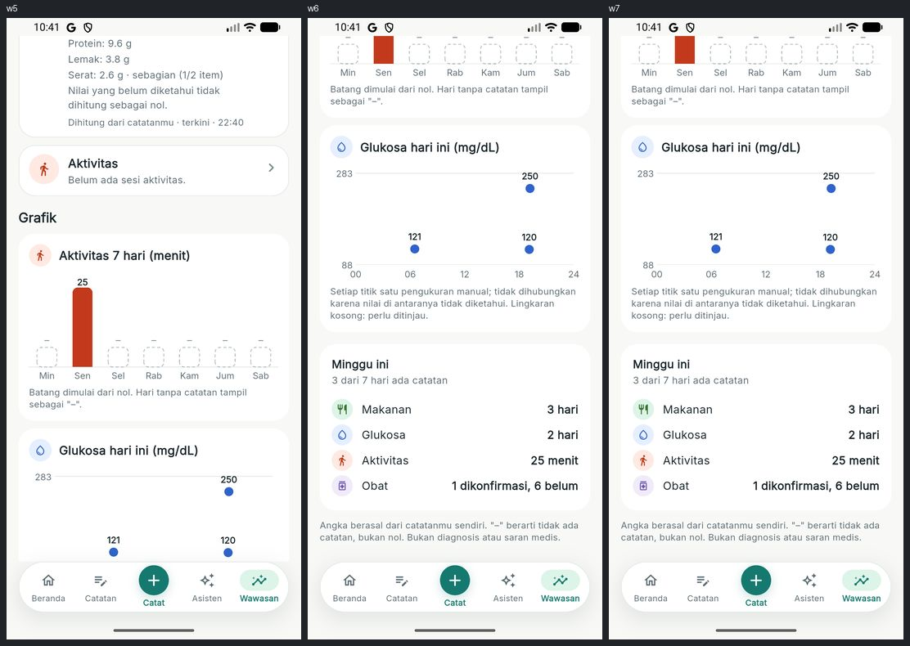
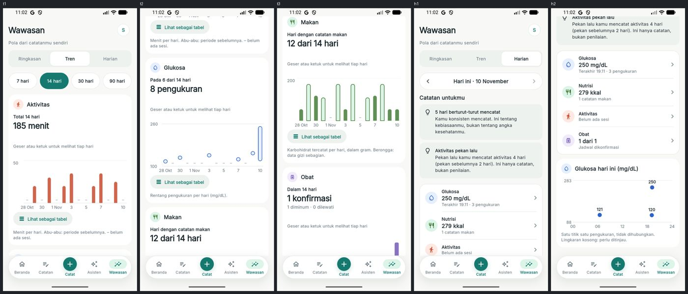
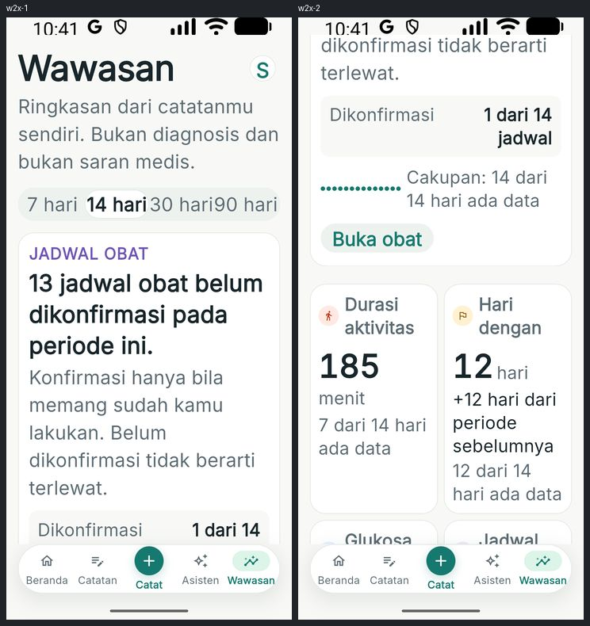
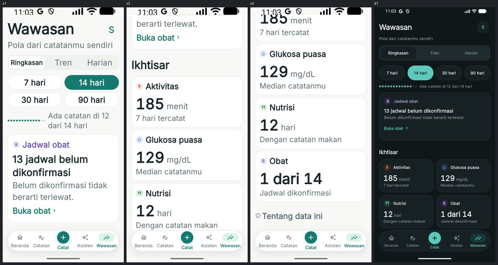
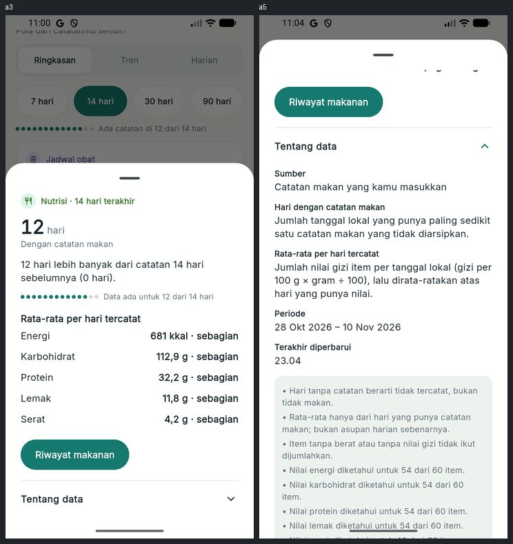
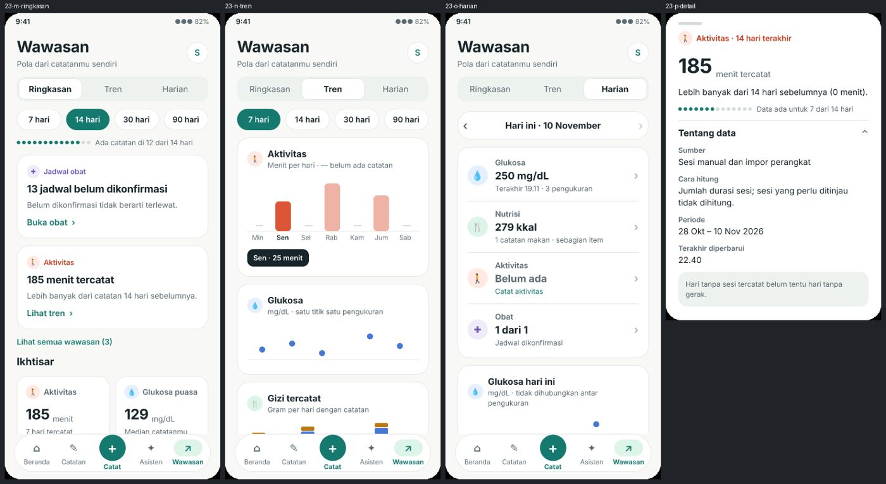

# beOkay 3.0 — Redesign UI/UX "Intelligence-First" (Wawasan)

> Tanggal: 10 November 2026. Desain FigCraft: halaman "23 — Redesign Wawasan (Ringkasan · Tren · Harian)" di `design/beOkay-ui-v3.figcraft`, ekspor `design/exports/23-*.png`.
> Bagian Asisten dari brief ini (kartu makanan ringkas, gerbang identitas, lembar detail, label aksi) sudah dikerjakan di [Fase 3](beokay-3.0-phase-3.md).

## 1. Masalah awal dan akar masalah yang terverifikasi

| Masalah (tangkapan sebelum) | Akar masalah di kode |
|---|---|
| `stats-v1 · 10 Nov 2026, 22.40` di bawah statistik | `statistics_section.dart` merender `analysisVersion` dan `computedAt` langsung; lembar "Cara dihitung" juga menampilkan "Versi analisis" |
| "X dari 14 hari ada data" di setiap kartu | `StatisticTile` dan `InsightNarrativeCard` masing-masing memanggil `coverageText` |
| Kartu insight berisi judul panjang, paragraf, blok bukti, titik cakupan, dan hingga 3 tombol | widget merender `title`, `body`, `evidence`, `coverage`, dan semua `actions` dari server apa adanya |
| Insight yang muncul bergantung urutan aturan server, bukan relevansi | `buildInsightCards(limit = 3)` memotong kandidat sebelum klien bisa memilih |
| Statistik periode, ringkasan harian, grafik mingguan, kartu "Minggu ini", dan pintu ke Tren bercampur dalam satu gulir sepanjang 7 layar | `InsightsScreen` menumpuk `StatisticsSection`, `ContextualCard`, `_TrendsEntry`, `_Summary`, `_Charts`, `WeeklyCard` |
| "Dihitung dari catatanmu · terkini · 22:40" di setiap kartu harian | `_Summary._footnote` |
| Pemilih periode berdempet pada teks 2× ("7 hari14 hari30 hari90 hari") | baris tetap empat kolom dengan `FittedBox` |
| Versi komputasi dan stempel ISO mentah di "Metode dan sumber" glukosa/aktivitas; "Versi N" di detail catatan | string disusun langsung di widget |

## 2. Perubahan per layar

**Wawasan** kini punya tiga bagian (`SectionTabs`): **Ringkasan | Tren | Harian**. Bagian yang dipilih disimpan di `insightsSectionProvider`, sehingga kembali dari detail tidak mengubah konteks.

- **Ringkasan**: pemilih periode → satu baris kelengkapan data tingkat halaman ("Ada catatan di 12 dari 14 hari") → maksimal 2 insight (sisanya di "Lihat semua wawasan (N)") → "Ikhtisar" berisi 4 kartu metrik ringkas → tautan "Tentang data ini". Semua kartu bisa diketuk untuk detail.
- **Tren**: memakai ulang grafik tren yang sudah ada (geser/ketuk, tabel kembar) tanpa ringkasan berulang. Urutan: Aktivitas, Glukosa, Makan, Obat, lalu Konsistensi. Keterangan grafik dipersingkat menjadi satu kalimat.
- **Harian**: navigator tanggal → catatan kontekstual (hari ini saja) → satu kartu berisi empat baris (Glukosa, Nutrisi, Aktivitas, **Obat** untuk tanggal terpilih lewat `/api/me/medications/today?date=`) → grafik titik glukosa hari itu (hanya bila ada pengukuran). Grafik aktivitas 7 hari dan kartu "Minggu ini" dihapus karena mengulang Ringkasan/Tren.
- **Detail Nutrisi**: grafik batang bertumpuk karbohidrat/protein/lemak dalam gram per hari (legenda, tabel kembar, hari tanpa catatan "–"), lalu rata-rata per hari tercatat dengan tanda "sebagian". Grafik ini sebelumnya ada di gulir utama Wawasan.
- **Beranda**: kartu "Sedikit wawasan hari ini" memakai model presentasi yang sama dan hanya punya satu aksi ("Lihat pola").
- **Glukosa / Aktivitas / Makan**: "Metode dan sumber" tanpa versi komputasi, waktu diformat ("Terakhir diperbarui 18.59"); "Versi N" diganti "Dikoreksi N kali" dan hanya muncul bila memang pernah dikoreksi. Riwayat revisi tetap utuh.

## 3. Logika presentasi (`insight_presentation.dart`, murni dan teruji)

- `InsightPresentation` (kategori, headline, satu kalimat pendukung, satu aksi, prioritas, sumber) dan `MetricPresentation` (label, nilai, satuan, keterangan, statistik sumber) dibangun dari data `stats-v1` per kode, bukan dengan memotong string.
- **Prioritas deterministik**: jadwal obat yang perlu dikonfirmasi (dapat ditindaklanjuti) > perubahan aktivitas (besarnya perubahan × kelengkapan) > glukosa puasa (diturunkan bila pengukuran < 3) > cakupan makan > pola hari kerja. Satu kartu per domain didahulukan; sisanya di "Lihat semua".
- **Perbandingan sadar-bukti** (`comparisonValidity`): perbandingan hanya diucapkan bila periode ini punya cukup data (≥ 2 hari aktivitas, sampel ≥ minimum). Bila tidak, kartu menulis "Data ada untuk 1 dari 14 hari." alih-alih "lebih sedikit".
- Format terpusat: `formatValue` (koma desimal, bilangan bulat untuk menit/kkal), `comparisonSentence`, `coverageSentence`, `revisionLabel`, `updatedAtLabel`.
- Server: `buildInsightCards` kini mengirim semua kandidat (maks 5) agar prioritas ditentukan di lapisan presentasi.

## 4. Kebijakan visibilitas metadata (diterapkan)

| Informasi | Di mana sekarang |
|---|---|
| Nilai utama, satuan, periode | kartu (Level 1) |
| Perubahan dibanding periode lalu | kartu insight bila valid; lembar detail dengan nilai pembanding (Level 2) |
| Kelengkapan data | satu baris per halaman; di lembar detail hanya bila tidak lengkap |
| Sumber, cara hitung, periode, waktu pembaruan, batasan | "Tentang data" di lembar detail (Level 3), cara hitung yang identik digabung |
| Versi analisis (`stats-v1`, `insight-rules-v1`), status internal | tidak ditampilkan; tetap ada di API, ekspor, dan model domain |
| Disclaimer medis | sekali di "Tentang data ini" dan kontekstual di detail glukosa |

## 5. Keputusan keselamatan data

- Hari tanpa catatan tetap "–" atau kosong, tidak pernah 0. Nilai tidak diketahui menjadi "belum diketahui"/"belum cukup data".
- Jadwal obat yang belum dikonfirmasi tidak disebut terlewat ("Belum dikonfirmasi tidak berarti terlewat").
- Energi harian dengan item tanpa data diberi tanda "sebagian item"; rata-rata gizi diberi "· sebagian".
- Glukosa: hanya median/rentang deskriptif, catatan "bukan penilaian medis" di detail glukosa; titik pengukuran tidak dihubungkan.
- Tidak ada perubahan pada perhitungan statistik; hanya urutan dan bahasa presentasi.

## 6. Komponen

Baru: `SectionTabs`, `PeriodSelector` (dua baris pada teks besar), `DataQualityHint`, `InsightCard`, `MetricTile`/`MetricGrid` (satu kolom pada teks besar), `AboutDataSection`, `showMetricDetail`, `showInsightDetail`, `showAboutWawasan` (`insight_widgets.dart`); `SummaryTab` (`summary_tab.dart`); `DailyTab`, `DayNavigator`, `DaySummaryCard` (`daily_tab.dart`); `TrendsBody` (`trends_screen.dart`). Dihapus: `statistics_section.dart`, `weekly_card.dart`, `weekly_insights.dart`, `weeklyInsightsProvider`.

## 7. Pengujian

| Lapisan | Hasil |
|---|---|
| Flutter `flutter analyze` | bersih |
| Flutter `flutter test` | **185/185**; `statistics_test.dart` ditulis ulang (Ringkasan, aksi tunggal, detail bertingkat, grafik makronutrien di detail Nutrisi, pemilih periode 2×, kosong, tanpa pola, prioritas, perbandingan dengan data minim, data hilang ≠ nol); Harian di `log_insights_test.dart` (hari kosong pada teks 2×, energi tidak diketahui, obat belum dikonfirmasi, teks besar) |
| Backend (stack uji Docker) | **270/270**, `tsc` bersih |
| Emulator (Pixel 4, akun sintetis, data dev nyata) | Ringkasan normal/2×/gelap, lembar detail Nutrisi dengan "Tentang data", Tren, Harian; tidak ada *overflow*; `stats-v1` tidak terlihat |

Kasus uji brief yang belum diuji otomatis: keyboard terbuka pada Wawasan (tidak ada input), landscape (produk hanya potret), ponsel kecil di bawah 320 dp.

## 8. Batasan tersisa

- Teks "Catatan untukmu" (insight kontekstual) masih dari server dan memuat kalimat "Ini hanya catatan, bukan penilaian." per butir.
- Daftar batasan pada "Tentang data" Nutrisi panjang (satu baris per zat gizi) karena berasal dari statistik terpisah.
- Prioritas insight memakai bobot tetap yang belum divalidasi dengan pengguna.
- Grafik Tren dan statistik Ringkasan berasal dari dua endpoint (`/trends` dan `/insights/statistics`); keduanya deterministik tetapi dihitung terpisah.

## 9. Saran berikutnya

1. Pindahkan salinan insight kontekstual ke model presentasi yang sama (per kode) dan gabungkan batasan per domain di server.
2. Uji keterbacaan dengan pengguna: apakah urutan prioritas dan kalimat perbandingan dipahami.
3. Satukan `/trends` dan `/insights/statistics` menjadi satu mesin periode.
4. Uji TalkBack manual dan perangkat kecil (≤ 320 dp).

## 10. Bukti

| Sebelum | Sesudah |
|---|---|
|  |  |
|  |  |
|  |  |
| |  |

Desain: 
